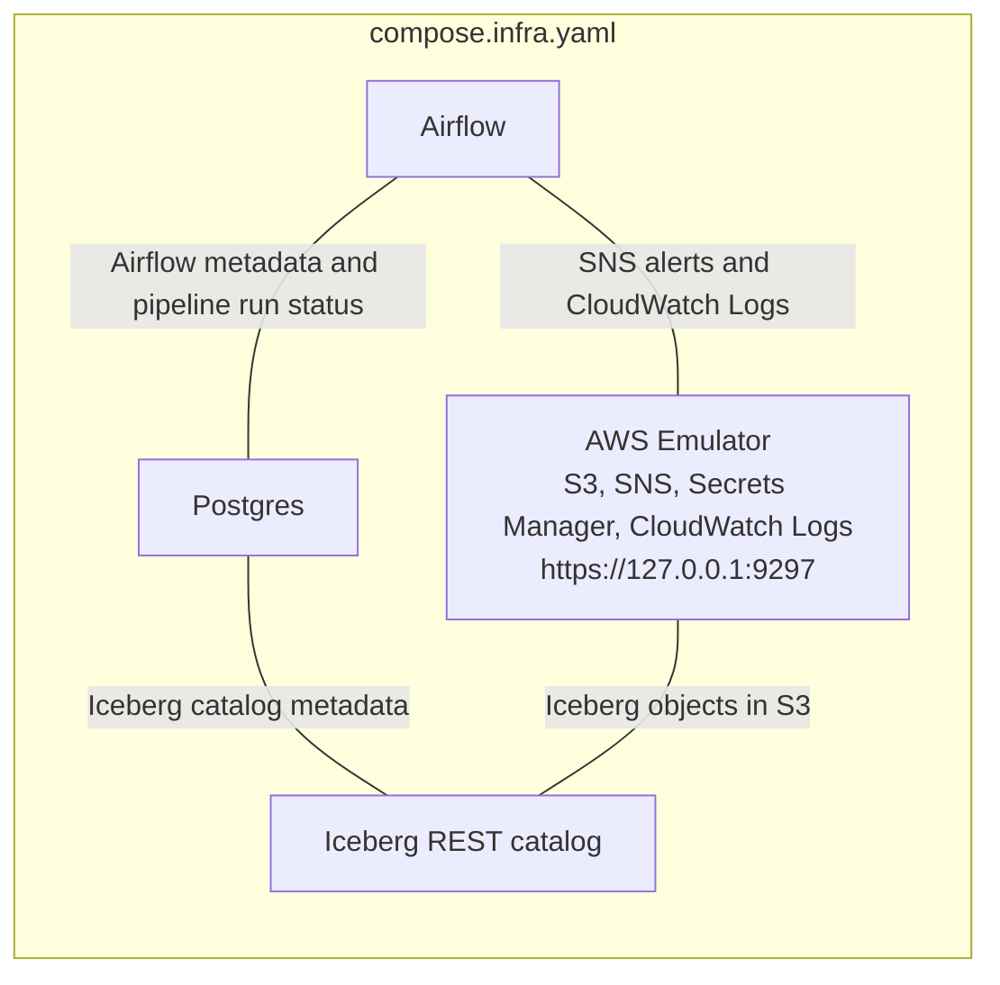
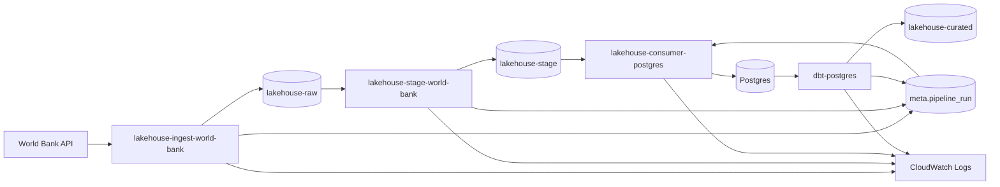
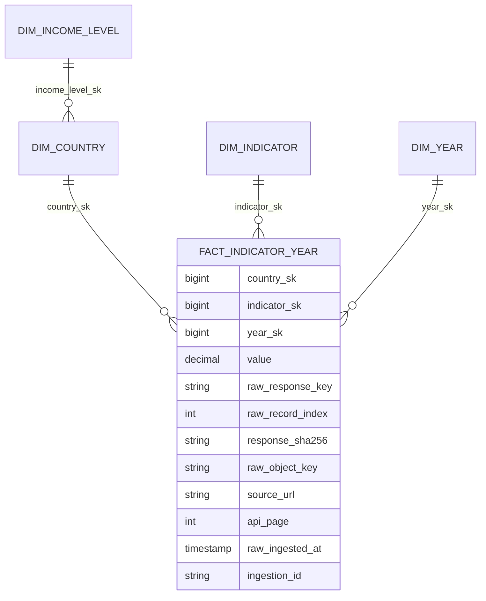

# Agreed proposal and architecture

This demo runs a World Bank lakehouse locally. Analysts query a small yearly country-indicator set without calling the API or treating a missing value as zero. From a clean checkout, `make demo` starts the platform, runs the writer and a bounded backfill, and prints the CSV paths after both succeed. The [production design note](production-design.md) describes the AWS and Snowflake mapping.

No AWS account, no paid API, and no API key. Every cloud call in this repo uses the AWS emulator at `https://127.0.0.1:9297`.

The platform merge request is on `main`. The next merge request is ingest.

## What the pipeline covers

Countries: BRA, CAN, DEU, GBR, IND, JPN, MEX, USA, ZAF.

Indicators:

| Name | Code |
|---|---|
| Population, total | `SP.POP.TOTL` |
| GDP, current US dollars | `NY.GDP.MKTP.CD` |
| GDP per capita, current US dollars | `NY.GDP.PCAP.CD` |
| Life expectancy at birth, total years | `SP.DYN.LE00.IN` |

Years: 2018 through 2024. Country metadata comes from the same public API, including income level. Adding a country or an indicator is a change to `config/pipeline.yml`. The extract loop and the expected-key grid both read that file.

The default grid is 9 countries × 4 indicators × 7 years = 252 observations. A backfill can narrow countries, indicators, or years.

## Platform

Always-on services live in `compose.infra.yaml`. Job images live in `compose.jobs.yaml` and are not left running.



* **Buckets** — `lakehouse-raw`, `lakehouse-stage`, `lakehouse-curated`.
* **SNS topic** — `world-bank-alerts`.
* **Secret** — `world-bank/alert-email`. Terraform creates the secret without storing an email address.
* **Log groups**
  * `/world-bank/airflow`
  * `/world-bank/lakehouse-ingest-world-bank`
  * `/world-bank/lakehouse-stage-world-bank`
  * `/world-bank/lakehouse-consumer-postgres`
  * `/world-bank/dbt-postgres`

A run writes a stream named with its `ingestion_id`. The emulator keeps log events until its process stops. `FilterLogEvents` is how a run is read back.

`make platform` starts the stack, builds `dbt-postgres`, and applies dev Terraform. `scripts/emulator-env.sh` points Terraform and the AWS CLI at the emulator and prepends `~/.local/bin` for that process only. `make down` stops the stack and keeps the Postgres volume. Emulator objects live until the emulator container stops.

The platform spikes already passed. DuckDB 2.0.1 commits an SCD2 close and insert as two snapshots, overwrite then append. The initial dbt Fusion 2.0.12 spike passed. The curated probe later reproduced a panic during strict Postgres schema discovery (`list_relations_schemas`). Fusion wrote `catalog.json` with `--write-catalog` after the warehouse metadata query failed near `None`. The project uses dbt Core 1.12.7 with dbt-postgres 1.11.0. Its local probe built and tested both models and generated a populated catalog without errors.

## Email

The address is not a Terraform variable. `secrets/alert_email.enc` may be committed. `secrets/email.key` stays on the machine. Cipher is AES-256-CBC with PBKDF2.

| Ciphertext | Key | Apply |
|---|---|---|
| Absent | Absent | Skip the subscription. Apply still exits 0. |
| Present | Absent | Skip the subscription and print that the key is not on this machine. Exit 0. |
| Present | Present | Decrypt, `put-secret-value`, subscribe that address. |
| Present | Invalid | The subscription step fails with a decrypt error. Resources already applied stay applied. |

A task failure publishes to `world-bank-alerts`. A jump in the disappearance-warning count publishes to the same topic. The emulator stores the publish and returns a message id. Confirmation and delivery belong to a real account with the same topic.

## Images and runs

| Image | Work |
|---|---|
| `lakehouse-ingest-world-bank` | Live API, or stored responses in replay |
| `lakehouse-stage-world-bank` | SCD2 in Iceberg, then the manifest snapshot ids |
| `lakehouse-consumer-postgres` | That run’s snapshots into `stg` |
| `dbt-postgres` | Curated star, catalog, views, tests, export |

`world_bank_pipeline` is the only writer, with `max_active_runs=1`. A schedule and a backfill started together leave the second run waiting. `world_bank_backfill` writes nothing. It triggers `world_bank_pipeline` and waits.

Conf sets `mode`:

| Mode | What it does |
|---|---|
| `extract` | Pull the requested countries, indicators, and years from the API |
| `replay` | Read a stored run’s successful `responses/` and apply the stage rules |
| `reprocess_commit` | Repeat the consumer and dbt for one stored commit |
| `rebuild` | Load the current state of every stage table into an empty warehouse |



There is no `meta.pipeline_lock` table and no `meta.observation_coverage` table. The gate task reads `meta.pipeline_run`. Another incomplete `ingestion_id` stops a new extract. Resume uses that id. `abandon_previous=true` is the explicit way past it. A failed task publishes to SNS and writes the same failure in that run’s log stream. No trailing task turns a failed DAG run green. `make demo` uses the DAG run state.

XCom carries `ingestion_id` only.

## Manifest

`meta.pipeline_run` is the manifest.

| Column | Meaning |
|---|---|
| `ingestion_id`, `mode`, `source_ingestion_id` | This run, and the run a replay or rebuild reads |
| `request_countries`, `request_indicators`, `start_year`, `end_year` | The exact scope this run asked for |
| `raw_ingested_at`, `stage_ingested_at` | When the response was stored, and when the version was committed |
| `raw_status`, `stage_status`, `consumer_status`, `curated_status`, `export_status` | `pending`, `complete`, or `failed` |
| `stage_snapshot_ids` | For each SCD2 close and insert, the overwrite snapshot id and the following append snapshot id |
| `stage_changed_count` | Versions appended |
| `successful_attempt` | Raw attempt stage is allowed to read |

Before the Iceberg transaction the manifest stores the intended `stage_ingested_at` and a pending line per table. Recovery and the consumer read the stored snapshot ids. If a newer run has already committed a key, resuming the older run does not roll the fact backward.

`reprocess_commit` repeats the consumer and dbt for one stored commit. `rebuild` loads the current state of every stage table. One commit cannot rebuild the warehouse by itself.

## Raw

`API_PAGE_SIZE` is 50. `RAW_BATCH_SIZE` is 100. The HTTP body is stored whole. Record files hold at most 100 records. The container follows `page` / `pages`, keeps a short page in the buffer, splits a page longer than 100, and may leave the last file of a table short.

```text
s3://lakehouse-raw/world-bank/observation/date=2026-11-24/ingestion_id={run}/manifest.json
s3://lakehouse-raw/world-bank/observation/date=2026-11-24/ingestion_id={run}/attempt=1/responses/request_001_page_001.json
s3://lakehouse-raw/world-bank/observation/date=2026-11-24/ingestion_id={run}/attempt=1/records/00007.json
```

`country`, `indicator`, and `income_level` use the same layout. `manifest.json` names `successful_attempt` only after every page of that attempt is stored. A retry writes the next attempt beside it. Completed and failed attempts stay.

Each record carries `raw_response_key`, `raw_record_index`, `response_sha256`, `raw_object_key`, `source_url`, `api_page`, `raw_ingested_at`, and `ingestion_id`. `response_sha256` is the hash of the stored response body. Those fields continue onto stage, `stg`, and `fact_indicator_year`.

Ingest uses a connect timeout and a read timeout, then bounded exponential backoff with jitter for connection errors, HTTP 429, and transient 5xx. The body must be the `[meta, records]` pair, and `page` / `pages` must advance to the last page. A gap or the wrong shape fails that attempt. A failed call is a failed task and an SNS publish. It is not stored as a missing measurement.

The ingest image writes JSON log lines to its CloudWatch group. Each line has `level`, `event`, and `ingestion_id`. The stream name is the `ingestion_id`.

## Stage

DuckDB 2.0 attaches the REST catalog and writes `s3://lakehouse-stage/world-bank/{table}`, hidden-partitioned by `day(stage_ingested_at)`. The partition lets a consumer prune to one commit. The production note covers compaction, snapshot expiration, orphan cleanup, and partition evolution.

`record_hash` is the API fields in canonical form: sorted keys, JSON null for null, decimals without an exponent and without trailing zeros, timestamps in UTC. Lineage, both ingestion timestamps, `version`, `valid_from`, `valid_to`, and `is_current` stay out of the hash. `valid_from` and `valid_to` are when this platform observed the version. The year is the business time.

| Case | Result |
|---|---|
| New key | Version 1, `valid_to` null, `is_current` true |
| Same hash | No new file and no new snapshot |
| Different hash | Close the current row and insert the next version |
| Number becomes null, or null becomes a number | New version. Null stays null |
| Key missing from this response | The current version stays open |
| A past year comes back corrected | New version for that country, indicator, and year |

The close and the insert run in one SQL transaction. DuckDB 2.0.1 commits that pair as two snapshots: operation `overwrite`, then operation `append`. Both ids are stored. The pair is not one snapshot. The old Parquet file stays. A positional delete marks its row, a new file holds the closed after-image, and the insert writes version + 1 in this commit’s day. An empty change set stores no snapshot and marks stage complete.

A replay compares the stored response time with the latest successful raw record for that key. An older body cannot open a version after a newer response already confirmed the current hash.

Stage checks run before the commit: batch size, provenance, the response hash, one hash per business key in the run, value null or numeric, and a planned write of only new or changed keys.

## Consumer and curated star

The consumer loads the manifest’s snapshots into `stg`, including the provenance columns. A retry replaces that `ingestion_id` in `stg`. A zero change count completes the consumer with no insert.

dbt merges current versions into the star. History stays in Iceberg. Income level is an outrigger on country. Surrogate keys are stable hashes of `country_iso3`, `indicator_code`, `income_level_id`, and `year`. The fact keeps the last received value, including when a later extract omits that key. Income group on the country is the latest classification. The model note says the API does not give that group as of 2018.



`schema.yml` documents every column, `persist_docs` writes them to Postgres, and the native manifest records model-level lineage. The curated deliverable uses dbt Core’s native artifacts. `dbt docs generate` publishes `manifest.json` and `catalog.json` under `s3://lakehouse-curated/world-bank/dbt_catalog/date={day}/ingestion_id={run}/`.

Every successful run rewrites the reporting Parquet and CSV. `exports/` gets the same CSVs.

## Views

`meta.expected_key` is the config grid for every year a successful run has requested.

`vw_missing_or_incomplete` is a query over the fact and `meta.dq_result`:

| Reason | Meaning |
|---|---|
| `NEVER_RETURNED` | The expected key has never been received. There is no fact row |
| `SOURCE_NULL` | The latest retained observation has a null value |
| `MISSING_FROM_LATEST_EXTRACT` | A previous extract received this key, the latest extract whose scope included this country, this indicator, and this year did not return it, and the fact still holds the last value |

The third reason uses the warning row for that business key on the latest `ingestion_id` whose request scope contained it. A later extract that returns the key writes no new warning, so the view stops showing it.

`vw_yoy_change` builds the calendar spine and compares each year with the previous calendar year. A missing 2020 does not make 2021 compare with 2019. The change is null, with a reason, when the current value is null, the prior calendar year has no value, or the prior value is zero.

`vw_latest_year_comparison` takes, per indicator, the latest year with any numeric value, then shows every selected country for that year.

`vw_income_group_year` aggregates the selected countries under the current income label: population `SUM`, GDP `SUM`, GDP per capita as `SUM(GDP) / SUM(population)` where both exist, and life expectancy as a labeled population-weighted mean. Each row has `expected_country_count`, `available_country_count`, and `coverage_pct`.

## Data quality

```text
meta.dq_result
  ingestion_id
  check_name
  severity
  business_key
  message
  detected_at
```

The disappearance check inserts one warning per omitted key. Its scope is the country, the indicator, and the year this run requested. A run that asks for Brazil in 2020 does not warn that Canada in 2020 is missing. The fact value is left as it was.

| Layer | Check | Result |
|---|---|---|
| Raw | Pages finished, manifest names a successful attempt | Error, SNS, failed task |
| Raw | Stored body matches `response_sha256` | Error |
| Raw | Provenance present | Error |
| Stage | One hash per business key, one current version, no overlapping validity | Error |
| Stage | An unchanged hash did not create a version | Error |
| Curated | Fact grain, relationships, population positive when present | Error |
| Curated | GDP / population against GDP per capita, tolerances from config | Error past tolerance |
| Curated | Key in this run’s scope was on the fact and absent from this response | Warning row in `meta.dq_result` |
| Curated | That warning count jumps past the threshold | Warning row, and an SNS publish |

Any failed task publishes to SNS as well. The message carries `ingestion_id`, the task name, and the error.

Acceptance, on saved responses:

- Initial load
- Identical rerun, no new version and no duplicate fact
- Corrected historical value, new SCD2 version
- Numeric-to-null and null-to-numeric
- Pagination failure halfway through ingest, DAG stays failed, SNS publish stored
- Iceberg commit succeeds, manifest update fails, retry recovers that commit without a second version
- Postgres load succeeds, dbt fails, retry finishes dbt
- Backfill leaves years outside its window unchanged
- A key inside this run’s scope is omitted: the fact value remains, `meta.dq_result` names it, and the view shows `MISSING_FROM_LATEST_EXTRACT`
- A run for one country does not warn about the other countries
- A key never received shows `NEVER_RETURNED`. A retained null shows `SOURCE_NULL`
- Replay of an older response after a newer confirmation does not open a version
- An older run resumed after a newer commit does not roll the fact backward
- Rebuild from an empty warehouse restores the current Iceberg set
- Export fails after dbt, retry writes the files
- Ingest fails, cleanup finishes, the DAG run stays failed
- A new country or indicator is added only in config
- Year-over-year uses the previous calendar year
- GDP, population, and GDP per capita
- Schedule and backfill started together: the second run waits
- `make demo` with ciphertext present and no key still finishes
- Log events for the run are readable with `FilterLogEvents`

## Commands

| Command | What it does |
|---|---|
| `make platform` | Infra, `dbt-postgres` image, Terraform on the emulator |
| `make test` | Unit and integration tests for the merge request that added them. On the platform merge request it prints that the suites are not in that MR and exits 0 |
| `make test-spike` | Iceberg SCD2 spike and dbt Core Postgres spike |
| `make run` | Trigger `world_bank_pipeline` and wait for its result |
| `make demo` | Start the platform, wait for the writer and a bounded backfill, then print CSV paths. Exit nonzero if either run fails |
| `make down` | Stop the stack and keep the Postgres volume |

## Merge requests

1. **Platform.** On `main`. Infra, secret, topic, CloudWatch log groups, both spikes, `make platform`, `make test`, `make test-spike`, `make down`. The email ciphertext was created in this MR.
2. **Ingest.** `lakehouse-ingest-world-bank`, responses, batches, attempts, logs, and its tests. No DAG.
3. **Stage.** `lakehouse-stage-world-bank`, SCD2, both snapshot ids, and its tests.
4. **Consumer.** `lakehouse-consumer-postgres`, including the crash after the Iceberg commit.
5. **Curated tables.** Surrogate keys, provenance, model-level lineage, published catalog.
6. **`world_bank_pipeline`.** The writer DAG, failure publish, and `make run`.
7. **`world_bank_backfill`.** Trigger-and-wait for the four modes.
8. **Analytic outputs.** The four views, including the three missingness reasons, and the export on every success.
9. **Data quality.** `meta.dq_result`, the scoped disappearance warning, and the acceptance list.
10. **Production design note.** Mapping, Snowflake, the README tradeoff, AI usage. `make demo` becomes the documented clean-checkout command.

Each MR is reviewed before the next one starts. Tests for an image land in that image’s MR. `make test` is the suite command. `make test-spike` stays the platform spikes.

## Production note

This 252-row grid does not need a distributed lakehouse. The local stack shows separate responsibilities, a recoverable run, the original API body, queryable missingness, and a path to Snowflake and AWS. The README also records how AI was used.

| Local | Production |
|---|---|
| Emulator S3, SNS, Secrets Manager, CloudWatch Logs | The same services. Secret name and log group names stay |
| Compose Airflow | MWAA |
| `DockerOperator` | ECS `RunTask`, or Glue for the stage image |
| DuckDB | Glue or EMR Spark, same Iceberg tables |
| REST catalog | Glue Data Catalog |
| Postgres consumer and `dbt-postgres` | Snowflake consumer and Snowflake dbt |
| `meta.pipeline_run`, `meta.dq_result` | The same control tables |
| SNS publish | SNS and the incident subscription |

The Snowflake section covers a `MERGE` on the business key, warehouse size with auto-suspend, Streams and Tasks as the warehouse-native alternative, clustering only after a real query pattern, and a count reconciliation from the Iceberg snapshot to the current Snowflake table.
