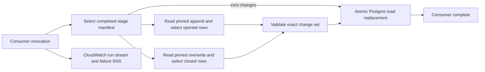

# Implementation contract

Cold start reads [ARCHITECTURE.md](ARCHITECTURE.md) before this file. That document is the agreed proposal and the architecture. Read it before writing or implementing any wave. This contract implements one wave of that document. A wave that contradicts `ARCHITECTURE.md` is wrong. The contract does not replace the proposal. A session that has not read `ARCHITECTURE.md` cannot continue.

Status: platform, ingest and stage are merged and archived in `IMPLEMENTATION_CONTRACT_HISTORY.md`. Consumer is the active wave. Its contract passed Architect readiness and awaits Lead acceptance.

## Invariants

These rules stay in force across waves. Where one conflicts with `ARCHITECTURE.md`, `ARCHITECTURE.md` wins.

- All work stays on this machine. No AWS account, no paid API, and no `git push` unless the user asks.
- The agreed ingest mode calls the public World Bank API. There is no API key. Saved responses are for tests and replay. The platform wave did not call that API. That closed-wave limit is not a ban on the agreed extract mode.
- Every AWS API call uses `https://127.0.0.1:9297` and the certificate the AWS Emulator writes for that port. `localhost` is not a substitute. The emulator certificate covers `127.0.0.1` and `localhost` only, and S3 must stay path-style on the IP.
- The apply environment unsets `AWS_ACCESS_KEY_ID`, `AWS_SECRET_ACCESS_KEY`, `AWS_SESSION_TOKEN`, and `AWS_PROFILE`, then points at `~/.aws/emulator/9297/emulator_credentials`, `config`, and `ca.pem`. It also sets `AWS_ENDPOINT_URL`, `AWS_CA_BUNDLE`, `AWS_EC2_METADATA_DISABLED=true`, `AWS_DISABLE_HOST_PREFIX_INJECTION=true`, and `AWS_REGION=us-east-1`.
- Terraform state, plans, `*.tfvars`, and `secrets/email.key` are gitignored. `secrets/alert_email.enc` may be committed. qa and prd tfvars are not created.
- No email address is invented. The alert recipient exists only after the user supplies ciphertext. The local Airflow web login is the fixture user `airflow` / `airflow` with email field `airflow@localhost`. That fixture is not the alert recipient and is not a person.
- Plaintext email, the key, and emulator credentials are never written into Terraform variables, the plan, the repo, or logs.
- dbt and the Iceberg spike run in Linux containers. dbt does not run on the Mac host. DuckDB is not installed on the Mac host.
- If the dbt 2.0.12 adapter fails, stop. Do not switch the image to dbt Core 1.x inside a wave. That pin is a contract change.

## Wave plan

| Wave | Type | Status | What it does |
|---|---|---|---|
| `platform` | feature | closed, archived | Local emulator stack, dev Terraform, spikes, and make targets. The spec is in `IMPLEMENTATION_CONTRACT_HISTORY.md`. |
| `ingest` | feature | closed, archived | Publish recoverable raw data and the selected attempt. |
| `stage` | feature | closed, archived | Apply Iceberg SCD2 and publish original snapshot IDs. |
| `consumer` | feature | Architect readiness passed | Load an exact completed stage commit into Postgres staging. |

Later merge requests wait until the user reviews the previous one. Their order is in `ARCHITECTURE.md`. This file does not restate that design.

## Durable raw and control interfaces

- `meta.pipeline_run` in warehouse is the commit point. It is initialized by the ingest image. A completed extract selects its own `ingestion_id`, `raw_date`, `successful_attempt`. A completed replay selects its source extract using `source_ingestion_id`, and inherits the source coordinates and scope. Replay creates no raw S3 data of its own. Mode and scope are immutable for a run ID.
- Raw objects live in `lakehouse-raw`. The table names are `observation`, `country`, `indicator`, and `income_level`. Each stable `world-bank/{table}/date={raw_date}/ingestion_id={extract_id}/manifest.json` uses schema version 1. Fields are `format_version`, `table`, `ingestion_id`, `raw_date`, `successful_attempt`, `responses` (ordered entries with `key`, `sha256`, `source_url`, `api_page`, `raw_ingested_at`) and `record_keys` (ordered full keys). All artifacts are within the published `attempt={successful_attempt}/` prefix. Raw batches are JSON arrays of 1–100 flattened records. The archived ingest contract contains the complete example.
- Each record's raw provenance stays with its extract for its lifetime: `raw_response_key`, `raw_record_index` (zero-based), `response_sha256`, `raw_object_key`, `source_url`, `api_page`, `raw_ingested_at`, `ingestion_id`. Stage versions also carry their own `stage_run_id`, so replay can own the stage commit without rewriting source provenance.
- Warehouse stage fields already exist: `stage_status`, `stage_ingested_at`, `stage_snapshot_ids` and `stage_changed_count`. Only stage owns them. A later consumer reads only a complete row and the exact saved Iceberg snapshots, never today's head substituted for the saved IDs.

## Durable stage and consumer interfaces

- Stage owns four Iceberg format-v2 tables, `ice.world_bank.{observation,country,indicator,income_level}`, behind local REST at `http://127.0.0.1:8181`. Locations are `s3://lakehouse-stage/world-bank/{table}`, hidden-partitioned by UTC day of `stage_ingested_at`. The merged stage catalog adapter defines the ordered schema and stable Iceberg field IDs. Stage types are mirrored in Postgres staging; nullable observations retain exact `DECIMAL(38,18)` values.
- A run is consumable when its warehouse row is stage-complete. It carries a stable UTC `stage_ingested_at`, integer `stage_changed_count`, and `stage_snapshot_ids` with exactly four complete entries. Each entry is `{"state":"complete","overwrite":<decimal ID string or null>,"append":<decimal ID string or null>,"changed_count":<nonnegative integer>}`. For no change, both IDs are null. A pure insertion has append only. A correction uses an overwrite and its immediate append child. Sum of entry counts equals the run count. Counts represent appended versions, excluding closed after-images.
- The append snapshot associates new current rows using `stage_run_id`, `stage_ingested_at` and `valid_from`. The overwrite snapshot associates closed after-images using the source commit's `stage_ingested_at` as `valid_to`. A closed row retains its earlier `valid_from`, `stage_ingested_at`, `stage_run_id` and all original raw provenance. A replay's stage identity differs from its original raw `ingestion_id`.
- Query original IDs through DuckDB CLI 2.0.1 `iceberg_scan('<REST metadata-location>', snapshot_from_id = <id>)`, using the exact decimal integer. Stage proved this against retained snapshots after a later append. Warehouse consumers must never substitute current head when exact snapshots are requested, and must fail if they have become unavailable.

## Wave `consumer` — Exact Iceberg commit load into Postgres

The `lakehouse-consumer-postgres` one-shot command loads the changed rows for a completed stage commit into Postgres `stg`. It preserves both sides of a correction and makes warehouse replacement atomic. This wave excludes dbt, curated output, DAG wiring and the separate current-state rebuild path.

| ID | Working-deliverable blocking behavior | Implementation and direct evidence |
|---|---|---|
| CON-1 | Read only a stage-complete commit's exact snapshot IDs, and no snapshots for zero changes. A switched table head, malformed manifest or absent snapshot cannot substitute different data. | Manifest validation and historical reader; fixed-ID Iceberg fixture with later commits. |
| CON-2 | Load only the selected append rows and matching closed after-images with their original raw lineage, exact numeric/null values and stage timestamps. | Reader projection and typed Postgres schema; real data assertions for both operation sides and historical partitions. |
| CON-3 | Replace only the invocation's load, publish rows and `consumer_status` atomically, and safely retry. | Warehouse adapter; real PostgreSQL insert failure, preserved previous load and repeat. |
| CON-4 | Run the packaged local-only job, record terminal failures, and expose logs and SNS acknowledgement when services are reachable. | Compose, pinned adapters and runtime fixture status/log checks. |

Four coupled obligations share one command and one bounded review. Credit the merged stage integration for real correction ancestry, original historical reads after a later head, stage crash/recovery and isolation. Credit ingest/stage integration for local endpoints, log groups, SNS topic and acknowledgements. Credit existing Compose and offline test targets. They do not establish Postgres consumer effects or decimal transport. Existing producer packages and tests, spike, Terraform and infra Compose are evidence-only. No prior consumer review attempts.



### Entry point and exact snapshot read

- Add one-shot Compose service/image `lakehouse-consumer-postgres`, entry point `python -m world_bank_consumer --ingestion-id <id>`. Use the existing ingest/stage run-ID syntax. Query the invocation from `meta.pipeline_run`. For `extract` or `replay`, select that row's own stage commit. For a pre-existing `reprocess_commit` invocation row, select the distinct `source_ingestion_id` row if it is a stage-complete extract or replay. The reprocess row's stage fields are irrelevant and unmodified; the same exact snapshot load is written under the reprocess invocation ID. Reject missing, malformed, pending or failed source commits, and reject `rebuild` in this command. Creation of reprocess/rebuild runs and execution of the current-state rebuild are separate orchestration work.
- Validate the source's complete stage manifest against the durable schema before opening a snapshot, including its UTC timestamp, four table entries, exact sum and count/ID consistency. Snapshot IDs accept canonical positive integer strings in the signed 64-bit range, bound as exact integers without float conversion. Nonzero count requires append; zero requires both IDs null. Validate that both saved IDs exist in REST metadata with the declared operation and that an append following a correction has the saved overwrite as its immediate parent. A metadata location must be under the selected stage table's fixed S3 metadata prefix. Never read current Iceberg head as a fallback. With total zero, skip all catalog and S3 calls.
- For a positive entry, query only its saved append via the proven `iceberg_scan` seam, selecting `stage_run_id = selected stage ingestion_id`, `stage_ingested_at = selected stage time`, `valid_from = selected stage time`, and current rows with no `valid_to`. Expect exactly the entry's `changed_count` unique business keys. Use the separate saved overwrite only when present, selecting closed rows with `valid_to = selected stage time`. Do not filter closes by source stage run ID or its new day partition; the close retains the old version's metadata. For each append of version 2 or above require exactly one same-key close of version minus one, with older `valid_from`. Version 1 expects no close. Fail on unexpected or duplicate rows, unmatched pairs/roles, missing provenance, or unexpected null in required fields before any warehouse replacement.
- Reuse stage's catalog checks, REST client, SQL literal handling and DuckDB runtime setup. Use a consumer projection that returns observation `value` as decimal text, then bind a Python `Decimal` or SQL null to Postgres. Do not use the producer's default JSON float decoder for the decimal. Use typed UTC timestamps and preserve the original raw, stage and validity times. The output contains only the selected changes, not full snapshot contents.

### Postgres staging and retry

- Consumer owns idempotent initialization of `stg.{observation,country,indicator,income_level}` on both fresh and existing warehouse volumes. Use existing `meta.pipeline_run` created by ingest. DDL mirrors the stage business and common columns with Postgres `text`, `integer`, `numeric(38,18)`, `timestamptz`, and `boolean`; preserve `api_payload` as canonical text. Observation `value`, optional names/country income level, and `valid_to` are nullable as in stage. All keys and provenance are required. Keep numeric null as SQL null.
- Add `consumer_run_id text NOT NULL` (invocation ID), `change_kind text NOT NULL` (one of `close` and `append`) and `snapshot_id bigint NOT NULL` (exact operation ID). The primary key is `(consumer_run_id, change_kind, <the stage business key>)`. A close preserves its original `ingestion_id`, `stage_run_id`, `stage_ingested_at`, and version. Do not use either upstream ID to replace a load. The role discriminator lets the next curated phase choose append rows without treating historical closures as current changes.
- Example corrected observation rows for consumer invocation `load-replay` selecting stage commit `run-replay`: the `close` for `(BRA,SP.POP.TOTL,2020)` has `snapshot_id=4859385892680518385`, `ingestion_id=raw-seed`, `stage_run_id=run-seed`, `version=1`, `is_current=false`, and `valid_to` equal to `run-replay`'s stage time. The `append` has `snapshot_id=7652143244230041123`, `ingestion_id=raw-correction`, `stage_run_id=run-replay`, `version=2`, `is_current=true` and null `valid_to`. Both rows carry `consumer_run_id=load-replay` while their original raw keys and timestamps stay with their own payloads.
- Hold a warehouse consumer session advisory lock, distinct from ingest and stage locks, around the invocation. A concurrent local consumer exits nonzero without altering the active load. For each invocation, gather and validate all change rows before warehouse replacement. Use one Postgres transaction to initialize DDL, delete only that `consumer_run_id` from all four tables, insert validated rows with bound parameters, and set the invocation's `consumer_status='complete'`. Zero changes perform the same completion with no inserts. Do not modify raw, stage, curated, or export state. A successful repeat reprojects the same pinned commit and replaces rather than appends. A failure during replacement rolls back every delete and insert and the complete marker together. When PostgreSQL is reachable and the consumer holds the lock, record a processing failure separately on an existing target whose consumer status is not already complete, preserving earlier complete data and status. An uncertain or abrupt commit can be retried with the same ID.
- Emit structured CloudWatch JSON to `/world-bank/lakehouse-consumer-postgres` using the invocation ID stream. Events include `consumer_started`, `consumer_completed` with selected stage ID, counts for closed and appended rows, and `consumer_failed`; the success event is emitted after the Postgres commit. A failure publishes safe JSON with `ingestion_id`, `task_name=lakehouse-consumer-postgres`, and `error` to the existing SNS topic, with `alert_published` and returned message ID in the log. No credentials, raw payloads or email. Exit 2 for usage errors, 1 with structured stderr on processing failure, and 0 with structured terminal stdout on success. Failure of reporting cannot conceal an original processing failure or undo a committed load.

### File-level execution plan

| Action | Path | Responsibility |
|---|---|---|
| Create | `images/consumer-postgres/Dockerfile` | Package Python, merged ingest/stage dependencies and pinned v2.0.1 DuckDB CLI with iceberg/httpfs using the proved platform/stage pattern. |
| Create | `images/consumer-postgres/world_bank_consumer/__init__.py`, `images/consumer-postgres/world_bank_consumer/__main__.py` | Command parsing, run selection, orchestration and terminal reporting. |
| Create | `images/consumer-postgres/world_bank_consumer/snapshots.py` | Validate manifest and snapshot roles, query exact historical changes and verify paired row sets/types. |
| Create | `images/consumer-postgres/world_bank_consumer/services.py`, `images/consumer-postgres/world_bank_consumer/staging.sql` | Run/status coordination, atomic replacements, idempotent staging schema, and local reporting. |
| Create | `images/consumer-postgres/tests/test_unit.py`, `images/consumer-postgres/tests/test_integration.py` | Focused selection/validation and real historical load fixtures. |
| Modify | `compose.jobs.yaml`, `Makefile`, `README.md` | Add one-shot service, suite commands, and operator instructions. |

No deletes. Consumer reuses the existing session/network pattern: warehouse `postgres:5432/warehouse`, local REST `http://127.0.0.1:8181`, emulator `https://127.0.0.1:9297`, explicit mounted local CA and credentials, path-style S3, no ambient AWS discovery, proxies, insecure TLS or alternate endpoints. Pass the local Terraform topic ARN. Stage and ingest packages remain unchanged.

### Executable fixture and acceptance

- Offline unit suite covers selected source versus consumer ID, all manifest shapes (zero, append-only, correction), integer bounds, unavailable/wrong-role/wrong-parent IDs, close/append attribution and pairing, missing provenance, and exact numeric/null transport. Any in-memory catalog fixture only returns an explicitly requested snapshot. Assert zero changes never opens a catalog. Report coverage without a percentage requirement.
- Real suite runs the packaged consumer and stage commands from the new image in the existing local Compose stack. Use a fresh `stage_test_<32 lowercase hex>` namespace/database, inherited stage test S3 prefix, and unique run IDs. The consumer uses `WORLD_BANK_CONSUMER_TEST_NAMESPACE` only for that exact pattern, mapping to the same isolated Postgres database and Iceberg location. Production always uses `warehouse` and `world_bank`. Apply the merged warehouse manifest DDL in the fixture database and publish exact saved raw pairs using the merged ingest writer. Use real stage orchestration and the existing test-only fault after a commit. No public source calls.
- Source scope is BRA, indicator `SP.POP.TOTL`, 2020–2021. A seed observation body is `[{"page":1,"pages":1},[{"countryiso3code":"BRA","indicator":{"id":"SP.POP.TOTL"},"date":"2020","value":10},{"countryiso3code":"BRA","indicator":{"id":"SP.POP.TOTL"},"date":"2021","value":null}]]` encoded as UTF-8. Companion single-page records are `{"id":"BRA","name":"Brazil","incomeLevel":{"id":"UMC"}}`, `{"id":"SP.POP.TOTL","name":"Population, total"}` and `{"id":"UMC","value":"Upper middle income"}`. Variants change only the named business records.
- Fixture sequence and observable results:
  1. Stage and consume the seed. Place the seed's reserved stage timestamp on an earlier UTC day using a legitimate pending reservation fixture. Expect five append rows, exact raw provenance, 2021 SQL null, no close rows, and committed consumer status. Use fixture-controlled raw timestamps in increasing order.
  2. Publish a newer extract with 2020 value `12345678901234567890.123456789012345678`, no 2021 record, and a changed country name. Start a distinct replay row selecting it and run actual stage, injecting process exit 75 after the country Iceberg correction and before warehouse records its completion. Consumer for the replay must fail on its pending stage state and insert nothing. Stage a subsequent newer extract with a distinguishable value (e.g. 30) and country name, then resume the replay stage. Verify its original two saved snapshot pairs survived. Consume the replay and assert the older value and country data from those pairs, one close plus one append for each changed table, no 2021 or untouched dimensions, and no copying of later head data. Assert exact decimal, raw and stage identities, original and new partition days, version and validity, exact operation IDs, and `consumer_run_id` equal to the replay invocation. Consume the newer extract separately and verify its distinct rows.
  3. Consume the replay again. Assert replacement with unchanged cardinality and values and that seed and newer loads stay unchanged. Create a `reprocess_commit` row referencing the replay. Its consumer load repeats original stage operations under the new invocation ID without changing stage fields or removing another load. Stage a newer identical confirmation and consume it, checking complete status and no rows.
  4. Before retrying a prior nonzero load, install a PostgreSQL fixture trigger rejecting a country insert for that invocation. Run the CLI, expecting code 1 after the replacement transaction was entered, then compare all load rows and committed status with the pre-failure state. Disable the trigger and retry, expecting exact same rows and success. In a separate case tamper with an isolated stage manifest to point to a missing, syntactically valid snapshot ID. Expect code 1 and no partial replacement or head fallback. Restore the fixture manifest after the check. Assert the real consumer CloudWatch `consumer_failed` and nonempty SNS acknowledgement for an ordinary failure.
- A successful CLI returns 0 with terminal `consumer_completed` JSON on stdout and no failure event. A processing failure returns 1 with safe `consumer_failed` JSON on stderr and never prints successful terminal output. The existing stage fault uses its established 75 status. Uncaught runtime or assertion errors fail the test; skipped integration is not a full pass. Cleanup removes only fixture database, Iceberg namespace/tables, fixture raw objects and log streams where supported, leaving live pipeline data and service state untouched.
- Setup uses `docker compose -f compose.infra.yaml up -d --wait aws-emulator postgres iceberg-rest` then `./scripts/emulator-env.sh terraform -chdir=infra/terraform init -input=false` and `./scripts/emulator-env.sh terraform -chdir=infra/terraform apply -input=false -auto-approve`. Exact acceptance:
  ```sh
  docker compose -f compose.infra.yaml -f compose.jobs.yaml config --quiet
  make test-unit
  make test
  make -n test-spike
  git diff --check
  ```
  `make test-unit` builds/runs the three offline suites and prints coverage diagnostics. `make test` also runs all three real fixture suites. Document `WORLD_BANK_ALERT_TOPIC_ARN="$(./scripts/emulator-env.sh terraform -chdir=infra/terraform output -raw topic_arn)" docker compose -f compose.infra.yaml -f compose.jobs.yaml run --rm --no-deps lakehouse-consumer-postgres --ingestion-id <completed-id>`, same-ID retry, and the corresponding local `aws logs filter-log-events` lookup.
- Auditor scope is the one-shot exact-commit load (CON-1 through CON-4). The direct witnesses are unchanged Iceberg history, actual Postgres data/status and atomic rollback, and local logs/acknowledgements. DAG, curated, rebuild, live World Bank calls and real AWS are outside this wave.

### Contract readiness

The consumer wave passes the Architect gate and is mechanically ready for implementation. The merged stage and platform runtime evidence establish local reads of pinned snapshots, after-images and recovery after later heads. The packaged consumer fixture exercises the remaining warehouse, numeric and retry obligations at their runtime boundary.
