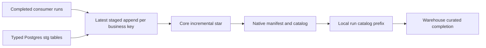

# Implementation contract

Cold start reads [ARCHITECTURE.md](ARCHITECTURE.md) before this file. That document is the agreed proposal and the architecture. Read it before writing or implementing any wave. This contract implements one wave of that document. A wave that contradicts `ARCHITECTURE.md` is wrong. The contract does not replace the proposal. A session that has not read `ARCHITECTURE.md` cannot continue.

Status: platform, ingest, stage and consumer are merged and archived in `IMPLEMENTATION_CONTRACT_HISTORY.md`. Curated is active. The approved Core star and native catalog contract passed Architect readiness and awaits Lead acceptance. The separate test suite selector task is implemented and audited.

## Invariants

These rules stay in force across waves. Where one conflicts with `ARCHITECTURE.md`, `ARCHITECTURE.md` wins.

- All work stays on this machine. No AWS account, no paid API, and no `git push` unless the user asks.
- The agreed ingest mode calls the public World Bank API. There is no API key. Saved responses are for tests and replay. The platform wave did not call that API. That closed-wave limit is not a ban on the agreed extract mode.
- Every AWS API call uses `https://127.0.0.1:9297` and the certificate the AWS Emulator writes for that port. `localhost` is not a substitute. The emulator certificate covers `127.0.0.1` and `localhost` only, and S3 must stay path-style on the IP.
- The apply environment unsets `AWS_ACCESS_KEY_ID`, `AWS_SECRET_ACCESS_KEY`, `AWS_SESSION_TOKEN`, and `AWS_PROFILE`, then points at `~/.aws/emulator/9297/emulator_credentials`, `config`, and `ca.pem`. It also sets `AWS_ENDPOINT_URL`, `AWS_CA_BUNDLE`, `AWS_EC2_METADATA_DISABLED=true`, `AWS_DISABLE_HOST_PREFIX_INJECTION=true`, and `AWS_REGION=us-east-1`.
- Terraform state, plans, `*.tfvars`, and `secrets/email.key` are gitignored. `secrets/alert_email.enc` may be committed. qa and prd tfvars are not created.
- No email address is invented. The alert recipient exists only after the user supplies ciphertext. The local Airflow web login is the fixture user `airflow` / `airflow` with email field `airflow@localhost`. That fixture is not the alert recipient and is not a person.
- Plaintext email, the key, and emulator credentials are never written into Terraform variables, the plan, the repo, or logs.
- dbt and the Iceberg spike run in Linux containers. dbt does not run on the Mac host. DuckDB is not installed on the Mac host.
- The approved local dbt runtime is Core 1.12.7 with dbt-postgres 1.11.0. Runtime and lineage scope changes require a user decision.

## Wave plan

| Wave | Type | Status | What it does |
|---|---|---|---|
| `platform` | feature | closed, archived | Local emulator stack, dev Terraform, spikes, and make targets. The spec is in `IMPLEMENTATION_CONTRACT_HISTORY.md`. |
| `ingest` | feature | closed, archived | Publish recoverable raw data and the selected attempt. |
| `stage` | feature | closed, archived | Apply Iceberg SCD2 and publish original snapshot IDs. |
| `consumer` | feature | closed, archived | Load exact completed stage commits into Postgres staging. |
| `test-suite-selection` | feature | implemented and audited | Select one local test suite or run the full suite. |
| `curated` | feature | Architect readiness passed | Merge current versions into the star and publish native model lineage and catalog. |

Later merge requests wait until the user reviews the previous one. Their order is in `ARCHITECTURE.md`. This file does not restate that design.

## Durable raw and control interfaces

- `meta.pipeline_run` in warehouse is the commit point. It is initialized by the ingest image. A completed extract selects its own `ingestion_id`, `raw_date`, `successful_attempt`. A completed replay selects its source extract using `source_ingestion_id`, and inherits the source coordinates and scope. Replay creates no raw S3 data of its own. Mode and scope are immutable for a run ID.
- Raw objects live in `lakehouse-raw`. The table names are `observation`, `country`, `indicator`, and `income_level`. Each stable `world-bank/{table}/date={raw_date}/ingestion_id={extract_id}/manifest.json` uses schema version 1. Fields are `format_version`, `table`, `ingestion_id`, `raw_date`, `successful_attempt`, `responses` (ordered entries with `key`, `sha256`, `source_url`, `api_page`, `raw_ingested_at`) and `record_keys` (ordered full keys). All artifacts are within the published `attempt={successful_attempt}/` prefix. Raw batches are JSON arrays of 1–100 flattened records. The archived ingest contract contains the complete example.
- Each record's raw provenance stays with its extract for its lifetime: `raw_response_key`, `raw_record_index` (zero-based), `response_sha256`, `raw_object_key`, `source_url`, `api_page`, `raw_ingested_at`, `ingestion_id`. Stage versions also carry their own `stage_run_id`, so replay can own the stage commit without rewriting source provenance.
- Warehouse stage fields already exist: `stage_status`, `stage_ingested_at`, `stage_snapshot_ids` and `stage_changed_count`. Only stage owns them. A later consumer reads only a complete row and the exact saved Iceberg snapshots, never today's head substituted for the saved IDs.

## Durable stage and consumer interfaces

- Stage owns four Iceberg format-v2 tables, `ice.world_bank.{observation,country,indicator,income_level}`, behind local REST at `http://127.0.0.1:8181`. Locations are `s3://lakehouse-stage/world-bank/{table}`, hidden-partitioned by UTC day of `stage_ingested_at`. The merged stage catalog adapter defines the ordered schema and stable Iceberg field IDs. Stage types are mirrored in Postgres staging; nullable observations retain exact `DECIMAL(38,18)` values.
- A run is consumable when its warehouse row is stage-complete. It carries a stable UTC `stage_ingested_at`, integer `stage_changed_count`, and `stage_snapshot_ids` with exactly four complete entries. Each entry is `{"state":"complete","overwrite":<decimal ID string or null>,"append":<decimal ID string or null>,"changed_count":<nonnegative integer>}`. For no change, both IDs are null. A pure insertion has append only. A correction uses an overwrite and its immediate append child. Sum of entry counts equals the run count. Counts represent appended versions, excluding closed after-images.
- The append snapshot associates new current rows using `stage_run_id`, `stage_ingested_at` and `valid_from`. The overwrite snapshot associates closed after-images using the source commit's `stage_ingested_at` as `valid_to`. A closed row retains its earlier `valid_from`, `stage_ingested_at`, `stage_run_id` and all original raw provenance. A replay's stage identity differs from its original raw `ingestion_id`.
- Query original IDs through DuckDB CLI 2.0.1 `iceberg_scan('<REST metadata-location>', snapshot_from_id = <id>)`, using the exact decimal integer. Stage proved this against retained snapshots after a later append. Warehouse consumers must never substitute current head when exact snapshots are requested, and must fail if they have become unavailable.


- Warehouse `stg.{observation,country,indicator,income_level}` carries complete operation rows from the producer contract. `consumer_run_id` is the load identity, `change_kind` is `append` or `close`, and `snapshot_id` is the exact Iceberg operation (Postgres bigint). Raw `ingestion_id` and `stage_run_id` remain their original identities, and `value` keeps all 38 digits and nulls. `meta.pipeline_run.consumer_status='complete'` publishes the load. A completed same-ID call performs no Iceberg or Postgres data rewrite. A distinct `reprocess_commit` row can load the same commit under its own identity.
- Curated uses current opened versions from completed loads, with `change_kind='append'` and `is_current=true` in the immutable staging load. A `close` row is historical evidence only. An older selected version or duplicate reprocess must not displace the latest version for a business key, and omission must not delete its retained fact.

## Task `test-suite-selection` — Select one test suite or run all

- **Scope.** User requested the existing `make test` aggregate and explicit `make test ingestion`, `make test stage`, `make test consumer`, and `make test curated` commands. This task owns command routing for the current suites and the curated selector seam. The curated suite itself is a separate task. Use the existing unit and real integration recipes unchanged in substance.
- **Behavior.** Partition recipes into suite dependencies. A selector runs its suite's image build, offline unit tests, and real fixture tests once. `make test` without a selector runs all installed suites. Multiple named selectors run their selected suites once. `make test-unit` runs all installed unit suites; `make test-spike` stays independent. Use the explicit goals in `MAKECMDGOALS` and phony aliases so `make test stage` does not implicitly run the full aggregate before its selector. Propagate a suite failure as a nonzero Make exit status. Until the separate curated suite lands, the curated selector exits nonzero with a clear unavailable message and runs none of the other suites. At curated delivery, wire its real unit and integration commands into its selector and both aggregates so it can pass only by running that suite.
- **File plan.** Modify `Makefile` and the test commands paragraph in `README.md`. No application files, test wrappers, changes to service credentials, or duplicate fixture suites. The curated task may later replace the temporary unavailable recipe and update the test commands paragraph when it supplies real tests.
- **Validation.** Run `make -n test`, `make -n test ingestion`, `make -n test stage`, `make -n test consumer`, `make -n test curated` and `make -n test-spike`. Dry-runs show the selected build, offline unit, and integration commands exactly once, or the explicit curated error before the curated suite exists. With the local stack and dev Terraform healthy, run `make test ingestion`, `make test stage`, `make test consumer`, and `make test`. Each installed selector and aggregate exit 0 only if their actual suites pass. Run `make test curated` for the expected independent nonzero status until it has real tests. Also check `git diff --check`. The merged Make recipes and runtime fixture suites supply the validation mechanism. The selector task passes Architect readiness and is mechanically ready.

## Wave `curated` — Core Postgres star and native dbt catalog

The `dbt-postgres` job merges current staged versions into a Postgres star, persists relation and column descriptions and publishes the native dbt manifest and catalog. The approved runtime is dbt Core 1.12.7 with dbt-postgres 1.11.0. Native manifest dependencies provide model-level lineage. Analytics views, reports/exports, DAG wiring, rebuild, and the later data-quality checks are outside this wave. The user chose Core with its native outputs and took column-level lineage out of scope.

| ID | Working-deliverable blocking behavior | Implementation and evidence |
|---|---|---|
| CUR-1 | Project a reproducible current star from completed consumer loads with stable surrogate keys, exact numeric/null values, and original raw provenance. Older retries and omissions cannot regress a retained fact. | Five dbt models, staged append selection, and real warehouse assertions. |
| CUR-2 | Build, test, persist descriptions, and validate populated native catalog and manifest with model-level dependencies. Incomplete metadata cannot be published as success. | Core project/config, verified catalog probe, and real artifact assertions. |
| CUR-3 | Publish both artifacts to the local run prefix and only then complete curated state. A failed build or upload can be retried without another consumer load. | One-shot runner, SDK and Postgres, real build failure/retry and artifact checks. |
| CUR-4 | Keep the installed test selectors, aggregate and platform spikes executable with the approved runtime. | Audited selector routing, Core-compatible spike, and explicit commands below. |

The four obligations share one runnable curated job and its normal test targets. Credit the merged consumer suite for complete typed staging loads and immutable provenance. The isolated Core 1.12.7/Postgres 1.11.0 two-model probe passed build/tests and produced a catalog containing both models without errors, crediting native Core/Postgres execution and artifact generation. Prior runtime checks proved emulator-only boto3 clients, local S3 interactions, run logs and SNS acknowledgement. The separate selector task already passed review. Those checks do not witness the star's current-state semantics, real comments, exact catalog publication, or retry around a failed build.

### Source selection and star schema

- Acquire the curated and consumer writer advisory locks for this local warehouse session before dbt reads. Stage never writes `stg`. Consumers use the existing `world_bank_consumer_writer` advisory key. Acquire locks in a fixed order and fail without altering an active run if either is busy. This holds a stable completed-load input set across dbt model statements. Use the same mechanism in the isolated fixture database. No lock table.
- Read each `stg` table through declared dbt sources and join `meta.pipeline_run.ingestion_id = stg.consumer_run_id` for `consumer_status='complete'`. Only `append` rows with `is_current=true` enter the current candidate set. Rank each table by its natural key, descending `version`, `stage_ingested_at`, `stage_run_id`, then `consumer_run_id` for duplicate reprocess copies. Use rank 1. Never transfer a historical close into the star. Reading all accepted changes keeps omitted keys and ensures that retrying an older run cannot regress a value. Reprocess load identity is never projected as raw provenance.
- Write five `curated` tables with Core incremental `merge` and fixed keys. For dimensions use their single surrogate key and for the fact use the three-surrogate tuple, with uniqueness and not-null/relationship dbt tests. The merge source contains one current row per key and does not delete omitted keys. For a business-key input, the stable surrogate is the signed big-endian 64-bit value formed by the first eight bytes of MD5 over the UTF-8 text key (base-10 text for year), equivalent to Postgres `('x' || substr(md5(cast(key as text)), 1, 16))::bit(64)::bigint`. Use a shared macro, propagate null for a null income level, and test that each dimension's natural and surrogate keys are unique.
- Public schemas:
  - `dim_income_level(income_level_sk bigint, income_level_id text, income_level_name text)`.
  - `dim_country(country_sk bigint, country_iso3 text, country_name text, income_level_sk bigint nullable)`. Classification is the latest accepted country classification. The model description states it is not a historical classification as of 2018. Test the nonnull outrigger keys against `dim_income_level`.
  - `dim_indicator(indicator_sk bigint, indicator_code text, indicator_name text)`.
  - `dim_year(year_sk bigint, year integer)`. Include observed years and every year of a completed extract/replay's requested scope, so a fully missing year in that scope can still be represented. Observed years cover a reprocess load whose source was never consumed separately.
  - `fact_indicator_year(country_sk bigint, indicator_sk bigint, year_sk bigint, value numeric(38,18) nullable, raw_response_key text, raw_record_index integer, response_sha256 text, raw_object_key text, source_url text, api_page integer, raw_ingested_at timestamptz, ingestion_id text)`. Preserve all eight provenance columns verbatim. Names and optional display fields retain provider nulls. Test fact grain, each dimension relationship, and provenance presence. Derive every accepted fact key from the staged natural keys and use actual `ref` dependencies on the dimensions. Missing dimension matches must produce a failing relationship or an equivalent explicit test, never silently remove facts through an inner join. Do not convert null measurements to zero.
- Use project `world_bank_curated` in a separate copy under `/usr/app/curated`, with declared `stg` and `meta` sources. Give every public column a `schema.yml` description and enable `persist_docs` for relation and columns. The native manifest must include model/source dependencies, e.g. `model.world_bank_curated.fact_indicator_year` reaches `source.world_bank_curated.stg.observation` and the dimension models. The published catalog must report real Postgres columns, types and comments for all five public relations without warehouse introspection errors.



### Job, catalog, and failure boundaries

- Use one-shot Compose service/image `dbt-postgres` with `python -m world_bank_curated --ingestion-id <id>`, existing ingest ID syntax, warehouse `postgres:5432/warehouse`, and target schema `curated`. Use the existing service namespace-sharing pattern, mounted emulator CA/credentials and path-style TLS AWS at `https://127.0.0.1:9297`. Reuse the tested local-only boto3 client construction and the Terraform `WORLD_BANK_ALERT_TOPIC_ARN`. No cloud credential fallback, proxies, remote adapter, or telemetry. Use an explicit CLI profile/project dir. Keep historical spike project files at `/usr/app`; the curated project is separate.
- Query the target's manifest under the locks. An extract/replay invocation requires a complete consumer and stage row. A distinct `reprocess_commit` invocation requires its own complete consumer row and a valid stage-complete extract/replay source for the catalog date. Validate stage timestamp, mode, and IDs. An unfinished target enters `curated_status='pending'` before a build. When already complete return successfully without another build. A new reprocess ID still executes independently.
- In a fresh temporary target directory execute `dbt build --project-dir /usr/app/curated --profiles-dir /usr/app/curated --target-path <temp>`, then `dbt docs generate` with the same directories. Require zero exits. Check the actual Core `manifest.json` and `catalog.json`: valid JSON, all five named public nodes, real model-level dependencies, nonempty declared column maps, and no catalog errors. An empty or invalid file is material failure. Publish the two unmodified native JSON files with `application/json` to `s3://lakehouse-curated/world-bank/dbt_catalog/date={day}/ingestion_id={id}/`; `day` is the UTC day of the selected completed stage commit, stable across midnight retries. A reprocess publishes under its new run ID using the source stage day. Ignore HTML, transient targets, and other dbt artifacts.
- Update only `curated_status='complete'` after both successful puts. On caught failure, leave already completed state intact, otherwise record `failed` when warehouse is reachable and the invocation owns both locks. Individual dbt model commits and an uploaded first artifact may survive a failure. The complete flag is the published success boundary. Retry a failed or interrupted curated ID from already completed `stg`, remerging current keys and replacing partial docs at the same prefix. Do not clear or demote any consumer status, repeat the consumer, or touch `export_status`.
- Per-run CloudWatch group `/world-bank/dbt-postgres` and stream = ingestion ID. Log structured `level`, `event`, `ingestion_id`, and safe metadata for `curated_started`, `curated_completed` or `curated_already_complete`, and terminal `curated_failed`. On accepted processing failure emit a safe error to stderr and attempt existing SNS topic publish with `ingestion_id`, `task_name=dbt-postgres`, and `error`; log `alert_published` with the acknowledgement ID. Keep credentials and provider values out of operational errors. Exit 2 on usage errors, 1 on failed accepted work, and 0 with terminal structured stdout on success.

### File-level execution plan

| Action | Path | Responsibility |
|---|---|---|
| Modify | `images/dbt-postgres/Dockerfile`, `compose.jobs.yaml` | Approved Linux Core pins, runnable entry point, emulator networking and read-only mounts. Preserve spike project layout and dbt service name. |
| Create | `images/dbt-postgres/curated/dbt_project.yml`, `images/dbt-postgres/curated/profiles.yml` | Separate project with local profiles and documented model materializations. |
| Create | `images/dbt-postgres/curated/macros/staging.sql`, `images/dbt-postgres/curated/models/sources.yml`, `images/dbt-postgres/curated/models/schema.yml` | Stable hashes, shared ranking, declared sources, relationship and uniqueness tests, and all column descriptions. |
| Create | `images/dbt-postgres/curated/models/{dim_income_level,dim_country,dim_indicator,dim_year,fact_indicator_year}.sql`, `images/dbt-postgres/curated/tests/fact_grain.sql` | Five current-only star models and composite fact grain check. |
| Create | `images/dbt-postgres/world_bank_curated/__init__.py`, `images/dbt-postgres/world_bank_curated/__main__.py`, `images/dbt-postgres/world_bank_curated/services.py` | Job arguments, state, dbt subprocess, artifact verification/publishing and local reporting. |
| Create | `images/dbt-postgres/tests/test_unit.py`, `images/dbt-postgres/tests/test_integration.py` | Offline runner checks and real warehouse/artifact integration. |
| Modify | `Makefile`, `spikes/dbt/run.sh`, `README.md` | Install the curated suite selector/aggregate, preserve independent spike checks with plain Core compile, document operator commands. |
| Create | `docs/dbt-runtime.md` | Record Fusion v2.0.12 PostgreSQL strict-lineage panic and failed catalog introspection near `None`, successful native Core probe, approved model-lineage scope, and reproducible local command forms. |

No deletes. Existing spike model/config, ingest, stage, consumer, Terraform and DAG code are evidence-only. Change the dbt spike command from the Fusion-only static analysis flag to Core `dbt compile`; require real populated `manifest.json` and `catalog.json` plus the existing run/test/docs checks. Extend the root build context only as needed to copy existing safe SDK dependencies and consumer staging DDL into the fixture image. Use the existing root ignore rules for secrets and local state.

### Executable fixture and acceptance

- Offline suite tests argument and run gating, retry-stable catalog date for distinct reprocess IDs, declared JSON model/dependency/catalog validation, and the failure boundary if the second upload throws. Use local in-memory service doubles. This suite must not reach Postgres, dbt or AWS, and reports coverage without a threshold.
- Real suite runs the packaged CLI using the local Postgres and emulator. Create one disposable Postgres database matching `curated_test_<32 lowercase hex>`, then apply the unchanged merged `meta.pipeline_run` and `stg` DDL there. The runner accepts that exact database pattern only via `WORLD_BANK_CURATED_TEST_DATABASE`. Production remains fixed at `warehouse`. Keep the target schema `curated` in both contexts. Populate staging using the finalized consumer column schema and completed manifest rows, without calling the World Bank API or rewriting Iceberg. Credit the previous real consumer fixture for its handoff into this schema.
- Initial completed extract fixture scope is BRA, `SP.POP.TOTL`, 2019–2021. Stage timestamps are fixed increasing UTC times e.g. `2025-01-01T12:00:00Z` and `2025-01-02T12:00:00Z`; run/atomically published consumer IDs use unique strings. Supply the four dimension/source tables with rows for country `BRA, Brazil, UMC`, indicator `SP.POP.TOTL, Population, total`, and income levels `UMC, Upper middle income`, `HIC, High income`. Stage observation appends are 2019 value 10 and 2020 value SQL null. `consumer_run_id` points to the selected complete ledger row, `snapshot_id` is a positive bigint, `change_kind='append'`, `version=1`, `is_current=true`, `valid_from=stage_ingested_at`, `valid_to=NULL`. Supply all required stage fields and distinct matching raw lineage for each row, for example a response key under the fixture raw observation attempt, index 0, a 64-digit SHA-256, record key under the same attempt, source URL, page 1, a UTC raw timestamp, and the fixture's extract ID. No real raw fetching is necessary for this consumer-facing fixture.
- Run and observe the following sequence:
  1. The seed CLI exits 0, ledger is complete, five curated relations exist, and two fact rows retain 10 and SQL null with all eight original provenance fields. Verify stable key values independently from the documented hash algorithm, dimension relationships, and year 2021 in the dimension even though its fact is absent. Inspect PostgreSQL relation and column comments. Download both artifacts from the exact S3 prefix; require the five model nodes and real columns/comments plus source and dimension dependencies.
  2. Repeat the completed seed ID and assert exit 0 with `curated_already_complete` and unchanged counts. Publish a later completed correction with a close for the 2019 version 1, a 2019 append version 2 with `12345678901234567890.123456789012345678`, and a country append with latest classification HIC. Omit 2020. Run curated. Verify exact decimal and the new row's provenance, preserved 2020 SQL null and lineage, current country classification, stable keys and no duplicates. Add a completed distinct reprocess ID staging copies of the older append rows, run the CLI and prove the newest fact and country still win.
  3. Publish a later completed consumer load changing the 2019 value. Install a fixture-owned Postgres trigger failing a fact update for that new raw ingestion ID. Run curated expecting exit 1, a `curated_failed` JSON on stderr, retained consumer completion, failed curated status and no successful new artifact pair. Check the real CloudWatch stream and SNS acknowledgement. Remove the trigger and rerun the same ID without ingest/stage/consumer commands. Assert exit 0, complete status, the updated exact fact, preserved omitted row and a populated pair at the expected prefix.
- The real harness runs only against local Compose. Always close connections and remove only the test database, catalog objects keyed by test run IDs, and their log streams where supported. No fixture mutations to the production schema. Build failure is a failing full suite, and catalog is asserted from real uploaded content as well as the warehouse. CLI success prints one terminal success JSON without a failure event. Accepted failure exits 1 and prints no success JSON.
- Prepare local services with `docker compose -f compose.infra.yaml up -d --wait aws-emulator postgres iceberg-rest`, then the dev Terraform init/apply commands documented by platform. Execute:
  ```sh
  docker compose -f compose.infra.yaml -f compose.jobs.yaml config --quiet
  make test curated
  make test
  make -n test ingestion
  make -n test stage
  make -n test consumer
  make -n test curated
  make test-spike
  git diff --check
  ```
  The curated selector runs only its real unit and integration suite. The aggregate runs all four installed suites, with `make test-unit` continuing to cover all four offline suites. The three earlier selectors keep their existing recipe separation. Both platform spikes must pass, with dbt reporting Core 1.12.7 and Postgres plugin 1.11.0. Document `WORLD_BANK_ALERT_TOPIC_ARN="$(./scripts/emulator-env.sh terraform -chdir=infra/terraform output -raw topic_arn)" docker compose -f compose.infra.yaml -f compose.jobs.yaml run --rm --no-deps dbt-postgres --ingestion-id <consumed-id>` and the log/artifact location.
- Auditor scope is the one curated command and its required selector/runtime boundary (CUR-1–CUR-4). Model values, catalog content and warehouse status are direct completion evidence.

### Contract readiness

The curated wave passes the Architect gate and is mechanically ready. The approved Core and Postgres versions have been proven together on the native build/docs path, prior local SDK and consumer evidence is credited, and the executable fixture supplies direct star, artifact, and post-consumer failure/retry evidence. The documented Fusion failure and model-lineage scope implement the user's explicit decision.
