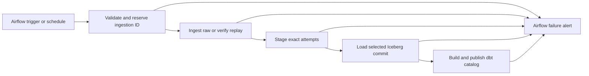

# Implementation contract

Cold start reads [ARCHITECTURE.md](ARCHITECTURE.md) before this file. That document is the agreed proposal and the architecture. Read it before writing or implementing any wave. This contract implements one wave of that document. A wave that contradicts `ARCHITECTURE.md` is wrong. The contract does not replace the proposal. A session that has not read `ARCHITECTURE.md` cannot continue.

Status: platform, ingest, stage, consumer and curated are merged and archived in `IMPLEMENTATION_CONTRACT_HISTORY.md`. The writer pipeline is active. Its contract passed Architect readiness and awaits Lead acceptance.

## Invariants

These rules stay in force across waves. Where one conflicts with `ARCHITECTURE.md`, `ARCHITECTURE.md` wins.

- All work stays on this machine. No AWS account, no paid API, and no `git push` unless the user asks.
- The agreed ingest mode calls the public World Bank API. There is no API key. Saved responses are for tests and replay. The platform wave did not call that API. That closed-wave limit is not a ban on the agreed extract mode.
- Every AWS API call uses `https://127.0.0.1:9297` and the certificate the AWS Emulator writes for that port. `localhost` is not a substitute. The emulator certificate covers `127.0.0.1` and `localhost` only, and S3 must stay path-style on the IP.
- The apply environment unsets `AWS_ACCESS_KEY_ID`, `AWS_SECRET_ACCESS_KEY`, `AWS_SESSION_TOKEN`, and `AWS_PROFILE`, then points at `~/.aws/emulator/9297/emulator_credentials`, `config`, and `ca.pem`. It also sets `AWS_ENDPOINT_URL`, `AWS_CA_BUNDLE`, `AWS_EC2_METADATA_DISABLED=true`, `AWS_DISABLE_HOST_PREFIX_INJECTION=true`, and `AWS_REGION=us-east-1`.
- Terraform state, plans, `*.tfvars`, and `secrets/email.key` are gitignored. `secrets/alert_email.enc` may be committed. qa and prd tfvars are not created.
- No email address is invented. The alert recipient exists only after the user supplies ciphertext. The local Airflow web login is the fixture user `airflow` / `airflow` with email field `airflow@localhost`. That fixture is not the alert recipient and is not a person.
- Plaintext email, the key, and emulator credentials are never written into Terraform variables, the plan, the repo, or logs.
- dbt and the Iceberg spike run in Linux containers. dbt does not run on the Mac host. DuckDB is not installed on the Mac host.
- The approved local dbt runtime is Core 1.12.7 with dbt-postgres 1.11.0. Runtime and lineage scope changes require a user decision.

## Wave plan

| Wave | Type | Status | What it does |
|---|---|---|---|
| `platform` | feature | closed, archived | Local emulator stack, dev Terraform, spikes, and make targets. The spec is in `IMPLEMENTATION_CONTRACT_HISTORY.md`. |
| `ingest` | feature | closed, archived | Publish recoverable raw data and the selected attempt. |
| `stage` | feature | closed, archived | Apply Iceberg SCD2 and publish original snapshot IDs. |
| `consumer` | feature | closed, archived | Load exact completed stage commits into Postgres staging. |
| `test-suite-selection` | feature | closed, archived | Select one local test suite or run the full suite. |
| `curated` | feature | closed, archived | Merge current versions into the star and publish native model lineage and catalog. |
| `world_bank_pipeline` | feature | Architect readiness passed | Orchestrate the four real writer jobs and report Airflow results. |

Later merge requests wait until the user reviews the previous one. Their order is in `ARCHITECTURE.md`. This file does not restate that design.

## Durable raw and control interfaces

- `meta.pipeline_run` in warehouse is the commit point. It is initialized by the ingest image. A completed extract selects its own `ingestion_id`, `raw_date`, `successful_attempt`. A completed replay selects its source extract using `source_ingestion_id`, and inherits the source coordinates and scope. Replay creates no raw S3 data of its own. Mode and scope are immutable for a run ID.
- Raw objects live in `lakehouse-raw`. The table names are `observation`, `country`, `indicator`, and `income_level`. Each stable `world-bank/{table}/date={raw_date}/ingestion_id={extract_id}/manifest.json` uses schema version 1. Fields are `format_version`, `table`, `ingestion_id`, `raw_date`, `successful_attempt`, `responses` (ordered entries with `key`, `sha256`, `source_url`, `api_page`, `raw_ingested_at`) and `record_keys` (ordered full keys). All artifacts are within the published `attempt={successful_attempt}/` prefix. Raw batches are JSON arrays of 1–100 flattened records. The archived ingest contract contains the complete example.
- Each record's raw provenance stays with its extract for its lifetime: `raw_response_key`, `raw_record_index` (zero-based), `response_sha256`, `raw_object_key`, `source_url`, `api_page`, `raw_ingested_at`, `ingestion_id`. Stage versions also carry their own `stage_run_id`, so replay can own the stage commit without rewriting source provenance.
- Warehouse stage fields already exist: `stage_status`, `stage_ingested_at`, `stage_snapshot_ids` and `stage_changed_count`. Only stage owns them. A later consumer reads only a complete row and the exact saved Iceberg snapshots, never today's head substituted for the saved IDs.

## Durable stage and consumer interfaces

- Stage owns four Iceberg format-v2 tables, `ice.world_bank.{observation,country,indicator,income_level}`, behind local REST at `http://127.0.0.1:8181`. Locations are `s3://lakehouse-stage/world-bank/{table}`, hidden-partitioned by UTC day of `stage_ingested_at`. The merged stage catalog adapter defines the ordered schema and stable Iceberg field IDs. Stage types are mirrored in Postgres staging; nullable observations retain exact `DECIMAL(38,18)` values.
- A run is consumable when its warehouse row is stage-complete. It carries a stable UTC `stage_ingested_at`, integer `stage_changed_count`, and `stage_snapshot_ids` with exactly four complete entries. Each entry is `{"state":"complete","overwrite":<decimal ID string or null>,"append":<decimal ID string or null>,"changed_count":<nonnegative integer>}`. For no change, both IDs are null. A pure insertion has append only. A correction uses an overwrite and its immediate append child. Sum of entry counts equals the run count. Counts represent appended versions, excluding closed after-images.
- The append snapshot associates new current rows using `stage_run_id`, `stage_ingested_at` and `valid_from`. The overwrite snapshot associates closed after-images using the source commit's `stage_ingested_at` as `valid_to`. A closed row retains its earlier `valid_from`, `stage_ingested_at`, `stage_run_id` and all original raw provenance. A replay's stage identity differs from its original raw `ingestion_id`.
- Query original IDs through DuckDB CLI 2.0.1 `iceberg_scan('<REST metadata-location>', snapshot_from_id = <id>)`, using the exact decimal integer. Stage proved this against retained snapshots after a later append. Warehouse consumers must never substitute current head when exact snapshots are requested, and must fail if they have become unavailable.

- Warehouse `stg.{observation,country,indicator,income_level}` carries complete operation rows from the producer contract. `consumer_run_id` is the load identity, `change_kind` is `append` or `close`, and `snapshot_id` is the exact Iceberg operation (Postgres bigint). Raw `ingestion_id` and `stage_run_id` remain their original identities, and `value` keeps all 38 digits and nulls. `meta.pipeline_run.consumer_status='complete'` publishes the load. A completed same-ID call performs no Iceberg or Postgres data rewrite. A distinct `reprocess_commit` row can load the same commit under its own identity.
- Curated uses current opened versions from completed loads, with `change_kind='append'` and `is_current=true` in the immutable staging load. A `close` row is historical evidence only. An older selected version or duplicate reprocess must not displace the latest version for a business key, and omission must not delete its retained fact.

## Durable curated interfaces

- `dbt-postgres --ingestion-id <id>` builds `curated.dim_income_level`, `curated.dim_country`, `curated.dim_indicator`, `curated.dim_year` and `curated.fact_indicator_year` from complete staging loads, using the latest append per business key. The archived curated contract defines exact columns and stable keys. PostgreSQL retains numeric decimals and source nulls; historical closures and omitted facts retain their prior meaning.
- Successful curated work marks only `curated_status=complete` after native `manifest.json` and `catalog.json` publish to `lakehouse-curated/world-bank/dbt_catalog/date={UTC stage day}/ingestion_id={invocation}/`. Curated reprocess uses its selected source's stage date and its own invocation ID. Future analytics/export owns `export_status`.
- `make test` runs all installed suites. `make test ingestion`, `stage`, `consumer`, and `curated` select their own full suite. `make test-unit` runs all installed offline suites. `make test-spike` retains local platform spikes.

## Wave `world_bank_pipeline` — Only writer DAG and Airflow run command

One scheduled-capable writer DAG runs the existing ingest, stage, consumer and curated jobs using the shared warehouse ledger. This wave includes same-ID resume, explicit abandonment, exact reprocess, Airflow-owned failure alerts, and the real `make run` command. The trigger-only backfill DAG, current-state rebuild, analytics/exports, data quality and clean-checkout `make demo` follow later.

| ID | Working-deliverable blocking behavior | Direct evidence |
|---|---|---|
| PIPE-1 | The sole writer has one active run, selects validated scope, gates new extracts, and resumes the recorded ID and scope. | Offline decision cases and real queued/blocked/abandoned Airflow runs. |
| PIPE-2 | The scheduler invokes the real local images in dependency order and skips only already-complete or mode-excluded work. | Real Docker child probe, producer integration credit, and disposable-stack Airflow fixture. |
| PIPE-3 | A task failure alerts once through the supervised publisher, remains failed in Airflow, and prevents later job execution. | Real saved-page failure, owner check and actual DAG/task state. |
| PIPE-4 | `make run` starts one identifiable Airflow run and returns according to its terminal state. | Real API auth probe and packaged CLI cases against the fixture stack. |
| PIPE-5 | Host and daemon endpoints remain local and the new test selector joins the current aggregate. | Docker capability probes, Airflow suite and existing selector evidence. |

One bounded writer entry point, with five coupled obligations. Credit existing job integrations, local Terraform resources, ledger contracts and Stage resumed commit proof. Airflow 2.10.5 image capability checks found the bundled Docker provider 4.0.0 and Docker SDK 7.1.0, with nonroot socket access through the configured supplemental group. A real DockerOperator child used the emulator namespace, mounted the engine-visible CA read-only, reached Postgres, and was removed with `auto_remove="force"`. The local API probe proved 200 with fixture Basic auth and 401 without when the Basic/session backends are configured. These probes establish interfaces; the full fixture must prove scheduled task execution.

### DAG identity and warehouse gate

- Define `world_bank_pipeline` in Airflow 2.10.5, UTC, `catchup=False`, `max_active_runs=1`, and no automatic task retries. Use `2026-01-01T00:00:00Z` as its fixed start date and read the optional `WORLD_BANK_PIPELINE_SCHEDULE` cron/preset from trusted scheduler configuration. Default to manual operation to keep an unconfigured local platform from calling the public API on startup. The same single-active-run limit applies to schedule and manual triggers. Leave the DAG unpaused on first registration for manual use.
- DAG conf is a JSON object with optional `ingestion_id`, `mode`, `source_ingestion_id`, `countries`, `indicators`, `start_year`, `end_year`, and `abandon_previous`. Reject unknown fields, invalid types, and invalid lengths/values. IDs use existing 1–128 ASCII alphanumeric/underscore/hyphen syntax with initial alphanumeric. Without an ID derive a stable safe value from the Airflow DagRun ID. Extract is the default new mode. Extract scope flags are lists of unique strings drawn from `config/pipeline.yml` and integers forming a subset of the defaults; normalize to config order, matching ingest. Existing resumed scope comes from the ledger, and supplied fields must agree. Replay and reprocess inherit source scope, require a distinct valid source ID, and reject scope overrides. Reject `rebuild` with a clear message until the backfill wave adds its writer path.
- Example new extract: `{"ingestion_id":"local-bra","mode":"extract","countries":["BRA"],"indicators":["SP.POP.TOTL"],"start_year":2020,"end_year":2021}`. Resume it with `{"ingestion_id":"local-bra"}`. Example replay is `{"ingestion_id":"local-replay","mode":"replay","source_ingestion_id":"local-bra"}`; reprocess uses `mode:"reprocess_commit"` and its own new ID.
- Before writes apply the existing ingest `pipeline_run.sql` under its existing DDL advisory lock and idempotently add nullable `abandoned_at timestamptz` and `abandoned_by_ingestion_id text` on that table. In a single transaction under a gate advisory lock, read or reserve the target row and decide abandonment. Use the existing schema and no new lock/coverage table. New extract rows pin current UTC `raw_date` and normalized scope. Replay requires a complete extract source and copies its raw date and scope. Reprocess requires a stage-complete extract or replay, copies source scope and leaves its own raw/stage statuses pending. Source and mode are immutable.
- A new extract is blocked by any other nonabandoned unfinished extract, replay or reprocess row, including standalone rows. For this wave `curated_status='complete'` is the successful boundary; `export_status` remains pending. Gate failures reserve no new row. With explicit `abandon_previous:true` on a new extract, mark all its blockers abandoned with UTC timestamp and the new run ID in the same transaction as insertion. Preserve every upstream status, object, and attempt. Existing active IDs resume when their input matches; reject resuming an abandoned ID. `abandon_previous` is invalid for a resume or another mode. Historical complete raw/commit artifacts remain usable as replay/reprocess sources.
- XCom carries one `return_value`: the gate's string ingestion ID. Read remaining inputs from the warehouse and Airflow context. There are no job output XComs, branch decisions in XCom, file lists or raw payloads.

### Task execution and failure ownership

- The task chain is `gate -> ingest -> stage -> consumer -> curated`, with success dependencies and no all-done leaf. By current ledger status each image task either finishes as an explicit no-work success, or executes its DockerOperator with the validated ID. Do not launch ingest or stage for reprocess. For extract/replay skip a job whose own status is already complete; for eligible unfinished jobs enforce predecessor complete. After a child succeeds, verify the corresponding warehouse completion flag before returning Airflow success. A child failure propagates and blocks later tasks. Core or downstream failures leave earlier completion flags intact.
- Launch only the known local images and list-form entrypoint arguments. Ingest gets ledger mode, extract scope or replay source flags; other images get only `--ingestion-id`. Jobs share `container:<local emulator container>` (default `world-bank-aws-emulator-1`) and mount the engine-visible emulator credential directory, derived from the Compose host `${HOME}/.aws/emulator/9297` or the private fixture override `WORLD_BANK_EMULATOR_HOST_DIR`, read-only at `/opt/emulator`. Use fixed local Docker socket, provider API version `auto`, `mount_tmp_dir=False`, `auto_remove="force"`, `do_xcom_push=False`, and local-image preflight. A missing image fails with a build instruction rather than pulling by application image name. Default nonroot Airflow scheduler gets the Docker supplementary group through `WORLD_BANK_DOCKER_GID` (local Colima default 991; configurable). `WORLD_BANK_DOCKER_SOCKET` defaults to the engine-host `/var/run/docker.sock`. Only the scheduler gets that bind.
- Give the scheduler emulator namespace sharing and a local CA/credentials mount for callbacks, and the existing config and initial SQL through read-only mounts. Airflow webserver retains localhost-only port 8080. Enable the Basic and session API auth backends. Share the Airflow logs volume between scheduler and webserver. Keep Postgres access on the local network. Local image environment carries `WORLD_BANK_ALERT_TOPIC_ARN` resolved from the unique emulator SNS topic named `world-bank-alerts`, and `WORLD_BANK_ALERT_OWNER=airflow`.
- Airflow task failure callback owns SNS when it supervises jobs. The four image reporters retain their own CloudWatch failure event and standalone SNS behavior; when the trusted launcher supplies `WORLD_BANK_ALERT_OWNER=airflow`, they skip SNS. Airflow logs structured `pipeline_task_failed` and successful `alert_published` with its emulator MessageId in `/world-bank/airflow`, stream = ingestion ID. The SNS JSON carries ingestion ID, task name, safe error and Airflow run ID. Gate failures without XCom use a safe supplied ID or the deterministic run ID derivation. Gate rejection, unavailable child image, nonzero child exit and abrupt task failure all follow this same failure callback. Notification failures cannot mark the Airflow task successful.
- Use explicit emulator credentials/CA, no ambient AWS credentials or proxies, and `https://127.0.0.1:9297` for scheduler AWS operations. A private fixture API URL may be supplied from trusted test scheduler configuration only, restricted to HTTP on literal `127.0.0.1` and sent to ingest via its existing loopback fixture env. Trigger conf cannot supply endpoints, Docker images, host mounts or environment keys.

### Operator command and file plan

- `make platform` builds the four writer images under their local application names, in addition to starting the existing infra and applying dev Terraform. Keep existing secrets/topic proof and spike behavior. `make run` invokes a local Python 3 stdlib client. The endpoint is authenticated Airflow REST v1 at literal loopback `http://127.0.0.1:8080`; a trusted environment override may choose a different loopback port for the private fixture. Use the existing local fixture Airflow account, reject alternate hosts, do not follow redirects, and bypass proxies. Read optional trigger JSON from environment `WORLD_BANK_RUN_CONF` without shell interpolation. Example `WORLD_BANK_RUN_CONF='{"ingestion_id":"local-bra"}' make run`.
- POST exactly one DagRun for `world_bank_pipeline` with a distinct valid Airflow `dag_run_id` and selected conf, then bounded-poll that same run ID at `/api/v1/dags/world_bank_pipeline/dagRuns/{dag_run_id}`. Report Airflow run ID and resolved ingestion ID for resume. Exit 0 only for actual `success`, and nonzero for `failed`, validation/HTTP errors, or deadline expiry. Do not resubmit after an ambiguous response or infer success from warehouse state. Timeouts leave the existing Airflow run available for inspection. Keep `make demo` pending until its planned wave.
- Document default manual scheduling, trusted local schedule opt-in, socket/GID override, four modes' current availability, same-ID scope and explicit abandonment, API status, and local CloudWatch log lookup. `make test pipeline` selects only the new offline and integration suites; `make test` and `make test-unit` include them, and existing selectors retain their behavior.

| Action | Path | Responsibility |
|---|---|---|
| Create | `dags/world_bank_pipeline.py` | Airflow DAG, task construction and success dependencies. |
| Create | `dags/world_bank_pipeline_support/{__init__,gate,runtime}.py` | Config/ledger reservation and recovery, DockerOperator/local IAM-free logging and callback. Use the mounted ingest schema. |
| Create | `scripts/run-pipeline.py` | Local authenticated trigger, exact DagRun polling, observable exit codes. |
| Modify | `compose.infra.yaml`, `Makefile`, `README.md` | Local scheduler/socket, builds, REST auth, operator commands and selector. |
| Modify | `images/ingest-world-bank/world_bank_ingest/services.py`, `images/stage-world-bank/world_bank_stage/services.py`, `images/consumer-postgres/world_bank_consumer/services.py`, `images/dbt-postgres/world_bank_curated/services.py` | Suppress image SNS only under trusted Airflow ownership. Preserve standalone reporting and CloudWatch job error. |
| Create | `tests/pipeline/test_unit.py`, `tests/pipeline/test_integration.py`, `tests/pipeline/compose.fixture.yaml`, `tests/pipeline/fixture_services.py` | Offline gates/CLI cases, private scheduler fixture and saved local responses/provisioning. |

No deletes. Existing producers, schema DDL, config and Terraform are evidence-only except the four reporter conditionals. No Docker provider replacement or new Airflow dependency.

### Executable fixture and acceptance

- Offline suite runs in the existing pinned Airflow image with `--network none` and read-only source mounts. Exercise conf shapes, immutable/resumable scope, completion predicates, explicit durable abandonment, strict mode/source dispatch, failure identity fallback and API client success/failure/timeout without a real socket. Coverage percentage is diagnostic only if measured by the existing runtime.
- Real integration uses a unique disposable Compose project, same real Airflow/provider and four locally built job images, and private Postgres, Iceberg REST and AWS emulator services. Use a fixture overlay to clear AWS host-published ports, dynamically publish the Airflow API on a loopback host port, and use a private temporary emulator HOME/credential mount on both emulator and scheduler. Set the emulator sibling name from the fixture project. Provision the three buckets, relevant log groups and local alert topic through the same mounted CA and local endpoint inside that test namespace. The HTTP fixture server shares the private emulator namespace, binds the ingress test seam on loopback, and reads only local fixture controls. Use the existing observation fixtures and source shape. Do not stop, restart, alter, or clean the user's running stack. Cleanup removes only that unique Compose project/volumes and its scratch data.
- Fixture scope is BRA, `SP.POP.TOTL`, 2020–2021, with two saved observation pages (2020 null, 2021 value 42) and one page each for BRA country, named indicator and UMC income level. The good fixture responds with complete pagination and the scope metadata. A bad variant returns HTTP 400 on observation page 2, and a correction variant changes 2021 to 43. A bounded local hold on the first observation request may keep one DagRun visibly active during the queue check.
- Real sequence:
  1. Submit a good run via `make run` against the fixture URL. Expect exit 0, one exact Airflow success state, completed four warehouse flags, curated nullable and numeric values, and both native catalog keys. Verify DAG import, `max_active_runs=1`, and exactly the gate's ingestion-ID output in XCom. Trigger two eligible writer runs while the first is held and verify the second remains queued before its gate, then let both succeed.
  2. Trigger the bad page variant. Expect exit nonzero with that Airflow DagRun failed, ingest failed and later tasks upstream-failed or otherwise unexecuted. No selected raw attempt or completed downstream state. Verify image failure log plus exactly one Airflow `alert_published` with a nonempty SNS ID, and no supervised image publication. Try a different new extract without abandonment, expect gate failure and no new ledger row.
  3. Run a different new extract with `abandon_previous:true`, correction fixture, and a fixture DB trigger that rejects a curated fact update for the new ID. Assert the failed ingestion retains its original evidence and is marked abandoned by the new ID. The new DagRun must fail with complete raw, stage and consumer, and failed curated. Remove the DB trigger and resume by the new ingestion ID with scope omitted. Expect success using the original ledger scope, unchanged raw attempt and stage snapshot IDs, no extra upstream launch or request, and corrected catalog/curated output. Verify the exact successful Airflow DagRun, distinct from its earlier failed attempt.
- Execute `docker compose -f compose.infra.yaml -f compose.jobs.yaml config --quiet`, `make test pipeline`, `make test`, `make -n test ingestion`, `make -n test stage`, `make -n test consumer`, `make -n test curated`, `make -n test-spike`, and `git diff --check`. The real fixture must execute and pass. A skipped scheduler or fake job is not a full pass. Existing image suites remain useful evidence for their standalone alert behavior. Auditor scope is the writer DAG/CLI and its exact runtime boundary, including failure/queue behavior and local-only endpoint transport.

### Contract readiness

The writer pipeline wave passes the Architect gate and is mechanically ready for implementation. Runtime probes show the actual bundled operator can launch a local sibling with the required namespace, mount and cleanup, and the actual Airflow API supports the configured authentication. Existing local job and SDK tests are credited. The full fixture observes the scheduler and job-image boundaries together and checks the exact terminal DAG result, retry and notification behavior.
