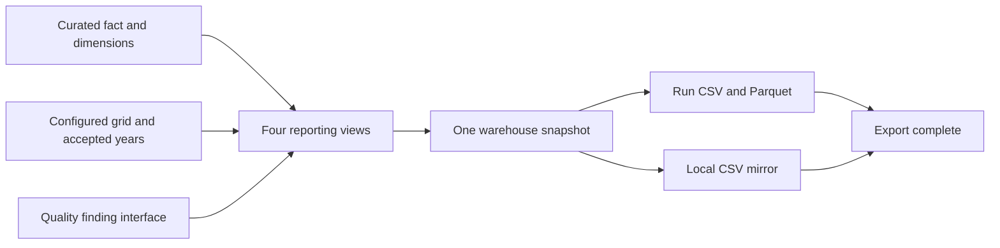

# Implementation contract

Cold start reads [ARCHITECTURE.md](ARCHITECTURE.md) before this file. That document is the agreed proposal and the architecture. Read it before writing or implementing any wave. This contract implements one wave of that document. A wave that contradicts `ARCHITECTURE.md` is wrong. The contract does not replace the proposal. A session that has not read `ARCHITECTURE.md` cannot continue.

Status: platform through backfill are merged and archived in `IMPLEMENTATION_CONTRACT_HISTORY.md`. Analytic outputs is active. Both named tasks passed Architect readiness and await Lead acceptance.

## Invariants

These rules stay in force across waves. Where one conflicts with `ARCHITECTURE.md`, `ARCHITECTURE.md` wins.

- All work stays on this machine. No AWS account, no paid API, and no `git push` unless the user asks.
- The agreed ingest mode calls the public World Bank API. There is no API key. Saved responses are for tests and replay. The platform wave did not call that API. That closed-wave limit is not a ban on the agreed extract mode.
- Every AWS API call uses `https://127.0.0.1:9297` and the certificate the AWS Emulator writes for that port. `localhost` is not a substitute. The emulator certificate covers `127.0.0.1` and `localhost` only, and S3 must stay path-style on the IP.
- The apply environment unsets `AWS_ACCESS_KEY_ID`, `AWS_SECRET_ACCESS_KEY`, `AWS_SESSION_TOKEN`, and `AWS_PROFILE`, then points at `~/.aws/emulator/9297/emulator_credentials`, `config`, and `ca.pem`. It also sets `AWS_ENDPOINT_URL`, `AWS_CA_BUNDLE`, `AWS_EC2_METADATA_DISABLED=true`, `AWS_DISABLE_HOST_PREFIX_INJECTION=true`, and `AWS_REGION=us-east-1`.
- Terraform state, plans, `*.tfvars`, and `secrets/email.key` are gitignored. `secrets/alert_email.enc` may be committed. qa and prd tfvars are not created.
- No email address is invented. The alert recipient exists only after the user supplies ciphertext. The local Airflow web login is the fixture user `airflow` / `airflow` with email field `airflow@localhost`. That fixture is not the alert recipient and is not a person.
- Plaintext email, the key, and emulator credentials are never written into Terraform variables, the plan, the repo, or logs.
- dbt and the Iceberg spike run in Linux containers. dbt does not run on the Mac host. DuckDB is not installed on the Mac host.
- The approved local dbt runtime is Core 1.12.7 with dbt-postgres 1.11.0. Runtime and lineage scope changes require a user decision.

## Wave plan

| Wave | Type | Status | What it does |
|---|---|---|---|
| `platform` | feature | closed, archived | Local emulator stack, dev Terraform, spikes, and make targets. The spec is in `IMPLEMENTATION_CONTRACT_HISTORY.md`. |
| `ingest` | feature | closed, archived | Publish recoverable raw data and the selected attempt. |
| `stage` | feature | closed, archived | Apply Iceberg SCD2 and publish original snapshot IDs. |
| `consumer` | feature | closed, archived | Load exact completed stage commits into Postgres staging. |
| `test-suite-selection` | feature | closed, archived | Select one local test suite or run the full suite. |
| `curated` | feature | closed, archived | Merge current versions into the star and publish native model lineage and catalog. |
| `world_bank_pipeline` | feature | closed, archived | Orchestrate the four writer jobs and report Airflow results. |
| `world_bank_backfill` | feature | closed, archived | Trigger the single writer and restore current Iceberg state. |
| `analytic-outputs` | feature | Architect readiness passed | Query reporting views and publish current CSV/Parquet artifacts. |

Later merge requests wait until the user reviews the previous one. Their order is in `ARCHITECTURE.md`. This file does not restate that design.

## Durable raw and control interfaces

- `meta.pipeline_run` in warehouse is the commit point. It is initialized by the ingest image. A completed extract selects its own `ingestion_id`, `raw_date`, `successful_attempt`. A completed replay selects its source extract using `source_ingestion_id`, and inherits the source coordinates and scope. Replay creates no raw S3 data of its own. Mode and scope are immutable for a run ID.
- Raw objects live in `lakehouse-raw`. The table names are `observation`, `country`, `indicator`, and `income_level`. Each stable `world-bank/{table}/date={raw_date}/ingestion_id={extract_id}/manifest.json` uses schema version 1. Fields are `format_version`, `table`, `ingestion_id`, `raw_date`, `successful_attempt`, `responses` (ordered entries with `key`, `sha256`, `source_url`, `api_page`, `raw_ingested_at`) and `record_keys` (ordered full keys). All artifacts are within the published `attempt={successful_attempt}/` prefix. Raw batches are JSON arrays of 1–100 flattened records. The archived ingest contract contains the complete example.
- Each record's raw provenance stays with its extract for its lifetime: `raw_response_key`, `raw_record_index` (zero-based), `response_sha256`, `raw_object_key`, `source_url`, `api_page`, `raw_ingested_at`, `ingestion_id`. Stage versions also carry their own `stage_run_id`, so replay can own the stage commit without rewriting source provenance.
- Warehouse stage fields already exist: `stage_status`, `stage_ingested_at`, `stage_snapshot_ids` and `stage_changed_count`. Only stage owns them. A later consumer reads only a complete row and the exact saved Iceberg snapshots, never today's head substituted for the saved IDs.

## Durable stage and consumer interfaces

- Stage owns four Iceberg format-v2 tables, `ice.world_bank.{observation,country,indicator,income_level}`, behind local REST at `http://127.0.0.1:8181`. Locations are `s3://lakehouse-stage/world-bank/{table}`, hidden-partitioned by UTC day of `stage_ingested_at`. The merged stage catalog adapter defines the ordered schema and stable Iceberg field IDs. Stage types are mirrored in Postgres staging; nullable observations retain exact `DECIMAL(38,18)` values.
- A run is consumable when its warehouse row is stage-complete. It carries a stable UTC `stage_ingested_at`, integer `stage_changed_count`, and `stage_snapshot_ids` with exactly four complete entries. Each entry is `{"state":"complete","overwrite":<decimal ID string or null>,"append":<decimal ID string or null>,"changed_count":<nonnegative integer>}`. For no change, both IDs are null. A pure insertion has append only. A correction uses an overwrite and its immediate append child. Sum of entry counts equals the run count. Counts represent appended versions, excluding closed after-images.
- The append snapshot associates new current rows using `stage_run_id`, `stage_ingested_at` and `valid_from`. The overwrite snapshot associates closed after-images using the source commit's `stage_ingested_at` as `valid_to`. A closed row retains its earlier `valid_from`, `stage_ingested_at`, `stage_run_id` and all original raw provenance. A replay's stage identity differs from its original raw `ingestion_id`.
- Query original IDs through DuckDB CLI 2.0.1 `iceberg_scan('<REST metadata-location>', snapshot_from_id = <id>)`, using the exact decimal integer. Stage proved this against retained snapshots after a later append. Warehouse consumers must never substitute current head when exact snapshots are requested, and must fail if they have become unavailable.

- Warehouse `stg.{observation,country,indicator,income_level}` carries complete operation rows from the producer contract. `consumer_run_id` is the load identity, `change_kind` is `append` or `close`, and `snapshot_id` is the exact Iceberg operation (Postgres bigint). Raw `ingestion_id` and `stage_run_id` remain their original identities, and `value` keeps all 38 digits and nulls. `meta.pipeline_run.consumer_status='complete'` publishes the load. A completed same-ID call performs no Iceberg or Postgres data rewrite. A distinct `reprocess_commit` row can load the same commit under its own identity.
- Curated uses current opened versions from completed loads, with `change_kind='append'` and `is_current=true` in the immutable staging load. A `close` row is historical evidence only. An older selected version or duplicate reprocess must not displace the latest version for a business key, and omission must not delete its retained fact.

## Durable curated interfaces

- `dbt-postgres --ingestion-id <id>` builds `curated.dim_income_level`, `curated.dim_country`, `curated.dim_indicator`, `curated.dim_year` and `curated.fact_indicator_year` from complete staging loads, using the latest append per business key. The archived curated contract defines exact columns and stable keys. PostgreSQL retains numeric decimals and source nulls; historical closures and omitted facts retain their prior meaning.
- Successful curated work marks only `curated_status=complete` after native `manifest.json` and `catalog.json` publish to `lakehouse-curated/world-bank/dbt_catalog/date={UTC stage day}/ingestion_id={invocation}/`. Curated reprocess uses its selected source's stage date and its own invocation ID. Future analytics/export owns `export_status`.
- `make test` runs all installed suites. `make test ingestion`, `stage`, `consumer`, and `curated` select their own full suite. `make test-unit` runs all installed offline suites. `make test-spike` retains local platform spikes.

## Durable writer interfaces

- `world_bank_pipeline` is the only writer DAG, with `max_active_runs=1`. Its normal task order is `gate -> ingest -> stage -> consumer -> curated`. `make run` triggers one exact writer run and reports that Airflow run's final state. The writer owns supervised SNS alerts and uses `/world-bank/airflow`. Standalone images retain their own alerts.
- Writer conf uses `ingestion_id`, `mode`, `source_ingestion_id`, the four extract scope fields (`countries`, `indicators`, `start_year`, `end_year`), and `abandon_previous`. The gate returns only the validated ingestion ID in XCom. Warehouse scope and mode are immutable across resume. `curated_status` is the writer success boundary until analytics/export, and `abandoned_at` plus `abandoned_by_ingestion_id` exclude a deliberately abandoned row from a new extract gate while retaining history.
- Extract selects its configured or narrowed API scope. Replay inherits a completed extract's saved raw attempt. Reprocess selects one completed stage commit, skips ingest/stage and writes a new consumer/curated load identity. Neither replay nor reprocess rewrites source provenance. The writer may verify completion and skip previously complete jobs on resume.

## Durable backfill interfaces

- The trigger-only `world_bank_backfill` DAG launches one exact manual child of the writer and waits for its final Airflow state. It has no warehouse, Docker or cloud writes. One writer `max_active_runs=1` applies to that child as to scheduled/manual writer runs.
- Rebuild restores all four current Iceberg tables into absent/empty staging and curated data relations. Its ledger pins `rebuild_snapshot_ids` and UTC `rebuild_pinned_at`; raw/stage work stays excluded and curated uses the pinned day for its run artifact path. Exact reprocess has a distinct load ID and the selected completed stage source's date.

## Wave `analytic-outputs` — Four reporting views and retryable file exports

The four PostgreSQL views expose missingness, calendar-year change, latest numerical comparison and income-group rollups. The writer publishes the four views in CSV and Parquet on each successful run and mirrors the same current CSVs under `exports/`. Build the two bounded tasks in order. Subsequent DQ production findings, DQ alerts, and clean-checkout demo remain distinct waves.

### Task `reporting-views` — Calculate the four Postgres reports

| ID | Working-deliverable blocking behavior | Direct evidence |
|---|---|---|
| VIEW-1 | Expected rows distinguish absent facts, source nulls and a warning for the latest scoped extract. | PostgreSQL results with later in-scope and out-of-scope extracts and fixture warning rows. |
| VIEW-2 | Calendar-year comparison cannot bridge an absent year; latest comparison preserves all configured countries. | PostgreSQL gap, zero and null cases. |
| VIEW-3 | Income rollups use matching denominators, current classification and independent coverage counts. | Independent arithmetic checked against a real PostgreSQL fixture. |

Credit the merged fact and dimension integration for exact decimals, current classification and absence-preserving updates. These are ordinary SQL views backed by the warehouse. The next task invokes their initialization and grid refresh; this one verifies the SQL directly in disposable Postgres.

#### Durable reporting and data-quality interfaces

- `meta.expected_key(country_iso3 text, indicator_code text, year integer)` has a composite primary key with all three fields nonnull. Refresh it atomically from the current config countries and indicators crossed with sorted distinct years in `curated.dim_year`. That dimension covers accepted requested years and observed years from a rebuild with a new ledger. Current curated run years are included before export. A narrow extract scopes its API request and its domain of disappearance checks; the reporting grid still uses the full configured country/indicator set for each represented year. Refresh accepts only config values validated against the existing pipeline JSON/YAML types; no hardcoded default list.
- Create the empty production seam `meta.dq_result(ingestion_id text NOT NULL, check_name text NOT NULL, severity text NOT NULL, business_key jsonb NOT NULL, message text NOT NULL, detected_at timestamptz NOT NULL)`, primary key `(ingestion_id,check_name,business_key)`. The disappearance check later writes `check_name='observation_disappeared'`, `severity='warning'`, `business_key={"country_iso3":"BRA","indicator_code":"SP.POP.TOTL","year":2021}` using exactly those string, string and integer fields. This wave creates the interface and reads matching rows; it does not generate DQ findings or DQ warning alerts.
- Place all four views in `curated` with these ordered columns. `value` for direct fact fields and `prior_value` are nullable `numeric(38,18)`. Computed amounts and percentages have `numeric(38,12)` output for deterministic CSV/Parquet with twelve fractional digits. Keys and labels are text, year/count fields are integers, and unavailable values remain SQL null.
  - `vw_missing_or_incomplete(country_iso3,indicator_code,year,value,reason)`. Left join expected keys to named facts. Use `NEVER_RETURNED` if no fact row exists. Otherwise use `MISSING_FROM_LATEST_EXTRACT` when the recorded warning matches the latest raw-complete `extract` whose recorded countries, indicators and inclusive years contain the key. Sort by raw ingestion time descending then ingestion ID descending. This warning takes precedence over a retained null. Otherwise use `SOURCE_NULL` for a present null fact. Emit no row for an available unflagged value. Replay/reprocess/rebuild never supersede an extract warning. A more recent qualifying extract with no warning clears the old flag; an unrelated narrow extract cannot clear it.
  - `vw_yoy_change(country_iso3,indicator_code,year,value,prior_value,yoy_change_pct,reason)`. Build a calendar spine from the first to the last represented year for the selected configuration. Join prior on exactly year minus one. Percent is `100 * (value-prior_value) / prior_value`. Reason order is `CURRENT_NULL`, `PRIOR_YEAR_MISSING` (prior absent or null), then `PRIOR_YEAR_ZERO`. Each yields null percent. A computable row has null reason.
  - `vw_latest_year_comparison(country_iso3,indicator_code,year,value)`. For each configured indicator find the last year among configured countries with any nonnull value, then include every configured country in that year with its actual value or null. An indicator with no numeric observations contributes no rows.
  - `vw_income_group_year(income_level_id,income_level_name,year,indicator_code,aggregation_method,value,expected_country_count,available_country_count,coverage_pct)`. Use each configured country's current classified income group, excluding unclassified countries from known groups. For every represented year and supported configured metric emit group membership counts independent of fact presence. Population `SP.POP.TOTL` and GDP `NY.GDP.MKTP.CD` each use `SUM` of numeric contributors. GDP per capita `NY.GDP.PCAP.CD` uses `GDP_PER_CAPITA_RATIO`, matched-country SUM GDP divided by SUM population. Life expectancy `SP.DYN.LE00.IN` uses `POPULATION_WEIGHTED_MEAN`, matched-country SUM(life × population) divided by SUM(population). Ratio and weighted contributions require both numeric inputs, and division is null for a zero denominator. Expected count is configured members; available count is the qualifying contributor set. Coverage is 100 × available / expected. With no contributors the value is null and available/coverage are zero. Only the four specified metrics have income aggregation rules.

#### Reporting views file plan and acceptance

| Action | Path | Responsibility |
|---|---|---|
| Create | `images/dbt-postgres/world_bank_analytics/__init__.py`, `images/dbt-postgres/world_bank_analytics/views.py`, `images/dbt-postgres/world_bank_analytics/reporting.sql` | Idempotent schema and view DDL, transaction-scoped expected grid refresh, and stable column/query definitions. |
| Create | `images/dbt-postgres/analytics_tests/test_views.py` | Real PostgreSQL acceptance for the four SQL views. |
| Modify | `images/dbt-postgres/Dockerfile` | Copy the analytics package and view fixture into the existing dbt image. |

No change to merged curated models, external providers, producer jobs or DAG in this task. Refresh the owned expected grid within a transaction, leave DQ rows intact, and keep business-key join logic consistent across views. Use the test matrix beneath as the external arithmetic oracle.

- Create a disposable `curated_test_<32 lowercase hex>` database in the local Postgres fixture, with curated relation columns from the live star contract and real ledger DDL. Load config countries BRA, CAN, DEU and all four indicators, with 2019–2021 represented. All three belong to UMC. One completed curated run supplies the represented year dimension; scoped extract rows may carry raw-complete state for warning selection. Example data: BRA population 100 in 2019 and 200 in 2021, GDP 900/0/1000 in 2019/2020/2021, life 70 in 2021. CAN 2021 population 100, GDP 800, life 80, and explicit null life in 2020. DEU 2021 GDP 600 and no population or life. Leave at least one group/metric/year with no contributors.
- For missingness assert BRA 2020 population is `NEVER_RETURNED`, CAN 2020 life is `SOURCE_NULL`, and add a fixture warning for BRA 2021 GDP on its actual latest qualifying extract. Verify the warning before and after a newer unrelated extract and then clear it with a newer qualifying extract without a warning. A fixture case with a retained null plus a matching latest warning verifies precedence. This fixture inserts DQ sample evidence; application code only reads it.
- Assert BRA 2021 population has `PRIOR_YEAR_MISSING`, 2021 GDP has `PRIOR_YEAR_ZERO`, and a current null has `CURRENT_NULL`. BRA 2020 GDP has `-100` percent. Latest life comparison lists BRA 70, CAN 80 and DEU null. UMC 2021 population is 300, GDP is 2400, paired GDP per capita is 6, and weighted life is `73.333333333333`; expected counts are 3, available counts are 2, 3, 2, 2 in that order. For 2 of 3, coverage is `66.666666666667`. Check grouped empty data returns null and zero coverage.
- Build with `docker compose -f compose.infra.yaml -f compose.jobs.yaml build dbt-postgres`, then `docker compose -f compose.infra.yaml -f compose.jobs.yaml run --rm --no-deps --entrypoint python dbt-postgres -m unittest discover -s analytics_tests -p test_views.py`. The disposable database is the only mutation and is dropped in teardown. Require all real SQL checks and `git diff --check` to pass. The next task incorporates this same fixture into the analytics selector without duplicating it.

### Task `reporting-export` — Publish typed report files and resume after curated

| ID | Working-deliverable blocking behavior | Direct evidence |
|---|---|---|
| EXP-1 | Export four views from one consistent warehouse snapshot to real CSV and typed Parquet, preserving raw decimals and nulls. | Actual PyArrow runtime probe and local SQL/S3 artifact reads. |
| EXP-2 | Publish all eight emulator objects and four identical host CSVs before marking export complete. Retry an interrupted publication. | Real emulator and host fixture plus failure/retry trace. |
| EXP-3 | Writer runs export only after curated, and a failed export leaves that DagRun failed and later resumes without upstream reruns. | Real disposable writer fixture and pre-upgrade ledger case. |

Credit existing SDK TLS and fixed-local endpoint proofs, all four job integrations, the writer's DockerOperator, and its private stack fixtures. PyArrow 18.1.0 installed in the actual dbt image and wrote/read a real Parquet decimal128(38,18) and null row exactly. The four view semantics are supplied by `reporting-views`. Neither proof establishes the new file, mount or state path; verify that path below.

- Add `python -m world_bank_analytics --ingestion-id <id>` in the existing `dbt-postgres` image with PyArrow 18.1.0. Require a valid run ID and a curated-complete ledger row. Reuse curated/consumer advisory locks in the existing order to serialize the reporting source and host mirror. Use the established mode-aware stage or rebuild UTC timestamp for the date prefix. Read the four views in one PostgreSQL repeatable-read transaction with reporting DDL and expected-grid refresh. Collect and generate all artifacts before publishing. Use the existing local mounted emulator credentials/CA, fixed path-style endpoint and Airflow/standalone alert ownership. No new AWS resources.
- S3 layout is `s3://lakehouse-curated/world-bank/reporting/date={day}/ingestion_id={run}/<view>.csv` and `<view>.parquet`, with the UTC stage day, source stage day for reprocess, or pinned day for rebuild. Use the four exact view names as basenames. Local `exports/<view>.csv` is the current successful mirror and uses byte-for-byte identical CSV content. The same run retries to the same S3 prefix. All modes that reach writer success run export; an existing complete same-ID export returns without rewriting the current mirror.
- Export the ordered view columns above and sort by natural text keys then year (income group uses group key then indicator then year). CSV is UTF-8, standard escaped CSV with header, LF records, decimal text without binary float and empty fields for SQL null. Parquet uses explicit string, int32, decimal128(38,18) direct facts and decimal128(38,12) computed values, and nulls, with valid schemas even for zero rows. Use matching Python Decimal values for both formats. Include no pandas implicit conversion.
- Set `export_status='pending'` for each accepted unfinished invocation. Upload all S3 files with appropriate content types, then atomically replace each local CSV from a same-directory temporary file. Readers can use only a complete run prefix as a published set. The existing `export_status='complete'` commit follows all eight uploads and four host replacements. A caught error sets `failed` when the ledger is reachable, returns nonzero and reports an `export_failed` event. Preserve curated and other statuses. Incomplete attempts may have partial S3 files or partially replaced local CSVs. Retry regenerates/replaces the entire set. A local mirror is shared and is current after successful publication.
- Add a final Airflow `export` task after `curated`, with the same success-only dependency, status verification, alert callback and no output XCom. It wraps the existing local `dbt-postgres` image with a list-form analytics entrypoint override. Require safe trusted mount source `WORLD_BANK_EXPORTS_HOST_DIR` (project `exports/` by default) and use `/exports` in the job. Compose standalone dbt service makes the same local path available. Create the normal directory during `make platform`; private tests override it to a disposable directory. Never accept file paths, entrypoints or image names from run conf. Report standalone errors in the existing `/world-bank/dbt-postgres` group. Airflow-owned failures still publish SNS once through the writer callback.
- Under the writer gate's existing DDL lock, add `export_required boolean NOT NULL DEFAULT false` to `meta.pipeline_run`. New writer rows and explicitly accepted same-ID writer resumes set it true. A nonabandoned prior run is unfinished if curated is incomplete, export is failed, or export is required but incomplete. This keeps curated-complete historical rows with the old pending export default from blocking an upgrade. It also blocks new extracts after a failed or interrupted required export. The usual explicit new-extract abandonment and same-ID resume rules still apply. Raw/stage/consumer/curated completion skips are unchanged. `make run` and backfill parent success now require the actual writer run including export.

#### Export and ordering file plan

| Action | Path | Responsibility |
|---|---|---|
| Create | `images/dbt-postgres/world_bank_analytics/{__main__,exports}.py` | CLI/ledger, consistent snapshot, typed serialization and file publication. |
| Modify | `images/dbt-postgres/world_bank_curated/services.py` | Optional reused reporter/warehouse helper seam for analytics, preserving curated caller behavior. |
| Modify | `images/dbt-postgres/Dockerfile`, `compose.infra.yaml`, `compose.jobs.yaml` | Pin PyArrow, copy config/test harness, add trusted local output mount/config. |
| Modify | `dags/world_bank_pipeline.py`, `dags/world_bank_pipeline_support/{gate,runtime}.py` | Export successor, status and legacy compatibility, configured host path. |
| Create | `images/dbt-postgres/analytics_tests/test_unit.py`, `images/dbt-postgres/analytics_tests/test_integration.py` | Serialization/error and real warehouse/S3/mirror acceptance. |
| Modify | `tests/pipeline/fixture.py`, `tests/pipeline/test_integration.py`, `Makefile`, `README.md`, `.gitignore`, `.dockerignore` | Private fixture output path and writer retry test, analytics selector, operator docs and generated output exclusions. |

Apply no changes to backfill DAG behavior, live IAM, catalog output format, or existing curated models. Extend `make test-unit` and `make test`; `make test analytics` runs only the analytics unit, reporting-view and artifact fixture tests. Writer fixture remains in `make test pipeline`. Use `exports/` only for generated host CSVs. Existing test selectors remain in place.

#### File export acceptance

- Offline tests verify all schemas for empty rows, exact decimal and null round-trip, deterministic CSV ordering and bytes, and partial S3 success returning failure without completing the ledger. Credit the real PyArrow probe and do not create another dependency-specific proof layer.
- Run analytics against a private `curated_test_<32 hex>` database with the same fixture schema and config as the view task and a disposable local mirror. Use the same local emulator resources with isolated unique run IDs. Query the real exported S3 keys. Read the CSV and real Parquet contents using standard CSV and PyArrow readers. Check names, schema/order, independently expected report rows, null and exact raw decimal values, and byte equality between each S3 CSV and its local mirror. Include a curated-complete empty fixture that still emits four header-only CSVs and four valid typed Parquet files. Clean up only fixture database, prefix and local temporary directory.
- In the private scheduler fixture, set an engine-visible `WORLD_BANK_EXPORTS_HOST_DIR` inside the existing private fixture home and create that directory before startup. Establish one successful writer with eight run objects, four mirrored CSVs and `export_status='complete'`. Include a historical imported row with curated complete, export pending and no export obligation; prove a new normal extract can start. Before a later writer run, create a directory at one exact mirror filename in this fixture only so local replacement fails after curated. Expect the exact Airflow DagRun to fail and `export_status='failed'`, while raw, stage, consumer and curated remain complete. Verify the writer gate blocks another new extract during failure. Restore a writable filename and resume the same ID. Expect only the export process to start again, same upstream attempts/snapshots and curated log starts, status complete, and all files in the same S3 prefix and four correct mirror files. Observe structured failure and SNS in the private emulator through the existing callback.
- Validate `docker compose -f compose.infra.yaml -f compose.jobs.yaml config --quiet`, `make test analytics`, `make test pipeline`, `make test`, selector dry-runs and `git diff --check`. The already-passing view fixture may be credited when its SQL and assumptions are unchanged. The writer and artifact suites must execute with real services. README names the four local files and S3 run prefix, selector, exact retry, and availability after export completion.

### Contract readiness

Both named tasks pass the Architect gate and are mechanically ready for Lead acceptance. Implement and validate `reporting-views` first, then `reporting-export`. Review the SQL calculation/data-quality seam and the file/writer completion boundary as separate scopes.
