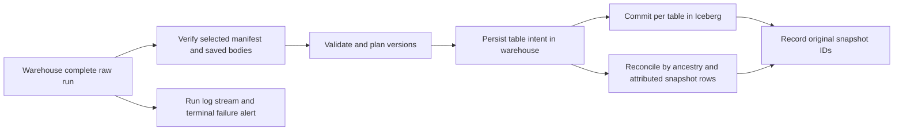

# Implementation contract

Cold start reads [ARCHITECTURE.md](ARCHITECTURE.md) before this file. That document is the agreed proposal and the architecture. Read it before writing or implementing any wave. This contract implements one wave of that document. A wave that contradicts `ARCHITECTURE.md` is wrong. The contract does not replace the proposal. A session that has not read `ARCHITECTURE.md` cannot continue.

Status: platform and ingest are merged and archived in `IMPLEMENTATION_CONTRACT_HISTORY.md`. Stage is the active wave. Its contract passed Architect readiness and awaits Lead acceptance.

## Invariants

These rules stay in force across waves. Where one conflicts with `ARCHITECTURE.md`, `ARCHITECTURE.md` wins.

- All work stays on this machine. No AWS account, no paid API, and no `git push` unless the user asks.
- The agreed ingest mode calls the public World Bank API. There is no API key. Saved responses are for tests and replay. The platform wave did not call that API. That closed-wave limit is not a ban on the agreed extract mode.
- Every AWS API call uses `https://127.0.0.1:9297` and the certificate the AWS Emulator writes for that port. `localhost` is not a substitute. The emulator certificate covers `127.0.0.1` and `localhost` only, and S3 must stay path-style on the IP.
- The apply environment unsets `AWS_ACCESS_KEY_ID`, `AWS_SECRET_ACCESS_KEY`, `AWS_SESSION_TOKEN`, and `AWS_PROFILE`, then points at `~/.aws/emulator/9297/emulator_credentials`, `config`, and `ca.pem`. It also sets `AWS_ENDPOINT_URL`, `AWS_CA_BUNDLE`, `AWS_EC2_METADATA_DISABLED=true`, `AWS_DISABLE_HOST_PREFIX_INJECTION=true`, and `AWS_REGION=us-east-1`.
- Terraform state, plans, `*.tfvars`, and `secrets/email.key` are gitignored. `secrets/alert_email.enc` may be committed. qa and prd tfvars are not created.
- No email address is invented. The alert recipient exists only after the user supplies ciphertext. The local Airflow web login is the fixture user `airflow` / `airflow` with email field `airflow@localhost`. That fixture is not the alert recipient and is not a person.
- Plaintext email, the key, and emulator credentials are never written into Terraform variables, the plan, the repo, or logs.
- dbt and the Iceberg spike run in Linux containers. dbt does not run on the Mac host. DuckDB is not installed on the Mac host.
- If the dbt 2.0.12 adapter fails, stop. Do not switch the image to dbt Core 1.x inside a wave. That pin is a contract change.

## Wave plan

| Wave | Type | Status | What it does |
|---|---|---|---|
| `platform` | feature | closed, archived | Local emulator stack, dev Terraform, spikes, and make targets. The spec is in `IMPLEMENTATION_CONTRACT_HISTORY.md`. |
| `ingest` | feature | closed, archived | Publish recoverable raw data and the selected attempt. |
| `stage` | feature | Architect readiness passed | Apply standalone Iceberg SCD2 and publish original snapshot IDs for the consumer. |

Later merge requests wait until the user reviews the previous one. Their order is in `ARCHITECTURE.md`. This file does not restate that design.

## Durable raw and control interfaces

- `meta.pipeline_run` in warehouse is the commit point. It is initialized by the ingest image. A completed extract selects its own `ingestion_id`, `raw_date`, `successful_attempt`. A completed replay selects its source extract using `source_ingestion_id`, and inherits the source coordinates and scope. Replay creates no raw S3 data of its own. Mode and scope are immutable for a run ID.
- Raw objects live in `lakehouse-raw`. The table names are `observation`, `country`, `indicator`, and `income_level`. Each stable `world-bank/{table}/date={raw_date}/ingestion_id={extract_id}/manifest.json` uses schema version 1. Fields are `format_version`, `table`, `ingestion_id`, `raw_date`, `successful_attempt`, `responses` (ordered entries with `key`, `sha256`, `source_url`, `api_page`, `raw_ingested_at`) and `record_keys` (ordered full keys). All artifacts are within the published `attempt={successful_attempt}/` prefix. Raw batches are JSON arrays of 1–100 flattened records. The archived ingest contract contains the complete example.
- Each record's raw provenance stays with its extract for its lifetime: `raw_response_key`, `raw_record_index` (zero-based), `response_sha256`, `raw_object_key`, `source_url`, `api_page`, `raw_ingested_at`, `ingestion_id`. Stage versions also carry their own `stage_run_id`, so replay can own the stage commit without rewriting source provenance.
- Warehouse stage fields already exist: `stage_status`, `stage_ingested_at`, `stage_snapshot_ids` and `stage_changed_count`. Only stage owns them. A later consumer reads only a complete row and the exact saved Iceberg snapshots, never today's head substituted for the saved IDs.

## Wave `stage` — Standalone Iceberg SCD2 and snapshot recovery

The stage image consumes one completed raw run by ID, validates its published input, commits changed versions to local Iceberg, and publishes the exact original snapshots in warehouse. The scope excludes DAG wiring, consumer, backfill orchestration, and curated output.

| ID | Working-deliverable blocking behavior | Implementation and direct evidence |
|---|---|---|
| STG-1 | Consume only the selected completed attempt and validate body-to-record lineage and supported values before writes. Corrupt input cannot modify Iceberg. | Raw reader and fixture rejection; ingest manifest and S3 tests credit the producer seam. |
| STG-2 | Compare canonical per-key state and preserve newer source confirmations, missing keys and nulls. Older replay or resume cannot regress current values. | Input normalization and SCD2 planner, unit and real fixture transitions. |
| STG-3 | Atomically close/insert per Iceberg table. Persist the exact snapshots, or no IDs for no change. Data and after-images remain readable by historical snapshot and use the agreed hidden partition and location. | Existing single-table spike credits runtime and operation types. Real integration asserts stage schema, location, snapshots and rows. |
| STG-4 | Reserve a stable run timestamp and table intent. After uncertain commit or interruption, recover that table's original snapshot IDs without adding a duplicate or attributing another run's commit. | Warehouse coordination and Iceberg ancestry/time-travel checks; exact after-commit interruption tests. |
| STG-5 | Package the one-shot job, keep cloud calls on the local emulator, and report failure with nonzero exit, run logs and the existing SNS topic. | Compose and existing pinned transports credit endpoint patterns. Unit safety checks and real job CloudWatch/SNS fixture. |

Scope sizing is five coupled behaviors with one stage entry point. Evidence-only platform files are `infra/terraform/{buckets,logs,topic,providers}.tf`, `infra/iceberg-rest/`, `compose.infra.yaml`, and the existing ingest source/tests. `spikes/iceberg/` proves the version, attach, SCD2 transaction, two REST-visible operations and rollback on the spike table. Separate capability discovery below establishes the new table and historical-read seam.



### Entry point, inputs, and freshness

- Add one-shot service/image `lakehouse-stage-world-bank` and `python -m world_bank_stage --ingestion-id <id>`. Use the existing ingest run-ID format. The job takes no public source URL and makes no World Bank requests. A missing/unready source, unsupported run mode, or corrupt storage fails visibly. Validate a replay against its completed extract row and require the source ID, raw destination coordinates and scope to agree. Already-complete stage invocations are idempotent. Confirm recorded snapshot IDs remain present in the catalog and fail visibly on missing committed artifacts.
- Validate all inputs for a pending write before changing any Iceberg data. Fetch version 1 manifests, ordered response and batch objects only by their validated keys. Validate manifest identity, fields, unique attempt-relative paths, contiguous listed pages per request against page metadata, actual SHA-256 for each saved body, 1–100 records per batch, and numeric/null observation values. Parse JSON preserving decimals. Require every listed record to match the source payload at its zero-based response index after removing exactly the eight reserved fields. Check all eight provenance values against the manifest, object key, source ID and response index. Every response record appears exactly once across batches. For replay the records still come from the saved body; the batch supplies their verified provenance.
- Build the business key from observation `countryiso3code`, `indicator.id`, and integer `date` (year), country `id`, indicator `id`, and income level `id`. Check observation, country and indicator keys against the run scope. Income levels are an unfiltered catalogue. Table-specific keys must be present and nonempty. Reject conflicting hashes for a key before any Iceberg write. For multiple identical canonical payloads of one key, choose the record with the greatest source ordering tuple.
- The source ordering tuple is parsed UTC `raw_ingested_at`, source `ingestion_id`, `raw_response_key`, `raw_record_index`. Compare per candidate key to the latest present record from successful extract rows (including raw-complete extracts that produced no stage version). Never consider a replay row distinct source data. A relevant source run can be skipped when its raw run timestamp is strictly earlier than the earliest candidate record timestamp, or its requested scope cannot contain any candidate key for that table. A more recent extract that omits the key is no confirmation, and a relevant unreadable selected source fails closed rather than authorizing a stale change. This bounded local proof scans published inputs in warehouse, with no separate coverage or lock table.
- Filter candidates whose source tuple is older than the latest successful raw record for the same key. Also skip a current row whose `valid_from` is greater than or equal to this run's reserved stage time, guarding a resumed older stage intent when a later run already committed that key. After those checks, open unseen keys at version 1, retain identical hashes unchanged, and close/reopen different hashes. Omitted keys never close. Compare stage current rows and reject multiple current versions for an affected key before writing.

### Iceberg storage and transaction

- In production attach DuckDB 2.0.1 as `ice` at `http://127.0.0.1:8181`, namespace `world_bank`. Create each missing Iceberg format-v2 table by the REST catalog at `s3://lakehouse-stage/world-bank/{table}`, with a hidden `day(stage_ingested_at)` partition on the timestamp column. Use the REST configuration's returned prefix if supplied. Validate existing table location, schema and default partition before writes. Create a table lazily for its first real append; unchanged existing tables get no data or metadata write. In test mode (`WORLD_BANK_STAGE_TEST_NAMESPACE`), the isolated Postgres database uses the same name as the test namespace. The test namespace is strictly constrained to `stage_test_<32 lowercase hex chars>` and its locations are `s3://lakehouse-stage/stage-tests/{namespace}/{table}`; it never writes production locations.
- Build immutable schema with stable Iceberg column IDs. Canonical `api_payload STRING` keeps all provider fields. `record_hash STRING` is SHA-256 over its UTF-8 bytes. Canonicalize recursively using sorted object keys, compact JSON, list order, null as JSON null, decimal form without exponent or trailing fractional zeros and normalized numeric zero. Use exact decimal parsing, never binary float. Canonicalize parseable ISO timestamps with explicit offsets to UTC, preserving date-only strings. Hash only original API fields, with no derived fields, timestamps added by ingest/stage, lineage or SCD2 metadata.
- Business columns: `observation(country_iso3 STRING, indicator_code STRING, year INT, value DECIMAL(38,18) nullable)`; `country(country_iso3 STRING, country_name STRING nullable, income_level_id STRING nullable)`; `indicator(indicator_code STRING, indicator_name STRING nullable)`; `income_level(income_level_id STRING, income_level_name STRING nullable)`. Names are the raw `name`, except income-level name is raw `value`. Country classification is raw `incomeLevel.id`. Require numeric values to be exactly representable in the pinned observation decimal type; reject rather than round out-of-range scale or precision.
- Common columns on all four tables after business columns: `api_payload STRING`, `record_hash STRING`, `raw_response_key STRING`, `raw_record_index INT`, `response_sha256 STRING`, `raw_object_key STRING`, `source_url STRING`, `api_page INT`, `raw_ingested_at TIMESTAMPTZ`, `ingestion_id STRING`, `stage_run_id STRING`, `stage_ingested_at TIMESTAMPTZ`, `version INT`, `valid_from TIMESTAMPTZ`, `valid_to TIMESTAMPTZ nullable`, `is_current BOOLEAN`. Key and common values are always populated except `valid_to` on current rows. Use the run's reserved time for the inserted row's `valid_from` and `stage_ingested_at`. Close rows only by setting `valid_to` to that time and `is_current=false`. Keep their historic lineage, stage time and version unchanged.
- Write only actual new/changed keys. In one DuckDB connection and transaction per table, update planned current rows by exact key and prior version, then insert every new version. Skip the UPDATE SQL for pure first inserts and skip all writing for an empty plan. One append snapshot is expected for pure insert. A correction has two snapshots: overwrite then append. Both snapshots are reachable in the live metadata chain, and the overwrite contains the closed after-images. Use DuckDB CLI with `-bail`, safe bound or escaped data, and no secret or query dumps on failure.
- Runtime capability discovery succeeded on pinned v2.0.1. The isolated REST format-v2 probe verified explicit location and hidden day partition on a timestamptz field; performed an exact decimal write, an update+insert correction and a later append; then read the original baseline, overwrite, and append via `iceberg_scan(metadata_location, snapshot_from_id = <id>)`. It observed the expected value, close, and null respectively and correct overwrite/append ancestry. The probe exited 0 and purged its test table. Use REST GET for metadata location and exact signed 64-bit snapshot/parent IDs; do not use SQL `FOR VERSION AS OF` with this pinned CLI.

### Warehouse publication and recovery

- Serialize standalone stage writers through a warehouse session advisory lock in a separate lock key space from ingest. Hold it from the first stage-state read to the last SQL update. A conflicting invocation exits nonzero without modifying the active run. Use transactions for individual manifest updates; there is no stage-specific Postgres table. Set `stage_status=pending` and reserve one UTC `stage_ingested_at` before any Iceberg mutation. For a new reservation use at least one microsecond after the greatest previous reservation under that lock. Retain the reserved timestamp on all retries. Populate a pending line for all four tables at reservation time. No changes to raw or later-layer fields.
- The `stage_snapshot_ids` JSON object maps the four table names to their durable state. Pending entry is `{"state":"pending","plan":null}` before preparation, or a plan object naming `parent` (decimal snapshot ID string or null), `closes` (list of original `{"key":[...],"version":int}`), and `appends` (list of `{"key":[...],"version":int,"hash":"sha256-lowercase-hex"}`). A key is the business-key tuple above as JSON primitives in that order (e.g. `["BRA","SP.POP.TOTL",2020]`). IDs are strings in JSON so consumers never round 64-bit Iceberg IDs. Example prepared entry:
  ```json
  {"state":"pending","plan":{"parent":"8161548230596231425","closes":[{"key":["BRA","SP.POP.TOTL",2020],"version":1}],"appends":[{"key":["BRA","SP.POP.TOTL",2020],"version":2,"hash":"74234e98afe7498fb5daf1f36ac2d78acc339464f950703b8c019892f982b90b"}]}}
  ```
- Process tables in the durable raw interface order above. For each affected table, persist its actual current head and exact change list in the prepared entry before any transaction writes application data. Recover all prior pending plans before replanning remaining work. A successful invocation and retry use the same verification to publish table IDs. Read authoritative live REST metadata and follow parent IDs from current head back to the recorded parent. A missing nonnull parent, an unexplained lineage conflict, or unavailable snapshots must fail closed. For the recorded plan, a pure insertion is the immediate append child. For a close+insert, require its immediate overwrite child and the overwrite's immediate append child. Later commits on the same branch are allowed; do not substitute their head.
- Positively attribute an append to this intent using its historical snapshot: the exact set of inserted rows tagged with the run's `stage_run_id` and reserved timestamp must match all planned keys, hashes and versions, and each must be current at that snapshot. For each planned close, verify the overwrite after-image of the exact key/version is marked closed with `valid_to` equal to this run's reservation. A partial attributable close, conflicting marker, or other ambiguous result fails closed without retrying mutations. If no attributable change happened and there is no conflicting marker, revalidate/recompute the remaining work against its new current head and latest raw inputs, then replace that table's plan before any writes. A completed table is never rerun or replaced.
- A complete table entry is `{"state":"complete","overwrite":<id string or null>,"append":<id string or null>,"changed_count":<nonnegative int>}`. For append-only, overwrite is null. For unchanged both are null and count is zero. Example corrected entry `{"state":"complete","overwrite":"4859385892680518385","append":"7652143244230041123","changed_count":1}`. Changed count is only appended new versions. After all four entries complete, atomically publish `stage_status=complete` and the sum as `stage_changed_count`. A later consumer reads only complete rows and these IDs. The original run's overwrite after-images remain pinned even when their stage day is earlier than the new append's partition.
- On failure persist `stage_status=failed` if the accepted run is still uncompleted and retain all prepared/completed table entries. On crash the pending lines suffice. Do not roll back an already committed Iceberg table, delete files or compensate with a new version. A repeated completed invocation verifies its committed IDs, performs no Iceberg mutation, and exits 0. The emulator's ephemeral object store can make past IDs unavailable after a reset. Fail visibly and do not reset persistent stage locations or Postgres metadata automatically.

### Runtime, observability, and file plan

- Reuse the platform's local endpoints and namespace sharing. Warehouse is `postgres:5432/warehouse`; REST is `http://127.0.0.1:8181`; all AWS S3/Logs/SNS calls use `https://127.0.0.1:9297`, the mounted emulator credential/CA, region `us-east-1`, TLS verification and path-style S3. No ambient AWS credentials, proxies, AWS fallback endpoints, or unsafe REST redirects. The tested DuckDB secret and attach settings are in `spikes/iceberg/scd2.sql`. Use the dev Terraform `WORLD_BANK_ALERT_TOPIC_ARN` input as in ingest. Keep reusable raw schema constants and the previously validated boto3 client constructor from the ingest package where feasible without changing ingest behavior.
- Log structured JSON in group `/world-bank/lakehouse-stage-world-bank`, stream = ingestion ID. All messages have `level`, `event`, and `ingestion_id`. Emit `stage_started`, `stage_table_committed`, `stage_table_recovered` or `stage_table_unchanged`, then `stage_completed` or `stage_already_complete` for success. Table messages carry table name and changed count, and IDs where available. Failures emit `stage_failed` at ERROR and publish safe JSON `ingestion_id`, `task_name=lakehouse-stage-world-bank`, and `error` to SNS; log `alert_published` with message ID on acknowledgement. Preserve original failure and nonzero status if reporting fails. No credential, row payload or email logging. Later DAG wiring owns prevention of duplicate notifications.
- CLI exits 2 for usage errors, 1 for accepted processing failures with safe JSON on stderr, and 0 for successful completion with terminal JSON on stdout. Fault injection is test-only and is permitted only with an isolated test namespace matching the contract. When `WORLD_BANK_STAGE_TEST_EXIT_AFTER_COMMIT` names a stage table, terminate with exit 75 immediately after that real Iceberg commit and before Postgres finalizes that table; this simulates an abruptly killed process without graceful failure reporting.

| Action | Path | Responsibility |
|---|---|---|
| Create | `images/stage-world-bank/Dockerfile` | Package Python runtime, merged ingest dependencies and the v2.0.1 CLI with preinstalled iceberg/httpfs. Use the same pinned CLI/extension build pattern as the spike. |
| Create | `images/stage-world-bank/world_bank_stage/__init__.py`, `images/stage-world-bank/world_bank_stage/__main__.py` | Command orchestration and safe terminal behavior. |
| Create | `images/stage-world-bank/world_bank_stage/input.py` | Raw artifact validation, source records, canonical payloads, keys and freshness. |
| Create | `images/stage-world-bank/world_bank_stage/scd2.py` | Pure per-key change planning and version/validity policy. |
| Create | `images/stage-world-bank/world_bank_stage/iceberg.py` | Schemas, catalog, DuckDB execution, snapshots and recovery attribution. |
| Create | `images/stage-world-bank/world_bank_stage/services.py` | Stage Postgres state and local reporting adapters; reuse ingest code where it exposes a neutral seam. |
| Create | `images/stage-world-bank/tests/test_unit.py`, `images/stage-world-bank/tests/test_integration.py` | Focused planning and CLI fixture tests. |
| Modify | `compose.jobs.yaml`, `Makefile`, `README.md` | Add one-shot stage job, aggregate suites, and document stage invocation/retry/log lookup. |

No deletes. Existing ingest package, spikes, Terraform, architecture, warehouse schema DDL, and DAG files stay evidence-only.

### Executable validation and review boundary

- Stage unit suite runs without a network. Check canonical equality across numeric formats and key ordering, exact decimal extremes and nulls, all four downstream keys, invalid batch/provenance/hash and duplicate-key conflicts, omit-vs-null-vs-update planning, older source confirmation, and later current version precedence. Give fake API transport no external URLs. Existing ingest tests continue to validate the raw publisher and emulator clients. Diagnostic stage coverage prints source gaps without a percentage threshold.
- Real integration runs the packaged CLI under Compose using the actual emulator, Iceberg REST, Postgres and DuckDB. Generate a UUID-based isolated namespace and a same-name test database on the local Postgres instance. Apply the unchanged ingest manifest DDL to that database. Only the guarded test mode can use this DB, its isolated Iceberg namespace/path, and the postcommit exit injection. Produce raw fixtures under unique extract IDs using the merged writer and complete SQL rows. The fixture runner publishes inputs in source-time order, except that deliberately delayed older stage executions are invoked later. Build each successful fixture from four API pairs with integer page metadata and exact JSON body bytes. Example observation body: `[{"page":1,"pages":1},[{"countryiso3code":"BRA","indicator":{"id":"SP.POP.TOTL"},"date":"2020","value":10},{"countryiso3code":"BRA","indicator":{"id":"SP.POP.TOTL"},"date":"2021","value":20}]]`. Companion fixture records are country `{"id":"BRA","name":"Brazil","incomeLevel":{"id":"UMC"}}`, indicator `{"id":"SP.POP.TOTL","name":"Population, total"}` and income level `{"id":"UMC","value":"Upper middle income"}`. Scope is BRA, that indicator and 2020–2021. Use real lineages, and construct replay SQL rows with their original extract coordinates.
- Exercise this order in the real fixture. Verify stage operation IDs and data independently through REST and historical DuckDB reads.
  1. Initial fixture above stages four append-only table entries, five changed versions, expected partition/location, original provenance, and current version 1 with open validity. A newly ingested identical confirmation makes no REST snapshot or S3 table object changes and records a completed count of zero. A same-ID stage repeat exits 0 with the previously recorded IDs and no new writes.
  2. Between initial load and its newer unchanged confirmation, publish an older raw extract containing 11 for 2020. Replay that older extract after the confirmation. Expect no version or snapshot, even though the current row's own lineage predates the older extract. The 2020 value stays 10.
  3. A fresh extract gives 2020 a JSON null and omits 2021. The 2020 pair is an overwrite plus append, closed version 1 and current version 2 with numeric-to-null transition. The omitted 2021 version remains open at 20. Verify close and open share the intended timestamp and have their correct historical lineages.
  4. After that transition, publish a source with 2020 value 25 and a different country name. Exit 75 at observation commit and read the observation pair from REST while SQL still holds its pending plan. Publish and stage a later source with 2020 value 30 and a newer country name. Resume the interrupted run. It must disclose the original pair by ID, add no observation snapshots, and keep the later 30 and later country name current. The original append snapshot reads version 3 at 25 (null-to-number), and the later current is version 4 at 30. Retrying again is a no-op.
  5. Publish a final selected extract whose raw record body or provenance is modified after publication. The CLI fails before Iceberg writes, with exit 1 and `stage_failed` on stderr. Verify SQL failure, unchanged Iceberg state, run failure in CloudWatch `FilterLogEvents`, and the logged SNS acknowledgement with nonempty message ID. Other real successes exit 0 with terminal stdout JSON and no failure event on stderr.
- Test teardown purges only the UUID-isolated Iceberg tables and namespace, test-owned raw objects, test database, and test log streams when supported. Do not alter service state or production tables/prefixes. An uncaught runtime or assertion error returns nonzero; no skipped live test is a passing full suite. The deliberately abrupt exit has no graceful failure event requirement.
- Exact prerequisites: `docker compose -f compose.infra.yaml up -d --wait aws-emulator postgres iceberg-rest`; `./scripts/emulator-env.sh terraform -chdir=infra/terraform init -input=false`; `./scripts/emulator-env.sh terraform -chdir=infra/terraform apply -input=false -auto-approve`. No email subscription is needed. Runtime validation then uses these commands:
  ```sh
  docker compose -f compose.infra.yaml -f compose.jobs.yaml config --quiet
  make test-unit
  make test
  make -n test-spike
  git diff --check
  ```
  Compose configuration and job build must succeed; `make test-unit` builds/runs both isolated unit suites and prints stage diagnostic coverage; `make test` includes both real fixture integrations; the spike dry-run confirms the existing target remains intact. The core focused invocation after build is `WORLD_BANK_ALERT_TOPIC_ARN="$(./scripts/emulator-env.sh terraform -chdir=infra/terraform output -raw topic_arn)" docker compose -f compose.infra.yaml -f compose.jobs.yaml run --rm --no-deps lakehouse-stage-world-bank --ingestion-id <completed-id>`. Document the analogous `aws logs filter-log-events` command via `scripts/emulator-env.sh`.
- Auditor scope is the single stage entry point and its tightly coupled validation, write and recovery contract (STG-1 to STG-5). Check independent fixture outcomes, exact historical IDs, isolated test cleanup, and AWS endpoint safety. No consumer, DAG, live World Bank call, real AWS call, runtime version substitution or additional proof layer is required.

### Contract readiness

The stage file plan and executable cases cover one standalone entry point. Existing ingest and platform checks receive partial credit, and the local capability probe resolves partition, location, decimal, correction ancestry and historical-read assumptions. The stage wave passes the Architect gate and is mechanically ready for implementation.
