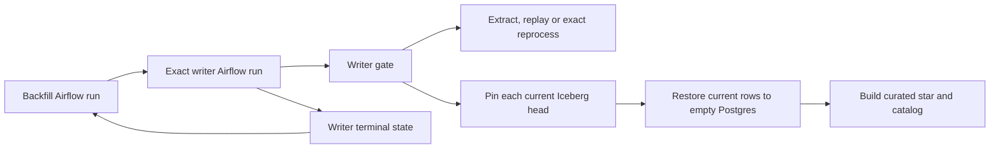

# Implementation contract

Cold start reads [ARCHITECTURE.md](ARCHITECTURE.md) before this file. That document is the agreed proposal and the architecture. Read it before writing or implementing any wave. This contract implements one wave of that document. A wave that contradicts `ARCHITECTURE.md` is wrong. The contract does not replace the proposal. A session that has not read `ARCHITECTURE.md` cannot continue.

Status: platform, ingest, stage, consumer, curated and the writer pipeline are merged and archived in `IMPLEMENTATION_CONTRACT_HISTORY.md`. Backfill is active. Both named tasks passed Architect readiness and await Lead acceptance.

## Invariants

These rules stay in force across waves. Where one conflicts with `ARCHITECTURE.md`, `ARCHITECTURE.md` wins.

- All work stays on this machine. No AWS account, no paid API, and no `git push` unless the user asks.
- The agreed ingest mode calls the public World Bank API. There is no API key. Saved responses are for tests and replay. The platform wave did not call that API. That closed-wave limit is not a ban on the agreed extract mode.
- Every AWS API call uses `https://127.0.0.1:9297` and the certificate the AWS Emulator writes for that port. `localhost` is not a substitute. The emulator certificate covers `127.0.0.1` and `localhost` only, and S3 must stay path-style on the IP.
- The apply environment unsets `AWS_ACCESS_KEY_ID`, `AWS_SECRET_ACCESS_KEY`, `AWS_SESSION_TOKEN`, and `AWS_PROFILE`, then points at `~/.aws/emulator/9297/emulator_credentials`, `config`, and `ca.pem`. It also sets `AWS_ENDPOINT_URL`, `AWS_CA_BUNDLE`, `AWS_EC2_METADATA_DISABLED=true`, `AWS_DISABLE_HOST_PREFIX_INJECTION=true`, and `AWS_REGION=us-east-1`.
- Terraform state, plans, `*.tfvars`, and `secrets/email.key` are gitignored. `secrets/alert_email.enc` may be committed. qa and prd tfvars are not created.
- No email address is invented. The alert recipient exists only after the user supplies ciphertext. The local Airflow web login is the fixture user `airflow` / `airflow` with email field `airflow@localhost`. That fixture is not the alert recipient and is not a person.
- Plaintext email, the key, and emulator credentials are never written into Terraform variables, the plan, the repo, or logs.
- dbt and the Iceberg spike run in Linux containers. dbt does not run on the Mac host. DuckDB is not installed on the Mac host.
- The approved local dbt runtime is Core 1.12.7 with dbt-postgres 1.11.0. Runtime and lineage scope changes require a user decision.

## Wave plan

| Wave | Type | Status | What it does |
|---|---|---|---|
| `platform` | feature | closed, archived | Local emulator stack, dev Terraform, spikes, and make targets. The spec is in `IMPLEMENTATION_CONTRACT_HISTORY.md`. |
| `ingest` | feature | closed, archived | Publish recoverable raw data and the selected attempt. |
| `stage` | feature | closed, archived | Apply Iceberg SCD2 and publish original snapshot IDs. |
| `consumer` | feature | closed, archived | Load exact completed stage commits into Postgres staging. |
| `test-suite-selection` | feature | closed, archived | Select one local test suite or run the full suite. |
| `curated` | feature | closed, archived | Merge current versions into the star and publish native model lineage and catalog. |
| `world_bank_pipeline` | feature | closed, archived | Orchestrate the four writer jobs and report Airflow results. |
| `world_bank_backfill` | feature | Architect readiness passed | Trigger the single writer and enable full-state rebuild into an empty warehouse. |

Later merge requests wait until the user reviews the previous one. Their order is in `ARCHITECTURE.md`. This file does not restate that design.

## Durable raw and control interfaces

- `meta.pipeline_run` in warehouse is the commit point. It is initialized by the ingest image. A completed extract selects its own `ingestion_id`, `raw_date`, `successful_attempt`. A completed replay selects its source extract using `source_ingestion_id`, and inherits the source coordinates and scope. Replay creates no raw S3 data of its own. Mode and scope are immutable for a run ID.
- Raw objects live in `lakehouse-raw`. The table names are `observation`, `country`, `indicator`, and `income_level`. Each stable `world-bank/{table}/date={raw_date}/ingestion_id={extract_id}/manifest.json` uses schema version 1. Fields are `format_version`, `table`, `ingestion_id`, `raw_date`, `successful_attempt`, `responses` (ordered entries with `key`, `sha256`, `source_url`, `api_page`, `raw_ingested_at`) and `record_keys` (ordered full keys). All artifacts are within the published `attempt={successful_attempt}/` prefix. Raw batches are JSON arrays of 1–100 flattened records. The archived ingest contract contains the complete example.
- Each record's raw provenance stays with its extract for its lifetime: `raw_response_key`, `raw_record_index` (zero-based), `response_sha256`, `raw_object_key`, `source_url`, `api_page`, `raw_ingested_at`, `ingestion_id`. Stage versions also carry their own `stage_run_id`, so replay can own the stage commit without rewriting source provenance.
- Warehouse stage fields already exist: `stage_status`, `stage_ingested_at`, `stage_snapshot_ids` and `stage_changed_count`. Only stage owns them. A later consumer reads only a complete row and the exact saved Iceberg snapshots, never today's head substituted for the saved IDs.

## Durable stage and consumer interfaces

- Stage owns four Iceberg format-v2 tables, `ice.world_bank.{observation,country,indicator,income_level}`, behind local REST at `http://127.0.0.1:8181`. Locations are `s3://lakehouse-stage/world-bank/{table}`, hidden-partitioned by UTC day of `stage_ingested_at`. The merged stage catalog adapter defines the ordered schema and stable Iceberg field IDs. Stage types are mirrored in Postgres staging; nullable observations retain exact `DECIMAL(38,18)` values.
- A run is consumable when its warehouse row is stage-complete. It carries a stable UTC `stage_ingested_at`, integer `stage_changed_count`, and `stage_snapshot_ids` with exactly four complete entries. Each entry is `{"state":"complete","overwrite":<decimal ID string or null>,"append":<decimal ID string or null>,"changed_count":<nonnegative integer>}`. For no change, both IDs are null. A pure insertion has append only. A correction uses an overwrite and its immediate append child. Sum of entry counts equals the run count. Counts represent appended versions, excluding closed after-images.
- The append snapshot associates new current rows using `stage_run_id`, `stage_ingested_at` and `valid_from`. The overwrite snapshot associates closed after-images using the source commit's `stage_ingested_at` as `valid_to`. A closed row retains its earlier `valid_from`, `stage_ingested_at`, `stage_run_id` and all original raw provenance. A replay's stage identity differs from its original raw `ingestion_id`.
- Query original IDs through DuckDB CLI 2.0.1 `iceberg_scan('<REST metadata-location>', snapshot_from_id = <id>)`, using the exact decimal integer. Stage proved this against retained snapshots after a later append. Warehouse consumers must never substitute current head when exact snapshots are requested, and must fail if they have become unavailable.

- Warehouse `stg.{observation,country,indicator,income_level}` carries complete operation rows from the producer contract. `consumer_run_id` is the load identity, `change_kind` is `append` or `close`, and `snapshot_id` is the exact Iceberg operation (Postgres bigint). Raw `ingestion_id` and `stage_run_id` remain their original identities, and `value` keeps all 38 digits and nulls. `meta.pipeline_run.consumer_status='complete'` publishes the load. A completed same-ID call performs no Iceberg or Postgres data rewrite. A distinct `reprocess_commit` row can load the same commit under its own identity.
- Curated uses current opened versions from completed loads, with `change_kind='append'` and `is_current=true` in the immutable staging load. A `close` row is historical evidence only. An older selected version or duplicate reprocess must not displace the latest version for a business key, and omission must not delete its retained fact.

## Durable curated interfaces

- `dbt-postgres --ingestion-id <id>` builds `curated.dim_income_level`, `curated.dim_country`, `curated.dim_indicator`, `curated.dim_year` and `curated.fact_indicator_year` from complete staging loads, using the latest append per business key. The archived curated contract defines exact columns and stable keys. PostgreSQL retains numeric decimals and source nulls; historical closures and omitted facts retain their prior meaning.
- Successful curated work marks only `curated_status=complete` after native `manifest.json` and `catalog.json` publish to `lakehouse-curated/world-bank/dbt_catalog/date={UTC stage day}/ingestion_id={invocation}/`. Curated reprocess uses its selected source's stage date and its own invocation ID. Future analytics/export owns `export_status`.
- `make test` runs all installed suites. `make test ingestion`, `stage`, `consumer`, and `curated` select their own full suite. `make test-unit` runs all installed offline suites. `make test-spike` retains local platform spikes.

## Durable writer interfaces

- `world_bank_pipeline` is the only writer DAG, with `max_active_runs=1`. Its normal task order is `gate -> ingest -> stage -> consumer -> curated`. `make run` triggers one exact writer run and reports that Airflow run's final state. The writer owns supervised SNS alerts and uses `/world-bank/airflow`. Standalone images retain their own alerts.
- Writer conf uses `ingestion_id`, `mode`, `source_ingestion_id`, the four extract scope fields (`countries`, `indicators`, `start_year`, `end_year`), and `abandon_previous`. The gate returns only the validated ingestion ID in XCom. Warehouse scope and mode are immutable across resume. `curated_status` is the writer success boundary until analytics/export, and `abandoned_at` plus `abandoned_by_ingestion_id` exclude a deliberately abandoned row from a new extract gate while retaining history.
- Extract selects its configured or narrowed API scope. Replay inherits a completed extract's saved raw attempt. Reprocess selects one completed stage commit, skips ingest/stage and writes a new consumer/curated load identity. Neither replay nor reprocess rewrites source provenance. The writer may verify completion and skip previously complete jobs on resume.

## Wave `world_bank_backfill` — Trigger-and-wait with full-state rebuild

This wave makes all four established modes available through a trigger-only backfill DAG. It adds the only missing writer path, current-state rebuild into an empty warehouse. Reporting views, reporting exports, extended DQ and demo are later waves. Two separately gateable task surfaces are direct writer rebuild, followed by the trigger-only parent and routing proof.

### Task `writer-rebuild` — Restore all current Iceberg rows into an empty warehouse

| ID | Working-deliverable blocking behavior | Direct evidence |
|---|---|---|
| RB-1 | Admit rebuild as a writer mode without ingest, stage mutations, or an extract scope override. Refuse populated staging or curated targets without deleting data. | Ledger/offline routing and real populated-target rejection. |
| RB-2 | Publish one rebuild load for all four current tables with fixed snapshot IDs, exact decimals and original lineage. A single historical delta cannot substitute for full state. | The existing pinned historical-scan reader and real multi-commit rebuild from empty target. |
| RB-3 | Build curated from the reconstructed load and retry cleanly after warehouse consumer completion. | Real failure at dbt, same-ID resume and artifact/state assertions. |

Credit existing consumer Iceberg exact scans, typed staging inserts, single-transaction publication, curated Core builds, writer queue and local Docker proofs. Only the current-state row selection and empty-target/pin boundaries are new. Source ownership stays in the same stage catalog and is read-only here. There is no new image or Terraform resource.

- Writer conf example `{"mode":"rebuild","ingestion_id":"warehouse-restore"}`. Reject country/indicator/year or abandonment overrides. An optional distinct `source_ingestion_id` identifies a stage-complete extract/replay as an audit anchor when its ledger is available. It never chooses an Iceberg snapshot or bounds the scan. A rebuild must work with a newly bootstrapped control ledger and no source ID. Store null request scope and retain existing immutable identity validation on resume. Include unfinished nonabandoned rebuilds in new-extract gate blockers. As for reprocess, raw/stage statuses stay pending and those two Docker tasks do not launch.
- The writer gate idempotently adds `rebuild_snapshot_ids jsonb` and `rebuild_pinned_at timestamptz` to `meta.pipeline_run` under its existing DDL lock. They belong to rebuild and remain null for the normal modes. Rebuild consumers may only run with a reserved rebuild row. Under the existing consumer advisory lock, verify all four canonical `stg` tables and five canonical `curated` tables are absent or empty prior to any initial load. Preserve unrelated relations and all control records. Never truncate, drop, or reset existing warehouse data. Guard subsequent unfinished consumer retries the same way; a completed same-ID consumer follows the existing no-op, so a failed dbt phase can resume on its loaded rows.
- For a first unfinished rebuild, acquire the existing stage writer advisory lock while reading the four current catalog heads and persist the agreed selection before staging replacement. Release the stage lock after a durable pin. The pin JSON has exactly four table keys and values positive signed-64-bit decimal ID strings or null. Null is allowed for a genuinely absent lazy-created table or a table with no snapshot. Example `{"observation":"8161548230596231425","country":"7652143244230041123","indicator":"4859385892680518385","income_level":null}`. The UTC pin timestamp and all IDs become immutable for the ingestion ID. Catalog/read errors fail visibly; never reinterpret them as empty. A retry reuses the pin, fails if a selected snapshot is unavailable, and never substitutes a newly advanced Iceberg head.
- Read all rows current at each selected snapshot through the proven fixed-ID DuckDB scan and explicit decimal projection. Validate required stage fields, exact allowed keys, and uniqueness of the current row per business key. A current row must have open validity; historical rows do not enter staging. Use normal `stg` types, original provider/raw/stage identities and timestamps, `change_kind='append'`, the exact selected snapshot ID, and the rebuild's `consumer_run_id`. A reconstructed current version number may be greater than 1 without a matching close because this is the full state. Reuse atomic four-table insertion and `consumer_status='complete'` publication; there is no raw, stage or Iceberg mutation.
- Curated accepts a rebuild invocation only with its consumer complete and valid persisted selection/timestamp. Use the existing star models and idempotent completion path. Use the UTC day of `rebuild_pinned_at` for the standard catalog prefix and the rebuild ingestion ID. Restore all current fact/dimension rows. `dim_year` retains the accepted requested ranges when old ledger rows exist and includes observed years when the ledger was new; expected-key calendar recovery is part of the later reporting scope. Do not invent an extract source from historical provenance.

#### Writer rebuild file and verification plan

| Action | Path | Responsibility |
|---|---|---|
| Modify | `dags/world_bank_pipeline_support/{gate,runtime}.py` | Validate and reserve rebuild, schema migration, dispatch only consumer/curated. |
| Modify | `images/consumer-postgres/world_bank_consumer/{__main__,services,snapshots}.py` | Empty-target guard, persistent pin and exact full-state read using existing staging. |
| Modify | `images/dbt-postgres/world_bank_curated/__main__.py` | Rebuild source/date handling, existing models and artifact publisher. |
| Modify | `images/consumer-postgres/tests/test_unit.py`, `tests/pipeline/test_unit.py`, `tests/pipeline/test_integration.py` | New mode and pin tests; real writer rebuild in the existing disposable fixture. |

Do not change staging DDL, stage writer, native models, or existing artifact format. Existing raw and stage files are read-only evidence.

- Offline tests validate mode overrides and immutable optional anchor, no ingest/stage for rebuild, pin validation/reuse across a changed head, historical rows excluded, duplicate current keys rejected, and a missing pinned snapshot failing closed. Use fake catalog responses equivalent to existing exact snapshot scans. Existing producer/read cases retain credit.
- In the private pipeline fixture, run direct `make run` with the rebuild JSON after at least two staged commits. Use BRA/one indicator with 2020 source null and 2021 corrected from 42 to 43. Before a rebuild, independently snapshot source table IDs and current rows for all four tables using the existing local stage catalog/reader. The test must demonstrate at least one restored current row untouched by the later correction. First assert failure on the populated target with unchanged data. Empty only the fixture's four staging and five curated data tables, leaving its separate stage catalog and upstream artifacts. Retry the same rebuild ID. Simulate a dbt write failure in the fixture using a PostgreSQL BEFORE INSERT trigger on its empty fact table. Assert the rebuild load is consumer-complete, contains full current rows with unchanged value/null, stage keys and provenance for all four tables, and curated is failed. Remove the trigger, resume that ID and assert success, same pin and staging, both native catalog files under the pinned UTC day, all expected curated rows, and unchanged source Iceberg heads.
- Execute `docker compose -f compose.infra.yaml -f compose.jobs.yaml build lakehouse-consumer-postgres dbt-postgres`, `make test consumer`, `make test pipeline`, and `git diff --check`. The selected real fixture must pass; affected image/runtime suites provide normal regression evidence. No additional whole-system stack needed.

### Task `backfill-trigger` — Forward validated scope and wait for the exact writer run

| ID | Working-deliverable blocking behavior | Direct evidence |
|---|---|---|
| BF-1 | Parent writes only Airflow metadata, launches one writer child with unchanged validated inputs, and safely reattaches when retried. | Exact Airflow metadata behavior, offline conflict/idempotence cases and one-child real fixture. |
| BF-2 | Parent respects writer serialization and reflects the exact child's outcome, including failure. | Held writer plus queued child, exact matching states, and ordinary failure propagation. |
| BF-3 | All four modes route through the parent and a narrowed extract does not change out-of-scope data. | Real fixture across extract, replay, exact reprocess and rebuild. |

Depends on `writer-rebuild` for the fourth mode. Credit the merged writer API, queue, local scheduler and real Docker fixtures, plus the confirmed Airflow 2.10.5 `trigger_dag`/`DagRun.find` signatures and `DagRunAlreadyExists` exception. The parent needs no Docker, warehouse, AWS, endpoint or app-image config.

- Define `world_bank_backfill` as an unscheduled manually triggered DAG, UTC, no catchup, `max_active_runs=1`, and one `trigger_and_wait` task without output XCom; Airflow writer gate still pushes only the ingestion ID. Keep writer max-active unchanged. Its reader/waiter uses a LocalExecutor slot, with the existing local executor concurrency leaving writer slots available.
- Accept the writer's conf object and known modes, including all extract narrowing and explicit abandonment fields supported by the gate. Validate basic shape and supplied ID, then let the writer perform durable scope, source and empty-warehouse checks. The same conf fields reach the writer, with an ingestion ID derived by the existing safe fallback from the deterministic child run ID when absent. Example: `{"mode":"extract","ingestion_id":"short-bra","countries":["BRA"],"indicators":["SP.POP.TOTL"],"start_year":2021,"end_year":2021}`. The rebuild, replay and reprocess examples use the exact writer modes and source rules above.
- Build the deterministic child ID as `manual__wbbackfill_` followed by the lowercase SHA-256 hex digest of the parent's UTF-8 Airflow run ID. Airflow 2.10.5 must assign the triggered child `run_type=manual` so its normal scheduler can run it. The reserved `backfill__` prefix classified the real fixture child as a CLI backfill run and left it queued after the active writer completed. Check for that exact writer run. If absent, use Airflow's bundled `airflow.api.common.trigger_dag.trigger_dag(dag_id="world_bank_pipeline", run_id=..., conf=..., replace_microseconds=False)`. A concurrent `DagRunAlreadyExists` may reattach only to the exact child with matching conf. Handle missing, conflicting or invalid runs as failures. A task retry/clear finds the same child without creating another. A distinct retriggered parent with the same explicit ingestion ID can resume a failed warehouse run through a new writer child.
- Poll the exact child with `DagRun.find(dag_id="world_bank_pipeline", run_id=[<child-id>])`, fresh Airflow sessions, bounded sleep and 1,800-second deadline. Check identity whenever accepting a result. Return a successful task only after the child is `success`; child `failed`, ambiguity, invalid config, missing child after trigger or timeout marks the parent task failed. No cancel or reissue on timeout. Log the child Airflow ID and ingestion ID before triggering, and include the exact child result in the local task log. The writer remains sole supervised failure publisher. The parent uses Airflow only and never invokes a warehouse, Docker, S3 or SNS client.
- Document triggering the parent through Airflow's existing UI or local authenticated REST with JSON examples for all four modes, exact child reference in parent task logs, same-ID resume, and the rebuild empty-target precondition. Keep `make run` as the direct writer command. Add `make test backfill`, the new offline target in `make test-unit`, and the combined suite in `make test`; preserve previous independent selectors.

#### Trigger-only file and verification plan

| Action | Path | Responsibility |
|---|---|---|
| Create | `dags/world_bank_backfill.py`, `dags/world_bank_pipeline_support/backfill.py` | Manual parent and Airflow-only trigger/wait. |
| Create | `tests/pipeline/test_backfill_unit.py`, `tests/pipeline/test_backfill_integration.py` | Exact child, queue, scope and four modes on actual scheduler. |
| Create / modify | `tests/pipeline/fixture.py`, `tests/pipeline/test_integration.py`, `tests/pipeline/fixture_services.py` | Reuse the existing disposable fixture setup across writer and parent. Extend fixture HTTP responses to respect requested date range without changing old full-range outcomes. |
| Modify | `Makefile`, `README.md` | Independent backfill testing and user-facing mode examples. |

No second Compose topology, extra Airflow dependency, or new service is needed. Keep the parent task's local execution log separate from child task failure alerting.

- Offline trigger cases exercise exact child query, deterministic same-parent retry and `DagRunAlreadyExists`, valid optional and explicit IDs, different-conf conflict, success/failure, timeout, stable mode forwarding and missing exact child. Use the existing pinned Airflow test image with no network.
- In the reused disposable pipeline fixture, seed both 2020 (SQL null) and 2021 (42). Hold a direct writer scoped to 2020 while triggering a backfill parent scoped to 2021. Observe a writer child with the exact deterministic ID and `run_type=manual` queued while another writer holds the active slot. Verify that the scheduler starts that same child after the active slot is released. Release with the correction response for 2021 value 43. Require exact parent and child success, just one child for the parent, and 2020 value, version and provenance untouched. Serve response page count based on requested years and preserve existing two-page full-scope success/failure cases.
- Trigger parent replay of a saved extract and parent reprocess of a completed stage commit. Verify the writer sees the exact modes/source IDs, replay allocates no new API attempt, reprocess launches no ingest or stage work, and both use distinct load identities without changing unrelated curated facts. Trigger parent rebuild once over the populated fixture, assert exact child failure and parent failure with data preserved, then truncate only fixture-owned data tables and resume the same rebuild ID in a new parent. Verify the new exact child succeeds and the complete current set is restored. The writer rebuild suite remains the detailed value/provenance and post-consumer retry witness.
- Execute `make test backfill`, `make test`, `make -n test pipeline`, `make -n test backfill`, `docker compose -f compose.infra.yaml -f compose.jobs.yaml config --quiet`, and `git diff --check`. The selected integration must exercise real child and parent Airflow states. A skipped fixture cannot satisfy acceptance. Reuse the local provisioned service pattern and clean up only the private project.

### Contract readiness

Both named tasks pass the Architect gate and are mechanically ready for Lead acceptance. Implement and validate `writer-rebuild` first, then `backfill-trigger`. The bounded review scopes are the full-state writer/data-safety path and the Airflow-only parent/exact outcome path.
