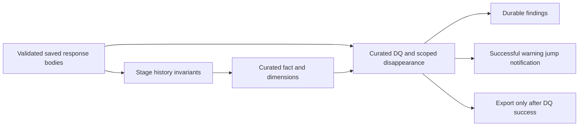

# Implementation contract

Cold start reads [ARCHITECTURE.md](ARCHITECTURE.md) before this file. That document is the agreed proposal and the architecture. Read it before writing or implementing any wave. This contract implements one wave of that document. A wave that contradicts `ARCHITECTURE.md` is wrong. The contract does not replace the proposal. A session that has not read `ARCHITECTURE.md` cannot continue.

Status: platform through analytic outputs are merged and archived in `IMPLEMENTATION_CONTRACT_HISTORY.md`. Data quality is active. Both named tasks passed Architect readiness and await Lead acceptance.

## Invariants

These rules stay in force across waves. Where one conflicts with `ARCHITECTURE.md`, `ARCHITECTURE.md` wins.

- All work stays on this machine. No AWS account, no paid API, and no `git push` unless the user asks.
- The agreed ingest mode calls the public World Bank API. There is no API key. Saved responses are for tests and replay. The platform wave did not call that API. That closed-wave limit is not a ban on the agreed extract mode.
- Every AWS API call uses `https://127.0.0.1:9297` and the certificate the AWS Emulator writes for that port. `localhost` is not a substitute. The emulator certificate covers `127.0.0.1` and `localhost` only, and S3 must stay path-style on the IP.
- The apply environment unsets `AWS_ACCESS_KEY_ID`, `AWS_SECRET_ACCESS_KEY`, `AWS_SESSION_TOKEN`, and `AWS_PROFILE`, then points at `~/.aws/emulator/9297/emulator_credentials`, `config`, and `ca.pem`. It also sets `AWS_ENDPOINT_URL`, `AWS_CA_BUNDLE`, `AWS_EC2_METADATA_DISABLED=true`, `AWS_DISABLE_HOST_PREFIX_INJECTION=true`, and `AWS_REGION=us-east-1`.
- Terraform state, plans, `*.tfvars`, and `secrets/email.key` are gitignored. `secrets/alert_email.enc` may be committed. qa and prd tfvars are not created.
- No email address is invented. The alert recipient exists only after the user supplies ciphertext. The local Airflow web login is the fixture user `airflow` / `airflow` with email field `airflow@localhost`. That fixture is not the alert recipient and is not a person.
- Plaintext email, the key, and emulator credentials are never written into Terraform variables, the plan, the repo, or logs.
- dbt and the Iceberg spike run in Linux containers. dbt does not run on the Mac host. DuckDB is not installed on the Mac host.
- The approved local dbt runtime is Core 1.12.7 with dbt-postgres 1.11.0. Runtime and lineage scope changes require a user decision.

## Wave plan

| Wave | Type | Status | What it does |
|---|---|---|---|
| `platform` | feature | closed, archived | Local emulator stack, dev Terraform, spikes, and make targets. The spec is in `IMPLEMENTATION_CONTRACT_HISTORY.md`. |
| `ingest` | feature | closed, archived | Publish recoverable raw data and the selected attempt. |
| `stage` | feature | closed, archived | Apply Iceberg SCD2 and publish original snapshot IDs. |
| `consumer` | feature | closed, archived | Load exact completed stage commits into Postgres staging. |
| `test-suite-selection` | feature | closed, archived | Select one local test suite or run the full suite. |
| `curated` | feature | closed, archived | Merge current versions into the star and publish native model lineage and catalog. |
| `world_bank_pipeline` | feature | closed, archived | Orchestrate the four writer jobs and report Airflow results. |
| `world_bank_backfill` | feature | closed, archived | Trigger the single writer and restore current Iceberg state. |
| `analytic-outputs` | feature | closed, archived | Query four reports and publish CSV/Parquet artifacts. |
| `data-quality` | feature | Architect readiness passed | Check stage history and curated metrics, persist scoped warnings, and gate export. |

Later merge requests wait until the user reviews the previous one. Their order is in `ARCHITECTURE.md`. This file does not restate that design.

## Durable raw and control interfaces

- `meta.pipeline_run` in warehouse is the commit point. It is initialized by the ingest image. A completed extract selects its own `ingestion_id`, `raw_date`, `successful_attempt`. A completed replay selects its source extract using `source_ingestion_id`, and inherits the source coordinates and scope. Replay creates no raw S3 data of its own. Mode and scope are immutable for a run ID.
- Raw objects live in `lakehouse-raw`. The table names are `observation`, `country`, `indicator`, and `income_level`. Each stable `world-bank/{table}/date={raw_date}/ingestion_id={extract_id}/manifest.json` uses schema version 1. Fields are `format_version`, `table`, `ingestion_id`, `raw_date`, `successful_attempt`, `responses` (ordered entries with `key`, `sha256`, `source_url`, `api_page`, `raw_ingested_at`) and `record_keys` (ordered full keys). All artifacts are within the published `attempt={successful_attempt}/` prefix. Raw batches are JSON arrays of 1–100 flattened records. The archived ingest contract contains the complete example.
- Each record's raw provenance stays with its extract for its lifetime: `raw_response_key`, `raw_record_index` (zero-based), `response_sha256`, `raw_object_key`, `source_url`, `api_page`, `raw_ingested_at`, `ingestion_id`. Stage versions also carry their own `stage_run_id`, so replay can own the stage commit without rewriting source provenance.
- Warehouse stage fields already exist: `stage_status`, `stage_ingested_at`, `stage_snapshot_ids` and `stage_changed_count`. Only stage owns them. A later consumer reads only a complete row and the exact saved Iceberg snapshots, never today's head substituted for the saved IDs.

## Durable stage and consumer interfaces

- Stage owns four Iceberg format-v2 tables, `ice.world_bank.{observation,country,indicator,income_level}`, behind local REST at `http://127.0.0.1:8181`. Locations are `s3://lakehouse-stage/world-bank/{table}`, hidden-partitioned by UTC day of `stage_ingested_at`. The merged stage catalog adapter defines the ordered schema and stable Iceberg field IDs. Stage types are mirrored in Postgres staging; nullable observations retain exact `DECIMAL(38,18)` values.
- A run is consumable when its warehouse row is stage-complete. It carries a stable UTC `stage_ingested_at`, integer `stage_changed_count`, and `stage_snapshot_ids` with exactly four complete entries. Each entry is `{"state":"complete","overwrite":<decimal ID string or null>,"append":<decimal ID string or null>,"changed_count":<nonnegative integer>}`. For no change, both IDs are null. A pure insertion has append only. A correction uses an overwrite and its immediate append child. Sum of entry counts equals the run count. Counts represent appended versions, excluding closed after-images.
- The append snapshot associates new current rows using `stage_run_id`, `stage_ingested_at` and `valid_from`. The overwrite snapshot associates closed after-images using the source commit's `stage_ingested_at` as `valid_to`. A closed row retains its earlier `valid_from`, `stage_ingested_at`, `stage_run_id` and all original raw provenance. A replay's stage identity differs from its original raw `ingestion_id`.
- Query original IDs through DuckDB CLI 2.0.1 `iceberg_scan('<REST metadata-location>', snapshot_from_id = <id>)`, using the exact decimal integer. Stage proved this against retained snapshots after a later append. Warehouse consumers must never substitute current head when exact snapshots are requested, and must fail if they have become unavailable.

- Warehouse `stg.{observation,country,indicator,income_level}` carries complete operation rows from the producer contract. `consumer_run_id` is the load identity, `change_kind` is `append` or `close`, and `snapshot_id` is the exact Iceberg operation (Postgres bigint). Raw `ingestion_id` and `stage_run_id` remain their original identities, and `value` keeps all 38 digits and nulls. `meta.pipeline_run.consumer_status='complete'` publishes the load. A completed same-ID call performs no Iceberg or Postgres data rewrite. A distinct `reprocess_commit` row can load the same commit under its own identity.
- Curated uses current opened versions from completed loads, with `change_kind='append'` and `is_current=true` in the immutable staging load. A `close` row is historical evidence only. An older selected version or duplicate reprocess must not displace the latest version for a business key, and omission must not delete its retained fact.

## Durable curated interfaces

- `dbt-postgres --ingestion-id <id>` builds `curated.dim_income_level`, `curated.dim_country`, `curated.dim_indicator`, `curated.dim_year` and `curated.fact_indicator_year` from complete staging loads, using the latest append per business key. The archived curated contract defines exact columns and stable keys. PostgreSQL retains numeric decimals and source nulls; historical closures and omitted facts retain their prior meaning.
- Successful curated work marks only `curated_status=complete` after native `manifest.json` and `catalog.json` publish to `lakehouse-curated/world-bank/dbt_catalog/date={UTC stage day}/ingestion_id={invocation}/`. Curated reprocess uses its selected source's stage date and its own invocation ID. Future analytics/export owns `export_status`.
- `make test` runs all installed suites. `make test ingestion`, `stage`, `consumer`, and `curated` select their own full suite. `make test-unit` runs all installed offline suites. `make test-spike` retains local platform spikes.

## Durable writer interfaces

- `world_bank_pipeline` is the only writer DAG, with `max_active_runs=1`. Its normal task order is `gate -> ingest -> stage -> consumer -> curated`. `make run` triggers one exact writer run and reports that Airflow run's final state. The writer owns supervised SNS alerts and uses `/world-bank/airflow`. Standalone images retain their own alerts.
- Writer conf uses `ingestion_id`, `mode`, `source_ingestion_id`, the four extract scope fields (`countries`, `indicators`, `start_year`, `end_year`), and `abandon_previous`. The gate returns only the validated ingestion ID in XCom. Warehouse scope and mode are immutable across resume. `curated_status` is the writer success boundary until analytics/export, and `abandoned_at` plus `abandoned_by_ingestion_id` exclude a deliberately abandoned row from a new extract gate while retaining history.
- Extract selects its configured or narrowed API scope. Replay inherits a completed extract's saved raw attempt. Reprocess selects one completed stage commit, skips ingest/stage and writes a new consumer/curated load identity. Neither replay nor reprocess rewrites source provenance. The writer may verify completion and skip previously complete jobs on resume.

## Durable backfill interfaces

- The trigger-only `world_bank_backfill` DAG launches one exact manual child of the writer and waits for its final Airflow state. It has no warehouse, Docker or cloud writes. One writer `max_active_runs=1` applies to that child as to scheduled/manual writer runs.
- Rebuild restores all four current Iceberg tables into absent/empty staging and curated data relations. Its ledger pins `rebuild_snapshot_ids` and UTC `rebuild_pinned_at`; raw/stage work stays excluded and curated uses the pinned day for its run artifact path. Exact reprocess has a distinct load ID and the selected completed stage source's date.

## Durable reporting interfaces

- `meta.expected_key` is the full current configuration country × indicator grid for represented warehouse years. It serves reporting coverage and never determines a narrowed extract's disappearance scope.
- `meta.dq_result` has `ingestion_id text`, `check_name text`, `severity text`, `business_key jsonb`, `message text`, and `detected_at timestamptz`, all nonnull and primary key `(ingestion_id,check_name,business_key)`. Reporting recognizes `observation_disappeared` at severity `warning`, with canonical `{"country_iso3":"BRA","indicator_code":"SP.POP.TOTL","year":2021}` (string, string, integer). It chooses the latest raw-complete actual extract whose immutable scope contains that key, ordered by `raw_ingested_at` and ID descending. Retained facts, including nulls, stay in place. Replay, reprocess and rebuild do not advance this extract selection.
- The writer publishes reporting CSV and Parquet for the four curated views to `lakehouse-curated/world-bank/reporting/date={day}/ingestion_id={run}/` and mirrors the CSVs to the configured host `exports/`. `export_status='complete'` follows all file writes. Existing `export_required` makes an unfinished new writer export block further extracts and keeps legacy pre-export completions usable. The archived analytics contract defines the view schemas and column precedence.

## Wave `data-quality` — Validate history and publish scoped findings before export

Keep the existing raw, stage and dbt guards and add the runtime stage-history gap and final curated DQ. Data checks must leave task failure visible, while scoped disappearance findings and successful warning jumps allow export. No production note, live World Bank run or clean-checkout demo is required in this wave.

### Task `stage-history-quality` — Reject invalid SCD2 history

| ID | Working-deliverable blocking behavior | Direct evidence |
|---|---|---|
| HIST-1 | Reject multiple/no current version, malformed or overlapping validity, duplicate versions, or an adjacent unchanged hash before declaring stage complete. | Pure cases plus actual malformed Iceberg history rejected by the packaged stage job. |
| HIST-2 | Preserve valid correction, no-op behavior and exact snapshot recovery. | Existing stage fixture plus unchanged real assertions after adding the gate. |

Credit the merged ingest paginator and stage raw reader for all requested pages, selected attempt, SHA-256, and exact lineage/index validation, plus one candidate hash per business key. Credit the existing stage planner for no-op and its real fixture for proven close/append and recovery. There is no separate analyzer or repeated raw pipeline.

- Inspect full table rows, including historical versions, under the existing stage writer lock on unfinished runs. Reject before planning/mutating if any existing loaded table violates history. Require one current open version per key, positive unique versions ordered with strictly increasing validity starts, positive closed intervals, and no overlap. Adjacent intervals ending/starting at the same instant are valid. Historical rows are closed and current rows have null `valid_to`. Adjacent versions may not repeat the same record hash. A return to a previous hash after an intervening different record remains allowed.
- Use the live Iceberg table/current metadata and existing pinned snapshot lineage. After the existing write/recovery checks, validate resulting current table histories before final stage completion. A history failure follows existing stage error/status/SNS behavior and prevents downstream work. Preserve prepared and committed Iceberg evidence on failure. Already-complete jobs keep their published fast-path behavior.
- Modify only `images/stage-world-bank/world_bank_stage/{scd2,__main__}.py` and `images/stage-world-bank/tests/{test_unit,test_integration}.py`. Exercise all pure invalid categories and valid touching intervals. Extend the existing isolated Iceberg integration with an injected overlapping historical row (distinct version, one current retained), then a fresh valid source request. The actual stage CLI exits nonzero, keeps the corrupted test head unchanged, writes no new attempt snapshots, records stage failure, and logs/alerts through the existing reporter. Run `make test stage` and `git diff --check`. Prior successful stage checks remain accepted and run through the normal suite.

### Task `curated-dq` — Check numeric quality and write scoped warnings before export

| ID | Working-deliverable blocking behavior | Direct evidence |
|---|---|---|
| DQ-1 | Nonpositive population or an inconsistent coherent GDP/population/per-capita trio fails before export. | Decimal edge checks and real writer failed-run/resume. |
| DQ-2 | Only previously present, actually omitted in-scope observation keys get findings. Retained data, unchanged values, explicit nulls and unrelated keys remain correct. | Actual successful raw manifests, real fact, report and CSV observations. |
| DQ-3 | An increase above the configured comparable warning baseline produces one acknowledged local SNS warning per completed run. | Real comparable-scope fixture, stored ack and retry evidence. |
| DQ-4 | The writer gates export on quality, preserves upstream completion and legacy success, and exposes real suite entry points. | Exact Airflow task/DagRun states, legacy and resume cases. |

Credit dbt's existing real grain, uniqueness, relationship and lineage tests. Credit existing raw/curated preservation, local SDK security, standalone/supervised failure notification, and the report-view fixed warning semantics. The new curated command packages the already validated raw reader to use actual receipt evidence rather than reproducing it.

#### Quality rules and scope

- Extend `config/pipeline.yml` with `data_quality.gdp_per_capita.absolute_usd: "1"`, `data_quality.gdp_per_capita.relative_fraction: "0.01"`, and `data_quality.disappearance_jump_threshold: 1`. Validate fixed-point finite nonnegative decimal text or exact whole integers for tolerances, and a nonnegative integer for jump. These local defaults allow one USD or one percent, whichever is larger, and notify on at least two additional disappearing observations over a comparable baseline. Do not hardcode thresholds in runtime logic.
- Resolve facts against the existing business keys through the dimension joins. Every present numerical population `SP.POP.TOTL` must be strictly positive. Null population is permitted. Compare `NY.GDP.MKTP.CD / SP.POP.TOTL` to `NY.GDP.PCAP.CD` for a country-year when all three curated values are finite and numeric, population is positive, and a common source vintage is established. A common raw `ingestion_id` on all three retained facts qualifies. For an extract, all three values returned by its validated raw attempt may also qualify when each exactly equals its retained curated value, including unchanged observations without new fact lineage. Mere raw presence does not establish equality. Mixed vintages without confirmation do not form a consistency error; record checked/skipped counts in run diagnostics. Exact decimal/SQL numeric calculation fails only if `abs(reported - calculated) > max(absolute_usd, relative_fraction * abs(calculated))`. Equality at the limit is allowed. Null or missing components never become zero. These rules protect scoped backfills from false failure when an unrequested or omitted component legitimately retains an older value.
- On every mode run the present-population and eligible GDP checks. Write hard findings at severity `error`, check names `population_positive` or `gdp_per_capita_consistency`, keyed by canonical country/indicator/year JSON, with readable economic diagnostic text. Restore/retained PostgreSQL numeric corruption (nonfinite values) fails visibly; normal ingest and stage already disallow it.
- Only actual `extract` creates disappearance findings. Require a complete selected raw attempt and validate it with the existing stage reader `read_extract`, reused in the dbt image. Read its unfiltered returned observation key set, including source nulls and unchanged values. Any selected-manifest damage or incomplete raw data fails closed. Never infer absence from mandatory metrics, stage changed counts, staged writes, or fact nullness.
- Candidates are existing curated fact keys inside all three immutable request scope dimensions, with evidence they were received earlier than this extract. Use retained fact provenance and earlier staged append provenance from completed consumer loads if a newer fact replaced it before an old run resumed. Compare source extract order `(raw_ingested_at, ingestion_id)` to the current raw-complete extract and use preserved raw record time when a reconstructed row has no source ledger. Require an earlier raw ingestion ID. For a candidate not among this response's validated keys, create one `observation_disappeared` warning with the reporting JSON key. Existing fact values remain untouched, including retained nulls. Never-returned keys and keys outside stored scope receive no disappearance finding. Replay, reprocess and rebuild produce no disappearance rows and do not publish jump alerts.
- For a successful extract compare the current warning count to the most recent earlier raw-complete, DQ-complete actual extract with the same country and indicator sets and same start/end years. Baselines use source chronology rather than curated or retry time. A missing comparable baseline yields no jump. Publish one warning if `current_count - prior_count > disappearance_jump_threshold`. Also store one severity `warning` row with check `observation_disappearance_jump` and `business_key={}`, with prior ID, counts, increase and threshold in its message. The SNS JSON carries `ingestion_id`, `task_name=data_quality`, `event=observation_disappearance_jump`, `baseline_ingestion_id`, the two counts, increase and threshold. Use the existing local topic. A successful warning alert does not fail the task.

#### Ledger, ordering and retries

- Add a `python -m world_bank_dq --ingestion-id <id>` entry point to existing `dbt-postgres`. Reuse its warehouse curated/consumer locks, local credentials, SNS and CloudWatch reporter. Check only curated-complete invocations. Read the active snapshot consistently before computing findings. Keep the already-complete same-ID path read-only. Package the existing raw validator and shared analytics metadata DDL. Move the DQ table DDL into a shared SQL section/file that both analytics and DQ apply idempotently with the existing schema. Views, DQ schema and data remain compatible.
- The DQ adapter initializes `meta.pipeline_run.dq_status text NOT NULL DEFAULT 'pending'` with allowed pending/failed/complete values and nullable `dq_jump_message_id text` using idempotent warehouse DDL with the shared lock. Replace only this run's owned DQ check rows in one transaction, maintaining a retry-safe primary key and leaving any unrelated checks intact. Preserve all earlier layer statuses. A hard finding persists its diagnostics, sets DQ failed, returns nonzero, and emits a normal task-failure signal. Successful quality with no jump completes directly. Hard failure has precedence over successful-run jump publication.
- Persist computed findings before trying the jump notification. After an acknowledged SNS publish, commit its MessageId and completion together. A caught publish failure leaves the run incomplete/failed for retry, with findings retained; confirmed deliveries stored in the ledger are never republished. An external acknowledgement followed by a process loss before PostgreSQL stores it can be retried at least once. Do not claim distributed exactly-once delivery. Log successful `dq_disappearance_jump_published` with the acknowledged ID. Use ordinary `dq_failed` reporting for processing errors; during supervised execution Airflow keeps sole failure SNS ownership while DQ owns the nonfailure jump notification.
- Insert a writer `dq` task with success dependencies `curated -> dq -> export`; no task output XCom and no successful cleanup masking failure. Docker launch is the normal `dbt-postgres` image with fixed list-form DQ entrypoint. Require `dq_status='complete'` before unfinished writer exports. Treat an already-exported older row with absent/pending DQ status as an already-published legacy run, so a retry does not mutate historical exports. The existing export-required blocker gates incomplete new quality/export runs. A same-ID retry may rerun failed DQ and pending export while all completed upstream jobs stay untouched. Standalone analytics fixture/export semantics remain available as before. `make run` and backfill use the actual writer result.

#### Curated DQ file plan and executable acceptance

| Action | Path | Responsibility |
|---|---|---|
| Modify | `config/pipeline.yml`, `images/dbt-postgres/Dockerfile` | Decimal thresholds and packaging for the DQ CLI, validated stage raw reader and DQ tests. |
| Create | `images/dbt-postgres/world_bank_dq/{__init__,__main__,checks,services}.py` | Run state, Decimal/natural-key checks, comparable baseline and warning/error publishing. |
| Create / modify | `images/dbt-postgres/world_bank_analytics/{meta.sql,reporting.sql,views.py}` | Share the preserved metadata schema so DQ can record findings before any export. Do not change report calculations. |
| Modify | `dags/world_bank_pipeline.py`, `dags/world_bank_pipeline_support/runtime.py` | DQ image dispatch and success prerequisite, preserve old completed flows. |
| Create | `images/dbt-postgres/dq_tests/test_unit.py`, `tests/pipeline/test_dq_integration.py` | Focused offline arithmetic/scope and real writer, warning and retry evidence. |
| Modify | `tests/pipeline/{fixture_services,test_integration}.py`, `Makefile`, `README.md` | Legal saved responses for DQ, existing fixture ordering regressions, selector and usage. |

No new images, cloud endpoints, exclusive infrastructure services or test stack. Existing warehouse, reporting exporter, types and DQ key remain in use. Add `make test dq`; aggregate and offline suite targets include the DQ suite. Earlier selectors remain separate.

- Offline tests prove tolerance boundaries, validated exact confirmation of a common vintage, invalid/nonpositive/nullable population, scope filtering and prior evidence on an old resumed extract, actual presence of unchanged and explicit null records, identical-set baseline, strict jump threshold with no baseline, and retry retaining confirmed acknowledgement. Test a corrupt selected attempt follows the existing raw reader's error path instead of computing omissions. Reuse proven archived early layer checks and avoid duplicating body-verification tests.
- Use the existing disposable `PrivatePipeline` Compose fixture and its loopback API. Extend its controlled saved response modes to accept the exact requested country set/year range and GDP/population/per-capita indicators, retaining previous fixture behavior. For an initial BRA/CAN 2020–2021 seed use positive population, GDP and per capita triples such as 100, 1000, 10, with one explicit BRA 2020 population null. Leave a configured third country without an observation. A BRA-only baseline requests the same three indicators and both years, returns these same values and has zero warnings even with zero staged appends.
- For the next same-scope BRA extract return the unchanged population rows including explicit null, and omit precisely GDP and GDP per capita for BRA 2021. The source must still give valid pages and preserved indicator metadata. Expect only those two disappearance-key rows, a baseline count 0 and increase 2 above threshold 1, successful DQ and export, one confirmed jump SNS MessageId, and a successful exact Airflow run. Assert no CAN findings, retained fact values and provenance, the `MISSING_FROM_LATEST_EXTRACT` view/export for the two keys, `SOURCE_NULL` for the retained explicit null and `NEVER_RETURNED` for a never-present configured key. A same-ID retry keeps finding and SNS acknowledgement unique. A later extract with the same scope returns the omitted original values and clears the published flags without requiring fresh stage versions. A differently scoped run does not form a jump baseline.
- Separately demonstrate the real numeric gate after curated completion. Use a valid fresh source with changed values sharing one vintage, e.g. Brazil 2021 120 population, 1320 GDP and 11 per capita, and a positive Brazil 2020 population. In the private database, arrange a fixture-only trigger during curated fact writes to substitute zero for the 2020 population and an out-of-tolerance 2021 per-capita value. Verify the exact writer fails in DQ with persisted error rows and SNS failure, no export from that run, and all upstream statuses complete. Remove the fixture trigger and restore the correct curated values in the private database. Same-ID resume executes DQ then export only, clears the owned errors, and completes without a new raw attempt, stage commit or curated start. This controlled warehouse repair is test setup, not a supplied production data fix workflow.
- Run `docker compose -f compose.infra.yaml -f compose.jobs.yaml build lakehouse-stage-world-bank dbt-postgres`, `make test dq`, `make test pipeline`, `make test analytics`, `make test`, Compose configuration validation, selector dry-runs and `git diff --check`. Assert exact Airflow terminal states, failure acknowledgement, and no DQ output XCom. Clean up only the private fixture, its DB and emulator volumes. The real DQ suite must execute; earlier suites supply normal shared entry-point regression evidence.

### Contract readiness

Both named tasks pass the Architect gate and are mechanically ready for Lead acceptance. Implement `stage-history-quality` first, then `curated-dq`. The historical Iceberg invariants and curated workflow are independently bounded review scopes. Existing local readers, Docker entrypoints, SNS and PostgreSQL fixtures establish the runtime mechanisms. The new fixtures check history faults and actual end-to-end findings, numeric failure, resume and export.
