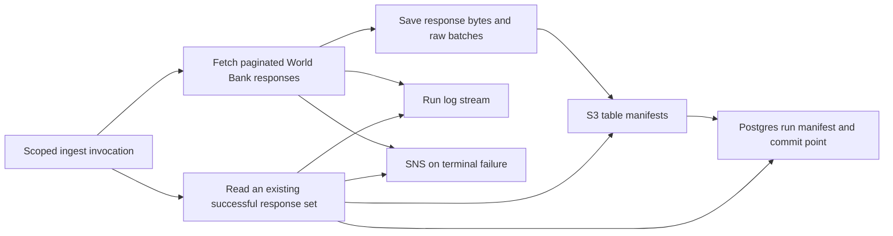

# Implementation contract history

Completed wave specs. The live contract is `IMPLEMENTATION_CONTRACT.md`. The agreed proposal is `ARCHITECTURE.md`. Read that document before using anything below. Where a rule in this archive conflicts with `ARCHITECTURE.md`, the architecture wins. The platform wave did not call the public World Bank API. That closed-wave limit is not a ban on the agreed ingest extract mode. Saved responses are for tests and replay.

## Wave `platform`

Closed. Merged. Archived here when ingest became the next wave. The text below is the spec this wave was built from. It is not the active wave.

Status at archive: the wave had been ready for the machinist, then completed. Wave `platform` is not active.

`make test` prints `test suites are not in this MR` and exits 0. `make test-spike` runs the Iceberg and dbt spikes, including the stale `spike.scd2_probe` repair. The file plan is unchanged. Edit `Makefile` and `README.md` only.

This file is the platform wave only. Later merge requests are boundaries in the next section. They are not files to create in this wave.

## Invariants

- All work stays on this machine. No AWS account, no paid API, no `git push`, no call to `api.worldbank.org`.
- Every AWS API call uses `https://127.0.0.1:9297` and the certificate the AWS Emulator writes for that port. `localhost` is not a substitute. The emulator certificate covers `127.0.0.1` and `localhost` only, and S3 must stay path-style on the IP.
- The apply environment unsets `AWS_ACCESS_KEY_ID`, `AWS_SECRET_ACCESS_KEY`, `AWS_SESSION_TOKEN`, and `AWS_PROFILE`, then points at `~/.aws/emulator/9297/emulator_credentials`, `config`, and `ca.pem`. It also sets `AWS_ENDPOINT_URL`, `AWS_CA_BUNDLE`, `AWS_EC2_METADATA_DISABLED=true`, `AWS_DISABLE_HOST_PREFIX_INJECTION=true`, and `AWS_REGION=us-east-1`.
- Terraform state, plans, `*.tfvars`, and `secrets/email.key` are gitignored. `secrets/alert_email.enc` may be committed. qa and prd tfvars are not created.
- No email address is invented. The alert recipient exists only after the user supplies ciphertext. The local Airflow web login is the fixture user `airflow` / `airflow` with email field `airflow@localhost`. That fixture is not the alert recipient and is not a person.
- Plaintext email, the key, and emulator credentials are never written into Terraform variables, the plan, the repo, or logs.
- dbt and the Iceberg spike run in Linux containers. dbt does not run on the Mac host. DuckDB is not installed on the Mac host.
- If the dbt 2.0.12 spike fails, stop. Do not switch the image to dbt Core 1.x inside this wave. That pin is a contract change.

## Wave plan

| Wave | Type | Status | What it does |
|---|---|---|---|
| `platform` | feature | closed | Local emulator, Postgres, Iceberg REST, Airflow with no DAGs, dev Terraform, `dbt-postgres` image, two spikes, `make platform`, `make test`, `make test-spike`, `make down` |

Later merge requests are not waves in this file and have no file plans. Their order is ingest, stage, consumer, curated star, `world_bank_pipeline`, `world_bank_backfill`, analytic outputs, data quality, production note. Each waits until the user reviews the previous one. The production-note MR is the one that documents `make demo` as the clean-checkout command.

## Boundaries later MRs must keep

Raw layout. HTTP bodies under `responses/` and batches of at most 100 records under `records/`, with attempt prefixes. `API_PAGE_SIZE` is 50. `RAW_BATCH_SIZE` is 100. These provenance columns travel through stage, `stg`, and the fact: `raw_response_key`, `raw_record_index`, `response_sha256`, `raw_object_key`, `source_url`, `api_page`, `raw_ingested_at`, `ingestion_id`.

Stage. DuckDB 2.0 Iceberg SCD2 on `s3://lakehouse-stage/world-bank/{table}`, hidden-partitioned by `day(stage_ingested_at)`. `record_hash` is canonical API fields only. Merge-on-read close plus insert run in one SQL transaction. DuckDB 2.0.1 commits that pair as two snapshots, an overwrite and then an append. The pair is not one snapshot. Absent keys keep the current version. The platform spike uses namespace `spike` and must not create `world-bank` tables.

Writer. One DAG, `world_bank_pipeline`, `max_active_runs=1`. `world_bank_backfill` only triggers it. Modes later: `extract`, `replay`, `reprocess_commit`, `rebuild`. No `meta.pipeline_lock`. No `meta.observation_coverage`.

Manifest. `meta.pipeline_run` is the manifest. XCom carries `ingestion_id` only. Recovery stores both snapshot ids from each SCD2 close and insert: the overwrite snapshot and the following append snapshot. Request scope is country, indicator, and year.

Data quality. `meta.dq_result` stores `ingestion_id`, `check_name`, `severity`, `business_key`, `message`, `detected_at`. Missing-view reasons are `NEVER_RETURNED`, `SOURCE_NULL`, and `MISSING_FROM_LATEST_EXTRACT`. The third keeps the fact value. The check is scoped to the country, indicator, and year the run requested. A key omitted from a later in-scope extract stays on the fact. The warning is a row in `meta.dq_result`.

Curated. Fact surrogate keys are stable hashes. Income level is an outrigger. dbt lineage requires a static-analysis compile, then `dbt docs generate`.

Logs. Later images write to the groups created here. The stream name is `ingestion_id`. Reserved image names, not built in this wave: `lakehouse-ingest-world-bank`, `lakehouse-stage-world-bank`, `lakehouse-consumer-postgres`.

Images Airflow will start later with `DockerOperator`, removing them on exit. That wiring is not this wave. This wave does not build ingest, stage, consumer, curated models, DAGs, views, `meta.pipeline_run`, `meta.dq_result`, or the production note.

## Wave `platform`

Feature wave. Depends on nothing in the repo. The repo today is a README and the lead planning docs.

### Working-deliverable obligations

| ID | Outcome |
|---|---|
| P1 | `make platform` starts the infra compose, builds `dbt-postgres`, and applies dev Terraform to the emulator. With no ciphertext and no key it exits 0. |
| P2 | After that run the three buckets exist, SNS topic `world-bank-alerts` exists, a publish returns a message id, secret `world-bank/alert-email` exists with no secret value, and the topic has no email subscription. |
| P3 | `make test` prints `test suites are not in this MR` and exits 0. It does not call the emulator, dbt, or DuckDB. `make test-spike` runs the Iceberg spike and the dbt spike. `make down` stops the stack. |
| P4 | `make demo` and `make run` exit non-zero and print `pipeline DAG is not in this MR`. They do not start the pipeline or call the World Bank API. |
| P5 | The email step follows the four-row table and the AES-256-CBC commands below. Plaintext never enters Terraform. |
| P6 | An apply whose provider endpoints are not all `https://127.0.0.1:9297` is a failed wave. Real credentials must be unset before Terraform and the AWS CLI run. |

P1–P6 are the working-deliverable obligations for this wave.

### Infra compose

`compose.infra.yaml` is always on. Project name `world-bank`. Publish ports only on `127.0.0.1`.

`aws-emulator`. Build `infra/aws-emulator/Dockerfile` from the AWS Emulator Docker guide: `public.ecr.aws/amazonlinux/amazonlinux:2023-minimal`, install the LTS RPM, `aarch64` when `TARGETARCH` is `arm64` and `x86_64` otherwise. `USER 1000`, `ENV HOME` and `EMULATOR_BIND_ADDRESS=0.0.0.0`, entrypoint `aws-emulator`. Compose sets `HOME` to the host home, mounts `~/.aws/emulator` at the same path, limits memory to 2g, and runs `aws-emulator -p 9297`. Publish `127.0.0.1:9297:9297` and `127.0.0.1:8181:8181`. Healthcheck is HTTPS `GET /__admin/health` with the emulator CA, expecting `ok`.

`postgres`. Image `postgres:16`. Local superuser `postgres` / `postgres`. Init SQL creates databases `airflow`, `warehouse`, and `iceberg_catalog`. Healthcheck `pg_isready`.

`iceberg-rest`. Build `infra/iceberg-rest/Dockerfile` from `apache/iceberg-rest-fixture` at a pinned 1.x tag, not `latest`, minimum 1.8.1, recorded in the Dockerfile. Add the PostgreSQL JDBC driver `42.7.5` on the fixture classpath. `network_mode: service:aws-emulator` so S3 is `https://127.0.0.1:9297` and the certificate hostname matches. Start only after the emulator is healthy and Postgres is healthy. Catalog impl `org.apache.iceberg.jdbc.JdbcCatalog`, URI `jdbc:postgresql://postgres:5432/iceberg_catalog`, warehouse `s3://lakehouse-stage/catalog`, IO impl `org.apache.iceberg.aws.s3.S3FileIO`, path-style access on. The entrypoint reads the emulator credentials file, imports `ca.pem` into a private truststore, and does not disable TLS. REST listens on port 8181.

`airflow-webserver` and `airflow-scheduler`. Image `apache/airflow:2.10.5`, LocalExecutor, examples off, metadata DB `airflow` on the Postgres service. Mount `dags/` which contains no DAG files. `_AIRFLOW_DB_MIGRATE=true` and the fixture web user above. Publish `127.0.0.1:8080:8080` for the webserver. A fixed local Fernet key may live in the compose file. It is a local fixture, not a reused secret.

`compose.jobs.yaml` builds `dbt-postgres` and does not leave it running. It does not define the three reserved image names.

### Terraform

Dev apply only. Values live in committed `.tf` locals. No `dev.tfvars`, `qa.tfvars`, or `prd.tfvars`. Backend is local. State stays under `infra/terraform/` and is gitignored. Commit `.terraform.lock.hcl`.

Provider `hashicorp/aws` 5.x, pinned. Region `us-east-1`. Do not set `access_key` or `secret_key` in the provider. Signing uses the emulator credentials file from the make environment. Set `s3_use_path_style`, `skip_credentials_validation`, `skip_metadata_api_check`, and `skip_requesting_account_id`. The `endpoints` block sets `s3`, `sns`, `secretsmanager`, `logs`, `sts`, and `iam` to `https://127.0.0.1:9297`. `make platform` exports `AWS_CA_BUNDLE` before apply.

Resources:

- S3 buckets `lakehouse-raw`, `lakehouse-stage`, `lakehouse-curated`, `force_destroy = true`
- SNS topic `world-bank-alerts`
- Secrets Manager secret `world-bank/alert-email` with no `aws_secretsmanager_secret_version`
- Log groups `/world-bank/airflow`, `/world-bank/lakehouse-ingest-world-bank`, `/world-bank/lakehouse-stage-world-bank`, `/world-bank/lakehouse-consumer-postgres`, `/world-bank/dbt-postgres`, with no retention that the emulator must honor

Outputs: topic ARN, secret name, bucket names, log group names. After apply, `scripts/prove-topic.sh` publishes one message with no email address and requires a message id. It also checks the secret exists, `get-secret-value` has no value, and the topic has no subscription when the ciphertext is absent.

### Email step

`scripts/email-subscribe.sh` runs after a successful apply, inside `make platform`. Decrypt, when it happens, is this shell step. The plaintext is not a Terraform variable and is not written to disk.

| Ciphertext `secrets/alert_email.enc` | Key `secrets/email.key` | Result |
|---|---|---|
| Absent | Absent | Skip the subscription. `make platform` still exits 0. |
| Present | Absent | Skip the subscription, print that the key is not on this machine, exit 0. |
| Present | Present | Decrypt, `put-secret-value`, subscribe that address to `world-bank-alerts`. |
| Present | Invalid | The subscription step fails with an explicit decrypt error. `make platform` exits non-zero. Buckets already applied stay applied. |

Cipher is AES-256-CBC with PBKDF2, via `openssl enc` on this machine's LibreSSL 3.3.6. AES-GCM is not the command. Decrypt stdout is the plaintext. The script may pass it to `put-secret-value` and `sns subscribe`. It must not write it to a file, the plan, or the log.

Decrypt when both files are present:

```bash
openssl enc -aes-256-cbc -d -salt -pbkdf2 -pass file:secrets/email.key -in secrets/alert_email.enc
```

A bad key or a bad ciphertext file is the invalid row. `openssl` failing is the explicit decrypt error. Do not treat a usage error as a skip.

Encrypt, for the lead to give the user later. Do not run it in this wave, and do not commit ciphertext:

```bash
printf '%s' 'the-address' | openssl enc -aes-256-cbc -salt -pbkdf2 -pass file:secrets/email.key -out secrets/alert_email.enc
```

`the-address` is the user's address, not a fixture. The probed round trip of this command pair exited 0 and returned the original text.

The machinist proves the present/present and invalid rows with a temporary key and ciphertext outside the committed tree. The plaintext is `spike-local@example.com`. It is a syntactically valid address on the reserved `example.com` domain, not a real mailbox. `spike-local` is not a valid subscribe endpoint. After that proof, remove the temporary files, delete the secret value, and delete the subscription, so a later `make platform` with neither file still satisfies P2. Do not print the address.

### Spikes

`make test-spike` does not apply Terraform and does not call the World Bank API. If the emulator health URL or the warehouse is down, it exits non-zero and tells the user to run `make platform`. `make test` does not have that precondition and does not start the stack.

Iceberg spike. Image built from `spikes/iceberg/Dockerfile` with DuckDB 2.0.1, recorded in the Dockerfile, not installed on the host. Two separate `docker compose run` containers, both on the emulator network namespace, both mounting the emulator CA and credentials. DuckDB attaches the REST catalog at `http://127.0.0.1:8181` with authorization none, and uses path-style HTTPS S3 at `127.0.0.1:9297` with `ca.pem`. The DuckDB file is discarded with the container. The table is `spike.scd2_probe` in the REST catalog.

`make down` keeps the Postgres volume. Emulator objects live only until that container stops. Before any statement that loads `spike.scd2_probe`, `spikes/iceberg/run.sh` checks the `iceberg_tables` row for namespace `spike` and table `scd2_probe`. If that row exists and loading the table fails because the metadata object is gone (`NoSuchKeyException` on the REST load), the script deletes that row and only that row, then continues. `DROP TABLE IF EXISTS` must not be the first load of a stale row. Do not delete the volume, other namespaces, or other tables. Do not add a file.

Assertions, all required:

- In one SQL transaction, close the current SCD2 row and insert the new version. DuckDB 2.0.1 commits that pair as two snapshots: operation `overwrite`, then operation `append`. The spike requires that pair and records both snapshot ids. It must not require or report one snapshot for the close and the insert. A setup insert before the transaction is not part of the pair.
- A forced statement failure inside a transaction rolls back. No overwrite/append pair is added, and the current row is unchanged.
- An unchanged rerun adds no snapshot.
- A second container reads the committed current row.

dbt spike. `images/dbt-postgres/Dockerfile` installs the official dbt `2.0.12` Linux binary for the image architecture and sets `DBT_ALLOW_EXPERIMENTAL_ADAPTERS=1`. The project has one model, one data test, and a Postgres profile aimed at host `postgres`, database `warehouse`. `spikes/dbt/run.sh` runs, in the container: `dbt run`, `dbt test`, `dbt compile --static-analysis baseline`, `dbt docs generate`. Do not pass `--static-analysis off`. The run exits 0 only if all four succeed and `target/manifest.json` and `target/index.html` exist. A failure stops the wave. The machinist does not retarget dbt Core 1.x.

### Make targets

| Target | Behavior |
|---|---|
| `platform` | Up infra, wait until healthy, build `dbt-postgres`, apply, prove the topic, run the email step |
| `test` | Print `test suites are not in this MR` and exit 0. Do not call the emulator, dbt, or DuckDB. Do not add a test suite. |
| `test-spike` | Iceberg spike, including the stale `spike.scd2_probe` repair, then the dbt spike |
| `down` | `docker compose -f compose.infra.yaml down` without deleting volumes. A later `make test-spike` must still pass against that volume and a new emulator. |
| `demo`, `run` | Print `pipeline DAG is not in this MR` to stderr and exit 1 |

### Logging

This matches the approved design.

- `make`, Terraform, and the email script write plain text to the terminal. Info: healthy, apply finished, subscription skipped, publish message id. Warn: ciphertext present and key absent, with the key-not-on-this-machine sentence and no file contents. Error: health, apply, or decrypt failure, with no plaintext, key, or address.
- Spikes write assertion name and pass or fail. They do not print row values that could be an email address.
- This wave creates the log groups and does not call `PutLogEvents`. `FilterLogEvents` is the later read path. Events live until the emulator process stops. The same group names are the production mapping.
- Later images, not this wave: one stream per `ingestion_id`, JSON lines with `level`, `event`, and `ingestion_id`. No secrets, email addresses, or AWS keys.

### File-level execution plan

Create:

- `Makefile`
- `compose.infra.yaml`
- `compose.jobs.yaml`
- `.gitignore`
- `dags/.gitkeep`
- `secrets/.gitkeep`
- `infra/aws-emulator/Dockerfile`
- `infra/postgres/init.sql`
- `infra/iceberg-rest/Dockerfile`
- `infra/iceberg-rest/entrypoint.sh`
- `infra/terraform/versions.tf`
- `infra/terraform/providers.tf`
- `infra/terraform/buckets.tf`
- `infra/terraform/topic.tf`
- `infra/terraform/secret.tf`
- `infra/terraform/logs.tf`
- `infra/terraform/outputs.tf`
- `infra/terraform/.terraform.lock.hcl`
- `scripts/emulator-env.sh`
- `scripts/prove-topic.sh`
- `scripts/email-subscribe.sh`
- `images/dbt-postgres/Dockerfile`
- `images/dbt-postgres/dbt_project.yml`
- `images/dbt-postgres/profiles.yml`
- `images/dbt-postgres/models/spike_model.sql`
- `images/dbt-postgres/models/schema.yml`
- `spikes/iceberg/Dockerfile`
- `spikes/iceberg/scd2.sql`
- `spikes/iceberg/run.sh`
- `spikes/dbt/run.sh`

Modify:

- `README.md` — local `make platform`, `make test`, `make test-spike`, and `make down`. `make test` prints that the test suites are not in this MR. State that `make demo` is not the clean-checkout command in this MR.

Delete: none.

Do not create ingest, stage, consumer, DAG, view, `meta` SQL, qa/prd tfvars, or the three reserved Dockerfiles. A file outside this list is drift.

### Validation

Local commands:

- `make platform` with neither ciphertext nor key exits 0 and satisfies P2.
- `make test` prints `test suites are not in this MR` and exits 0 with the stack stopped. It does not call the emulator, dbt, or DuckDB.
- `make test-spike` satisfies the four Iceberg assertions and the four dbt commands.
- `make down` stops the containers.
- `make demo` and `make run` exit non-zero with the required sentence.
- Ciphertext present and key absent: skip, print the key sentence, exit 0.
- Ciphertext present and key invalid: explicit decrypt error, non-zero exit.
- A temporary AES-256-CBC round trip with plaintext `spike-local@example.com` decrypts to that address, then `put-secret-value` and `sns subscribe` succeed. A bad key and a bad ciphertext file each fail the subscription step with a decrypt error. The temporary files, secret value, and subscription are removed afterward.
- After the catalog repair, `make test-spike` passes when `iceberg_tables` still has `spike` / `scd2_probe` and the emulator metadata object for that row is gone. The Postgres volume stays.

Runtime owned by Docker, the emulator, Postgres, and the Iceberg catalog is proven by those commands, not by a fake. There is no separate post-merge AWS account gate.

### Finding disposition

| Finding | Class | Fields | Attempt | Action |
|---|---|---|---|---|
| `openssl enc -aes-256-gcm` exits 1 with `bad decrypt` on LibreSSL 3.3.6 | unsupported capability, resolved | The subscription step could not decrypt. The user replaced the algorithm with AES-256-CBC and PBKDF2. The probed command pair exited 0 and returned the original text. | 0 | Closed. P5 now names those commands. No machinist correction. |
| Iceberg close and insert produced two snapshots | contract defect, closed | The spike required one snapshot. DuckDB 2.0.1 committed overwrite `4670047895643442367` then append `3795146508833802852`. Correction attempt 1 passed `close-and-insert`, `unchanged-rerun`, `rollback`, and `read-current`. | 1 | Closed. |
| `sns subscribe` rejected `spike-local` | contract defect, closed | `spike-local` was not a valid endpoint. Correction attempt 1 subscribed `spike-local@example.com`, confirmed the secret matched, then removed the subscription, the secret value, and the temporary files. A later `make platform` with neither file exited 0. | 1 | Closed. |
| Stale `spike.scd2_probe` after a new emulator | contract gap | The Iceberg spike is the product surface. With the Postgres volume kept, REST `GET /v1/namespaces/spike/tables/scd2_probe` returned HTTP 500 and `NoSuchKeyException` because `DROP TABLE IF EXISTS` loaded the catalog row. The spike exited 2. A manual `DELETE` of that one row let the next spike pass. The passing run did not exercise a recreated emulator. | 0 | The repair stays in `spikes/iceberg/run.sh`. The proof command is `make test-spike`. This target rename does not edit that script. |

### Contract readiness

Historical gate record for this closed wave. It does not authorize new work.

The wave was ready for the machinist. Gate outcome: **accepted**. This change edits `Makefile` and `README.md` only. The file-level plan is unchanged. No test suite is added.

`make test` with the stack stopped prints `test suites are not in this MR` and exits 0. `make test-spike` is the spike command. Credit the earlier spike pass, the subscribe proof, `make platform` with neither file, the key-absent skip, `make down`, `make demo`, and `make run`. Do not rerun those. Reason: the target rename does not change their behavior.

The stale-catalog proof, if not already recorded, is `make test-spike` after the emulator is recreated and the Postgres volume still has the `spike.scd2_probe` row. Logging is the Logging section and is part of the approved design.

## Wave `ingest` — Standalone World Bank raw ingestion

Merged to `main` at `af1b325`. The archived wave is closed.


**Scope.** One one-shot image and one ingest command. It accepts an extract or selection of saved responses for replay, and exposes the raw inputs to downstream consumers only after successful publication. There is no DAG, stage processing, backfill DAG, export, new AWS resource, or change to the platform spikes in this wave.

### Working-deliverable obligations

Five blocking obligations are bounded by the image invocation and the artifacts it commits. There are no prior ingest implementation or review attempts.

| ID | Behavior and consequence | Implementation and evidence |
|---|---|---|
| ING-1 | Extract the configured or narrowed scope from a paginated source with bounded retries and preserve absence and nulls. A bad page fails the invocation. | `config/pipeline.yml`, source adapter, unit and CLI fixture tests. |
| ING-2 | Store whole bodies and batches of at most 100 records with resolvable provenance. Stage and a reviewer can trace each record to the stored body. | Raw writer, independent body/lineage checks against saved HTTP bytes and real emulator objects. |
| ING-3 | Keep attempts immutable, commit only a complete selection, and allow same-ID retry or saved-response replay. Stage can distinguish published from incomplete data. | Postgres manifest, S3 manifests, unit failure injection and CLI fixture fail/retry/replay. |
| ING-4 | Report a failed accepted invocation with a nonzero status, CloudWatch error, and SNS publish when those services are reachable. An operator can retrieve the event by run ID. | CLI and local AWS adapter, real `FilterLogEvents` and a returned SNS message ID. |
| ING-5 | Run the packaged entry point and test it on the emulator without using a real AWS endpoint. | Docker/Compose, Makefile and README. Unit safety checks plus end-to-end fixture. |

Credit existing platform evidence for ING-4 and ING-5: `infra/terraform/{buckets,logs,topic,providers,outputs}.tf` provisions and pins the named resources, `scripts/prove-topic.sh` establishes the publish ID and log group, `compose.jobs.yaml` already shares the emulator namespace for a one-shot job, and `compose.infra.yaml` and `infra/postgres/init.sql` establish the reachable warehouse. These platform files, apart from adding the job service, are evidence only. Prior platform Compose and spike results remain credited. `make test` has no existing ingest coverage.

### Entry point and scope

- Compose service and image `lakehouse-ingest-world-bank`, with `python -m world_bank_ingest` as its entry point. Require `--ingestion-id` (1–128 ASCII letters, digits, underscores, or hyphens, starting with an alphanumeric). Default `--mode extract`. Accept optional comma-separated `--countries`, `--indicators`, and inclusive integer `--start-year` and `--end-year` for extract. Trim and reject empty, duplicate, out-of-config or inverted selections; normalize to config order so a retry with the same selections in a different order is the same scope.
- `config/pipeline.yml` is the shared config. Top-level `countries` is a nonempty list of unique ISO3 strings, `indicators` a nonempty list of unique World Bank code strings, and `start_year` and `end_year` are integer defaults. Populate them from the architecture (9 countries, 4 indicators, 2018–2024). The extract permits a year range that is a subset of those defaults. The repository image includes that file. Invalid input exits 2 before storage mutations.
- `--mode replay --source-ingestion-id <id>` selects one completed extract with a different ID, inherits its scope, and rejects scope overrides. Replays retrieve and verify the source attempt's actual response bodies without contacting the public API or copying data under a new S3 namespace. The replay's own Postgres row stores mode, source ID, source scope, source `raw_date`, `raw_ingested_at`, and `successful_attempt`; stage resolves the S3 prefix with the source ID and applies its own rules later. `reprocess_commit` and `rebuild` belong to later entry points.
- The job uses the warehouse service (`postgres:5432/warehouse`, existing local dev identity). It shares the emulator network namespace. It takes the alert topic ARN from `WORLD_BANK_ALERT_TOPIC_ARN`, supplied by the dev Terraform `topic_arn` output. Resolve all boto3 clients explicitly to `https://127.0.0.1:9297` with the mounted emulator CA/credentials, `us-east-1`, S3 path-style addressing, and no proxy, host-prefix injection, credential fallback, or metadata lookup. Never read host AWS profiles or forward host environment AWS credentials. Missing emulator credentials/CA fail closed.



### HTTP requests, pagination, and record artifacts

- Request source 2 observations from `https://api.worldbank.org/v2/country/{semicolon-separated ISO3}/indicator/{code}`, one request per selected indicator with `date={start}:{end}`. Fetch selected country metadata with `/country/{codes}`, selected indicator metadata with `/indicator/{code}?source=2`, and the income-level catalogue with `/incomelevel`. Use `format=json`, `per_page=50` and numeric `page` for every request. Observation requests also carry `source=2`. Assign request ordinals per table in deterministic config order, starting at 1.
- Start at page 1, check returned `page` equals the requested page and `pages` stays constant for that request, then request each page through the reported last page independently of short pages. Accept JSON integer or digit-string fields. The body is a pair of an object with page metadata and a list of record objects. The zero-page empty sentinel may use an empty list or null only with `page=1,pages=0,total=0`. Invalid JSON, invalid records or pagination, an HTTP terminal error, or exhausted retries fail the attempt. An observation value is a finite JSON number or JSON null. Unknown API fields survive in record JSON, and absent observations generate no rows.
- Use explicit 5-second connect and 20-second read timeouts. At most four attempts per page. Retry connection/timeouts, HTTP 429, and HTTP 500/502/503/504. Wait uniform jitter in `[0, min(4, 0.5 * 2^retry_index)]` seconds before the next attempt, with zero-based retry index. Failure exhausts only this page request; a rerun with the same ID creates a new raw attempt. Use normal verified HTTPS for the World Bank and separate its session from AWS transport.
- For each validated page, write the original body bytes, with whitespace untouched, as `responses/request_{ordinal:03d}_page_{page:03d}.json`. For records, flatten the unchanged source object with eight reserved provenance keys. Reject a source object that already carries a reserved provenance key. Buffer across short pages and across requests in a table. Flush at 100 records, split oversized pages across batches, and flush the final nonempty remainder. Output files are arrays of 1–100 objects named `records/{batch:05d}.json`, numbered per table from 1. A zero-record table has no batches.
- Reserved fields are `raw_response_key` and `raw_object_key` (full S3 keys without bucket), `raw_record_index` (zero-based position in that page's API list), `response_sha256` (lowercase SHA-256 hex for the saved body), `source_url` (actual URL including query), `api_page` (positive integer), `raw_ingested_at` (UTC timestamp of the page write in RFC 3339) and `ingestion_id` (string). Numeric fields retain JSON numeric precision without serializing decimals as strings. Preserve nulls.
- Example source fixture bytes (UTF-8, exact in the fixture, including any whitespace it supplies): `[{"page":1,"pages":1,"total":1},[{"countryiso3code":"BRA","indicator":{"id":"SP.POP.TOTL"},"date":"2020","value":null}]]`. With a page of this shape, the first raw record has `value:null`, `raw_record_index:0`, and keys linking to the original body and to `records/00001.json`.

### Run and publication state

- On both new and existing Postgres volumes the CLI idempotently applies the packaged `pipeline_run.sql` to warehouse before use. Use the architecture columns with `ingestion_id text PRIMARY KEY`, `mode text` constrained to the four declared modes, optional `source_ingestion_id text`, `request_countries text[]`, `request_indicators text[]`, `start_year/end_year integer`, timestamps as `timestamptz`, statuses as checked text defaulting to `pending`, `successful_attempt integer`, `stage_snapshot_ids jsonb`, and `stage_changed_count bigint`. The non-raw payload fields are nullable until their owning jobs fill them. Add `raw_date date` for locating S3 objects and `raw_attempt_count integer NOT NULL DEFAULT 0` for monotonic reservation. This wave writes only the request identity and raw columns. Apply concurrent first-time DDL under a Postgres transaction lock.
- Take a Postgres session advisory lock keyed by ingestion ID for the duration. A concurrent same-ID call fails without modifying the active run. New extract IDs fix the UTC `raw_date` before any fetch. The existing mode, source ID and normalized scope are immutable. Before any attempt writes, atomically persist the incremented attempt number and `raw_status=pending`, then commit that state. A failed/killed attempt cannot reuse its prefix, including across UTC midnight.
- Prefix is `world-bank/{table}/date={raw_date}/ingestion_id={id}/attempt={N}/` in `lakehouse-raw`. All four tables share one attempt number. Once every response and record file has been written, write the four table manifests at `world-bank/{table}/date={raw_date}/ingestion_id={id}/manifest.json`. Then atomically set SQL `raw_status=complete`, `successful_attempt=N`, and `raw_ingested_at` to the latest persisted page timestamp. SQL is the commit point. Downstream selects only a SQL-complete row and checks every table manifest has the selected ID, date, table, and successful attempt. A partial set of S3 manifests is unusable, even if individual files already name an attempt whose data was fully written. Do not delete or overwrite attempt objects.
- After a precommit failure, best-effort set the accepted run's `raw_status=failed` without recording a successful attempt. Keep the counter, raw date, and partial artifacts. If the process dies or the database cannot record the failure, the durable pending reservation has the same exclusion and retry behavior. A failed replay attempt has no new raw artifacts. Report uncertain SQL commits as nonzero without demoting a row that committed complete. Preserve a complete row on conflicts and observability failures; the next matching invocation reads it.
- A same-scope invocation of a complete extract verifies its four manifests and that all listed response and record keys still exist, then returns 0 without fetching, allocating an attempt, or writing S3. Missing or inconsistent artifacts fail visibly and preserve the committed row. After an emulator reset operators must extract under a new ID to recreate lost raw data. Replay verifies matching manifests, existence of record keys, and response-body hashes against actual GETs. Complete same-source replays use the same verification and remain read-only in S3.

### S3 manifest and observability

- The stable per-table manifest is UTF-8 JSON. `format_version` is integer 1. `table` is one of `observation`, `country`, `indicator`, `income_level`. `ingestion_id` and `raw_date` are strings (the latter is ISO YYYY-MM-DD). `successful_attempt` is a positive integer. `responses` is the ordered list of objects with `key` (full response S3 key), `sha256` (lowercase hex), `source_url` (complete request URL), `api_page` (positive integer), and `raw_ingested_at` (UTC RFC 3339 string). `record_keys` is the ordered list of complete nonempty batch S3 keys. Reject a replay manifest whose object keys escape its selected attempt prefix or whose listing is malformed.
- Complete example for one observation page with no records, using the exact ASCII body `[{"page":1,"pages":1},[]]` and its body hash below:

```json
{
  "format_version": 1,
  "table": "observation",
  "ingestion_id": "sample",
  "raw_date": "2026-11-24",
  "successful_attempt": 2,
  "responses": [
    {
      "key": "world-bank/observation/date=2026-11-24/ingestion_id=sample/attempt=2/responses/request_001_page_001.json",
      "sha256": "b207cc227eb07597bde71d11e575280b1483492b8f62fd04df6e54a0a30eeacb",
      "source_url": "https://api.worldbank.org/v2/country/BRA/indicator/SP.POP.TOTL?date=2020%3A2020&source=2&format=json&per_page=50&page=1",
      "api_page": 1,
      "raw_ingested_at": "2026-11-24T17:00:00Z"
    }
  ],
  "record_keys": []
}
```

- Use the confirmed architecture's log group `/world-bank/lakehouse-ingest-world-bank` and stream named for the invocation's `ingestion_id`. Emit JSON with `level`, `event`, `ingestion_id` and relevant safe metadata. Include INFO `ingest_started`, INFO `raw_artifacts_ready` before the database commit, INFO `ingest_completed` or `ingest_already_complete` on success, WARN `request_retry` with page and reason when retrying, and ERROR `ingest_failed` on terminal failure. Use `create_log_stream` idempotently and `put_log_events`; honor a reachable service that requires sequence tokens. No credentials, email, response bodies or full exception dumps in operational logs.
- Success exits 0 and writes a structured terminal event to stdout. An accepted invocation failure exits 1 and writes structured failure to stderr and CloudWatch. Independently attempt SNS publish to `world-bank-alerts` with JSON `ingestion_id`, `task_name` equal to `lakehouse-ingest-world-bank`, and a safe `error`. A successful publish records `alert_published` with its returned `message_id`. An unavailable failure reporter cannot hide the original nonzero status. Losing terminal logs after a successful SQL commit does not unwind it. Integration tests require the CloudWatch events and SNS acknowledgement when the services are available. Future DAG wiring must ensure only one alert publisher owns this task failure.

### File-level execution plan

| Action | Path | Responsibility |
|---|---|---|
| Create | `config/pipeline.yml` | Default request scope. |
| Create | `images/ingest-world-bank/Dockerfile`, `images/ingest-world-bank/requirements.txt` | Python 3.12 slim image with pinned boto3, requests, PyYAML, simplejson, psycopg (binary) and coverage. Use the repo root as build context and selective COPY. |
| Create | `images/ingest-world-bank/world_bank_ingest/__init__.py`, `images/ingest-world-bank/world_bank_ingest/__main__.py` | Package and command parsing, composition, orchestration, failure exit, safe logging at the process boundary. |
| Create | `images/ingest-world-bank/world_bank_ingest/source.py` | Scope and World Bank request construction, pagination, validation and retry. |
| Create | `images/ingest-world-bank/world_bank_ingest/raw.py` | Immutable body and record writes, table buffer, manifests and pinned response verification. |
| Create | `images/ingest-world-bank/world_bank_ingest/services.py`, `images/ingest-world-bank/world_bank_ingest/pipeline_run.sql` | Warehouse locking and state transitions, pinned AWS clients and reporting. |
| Create | `images/ingest-world-bank/tests/test_unit.py`, `images/ingest-world-bank/tests/test_integration.py`, `images/ingest-world-bank/tests/fixtures/observation_page_001.json`, `images/ingest-world-bank/tests/fixtures/observation_page_002.json` | Unit checks and the real CLI against saved HTTP bodies and emulator/warehouse. |
| Modify | `.dockerignore` (create if absent), `compose.jobs.yaml`, `Makefile`, `README.md` | Keep root Docker context free of secrets/local state, add one-shot image, scope tests to ingest, and give working operator examples. |

Exclude `.git`, `secrets`, handoffs, Terraform state/init files, virtual environments and coverage artifacts from Docker context. No changes to platform init/terraform, active DAGs, existing spike files, or Lead-owned documents. No deletes.

### Executable validation and review boundary

- Use `unittest` in the image and application coverage from the offline unit command. Unit checks supply an in-memory transport/store, an injected clock and sleeper, and deterministic jitter. Check default 252 requested slots and scope narrowing; a 37/128/5-record page sequence yields 100/70 batches, byte-for-byte response lineage and correctly reset per-page indexes; preserve a fractional number and a null. Also check malformed shape, 429 and transient 5xx retries, retry ceiling and nontransient failures, page-number and page-count failures, invalid arguments, fixed raw date across retry, a precommit failure, and fail-closed AWS transport configuration. Coverage is report-only.
- `test_integration.py` runs inside the one-shot job's network namespace. Start one test HTTP server on literal `127.0.0.1` and an OS-assigned port. The CLI uses an explicit fixture-only `WORLD_BANK_TEST_API_URL` pointing to that base URL; reject non-loopback test URLs and redirects. Validate real request path/query (narrow to BRA, SP.POP.TOTL, 2020–2021, per_page=50, source=2). The two committed observation files contain UTF-8 World Bank JSON pairs reporting 2 pages, one row each, with the API fields in the example above. Page 1 has page=1, date "2020", and value null. Page 2 has page=2, date "2021", and value 42. Serve the files without reserialization. Emit one valid single-page response for each dimension using its expected ID and fields. A complete country fixture, for example, is `[{"page":1,"pages":1},[{"id":"BRA","iso2Code":"BR","name":"Brazil","incomeLevel":{"id":"UMC","value":"Upper middle income"}}]]`.
- Run the actual CLI as a subprocess against that server and real S3, Postgres and CloudWatch. Use a UUID-backed test ID. First serve page 1 and make page 2 return a terminal error (e.g. HTTP 400). Expect exit 1, `ingest_failed` on stderr, no successful terminal stdout event, a persisted first body, no ready S3 table manifests, and failed SQL with no successful attempt. Query `FilterLogEvents` for the error and `alert_published` with nonempty message ID. Next serve page 2 normally with the same ID. Expect exit 0, terminal JSON on stdout, no failure on stderr, SQL complete for attempt 2, all matching manifests, original first-attempt data unchanged, and the second-attempt exact bodies, hashes, record provenance and original null verified by reading real S3. A repeat exits 0 with no new fixture requests or attempt. Then replay under a different UUID-backed ID, with the fixture server stopped or all requests rejected. Expect exit 0, matching source selection in Postgres, and no replay-owned S3 artifacts. Confirm each run's terminal log with `FilterLogEvents`; poll within a bounded deadline if needed. Shut down the server and clean up only the test-owned rows, S3 keys and streams where supported. SNS acknowledgement and data outside the test namespace remain untouched. No live World Bank call in tests.
- Standalone operation after platform resources are healthy and applied:
  ```sh
  docker compose -f compose.infra.yaml -f compose.jobs.yaml build lakehouse-ingest-world-bank
  export WORLD_BANK_ALERT_TOPIC_ARN="$(./scripts/emulator-env.sh terraform -chdir=infra/terraform output -raw topic_arn)"
  docker compose -f compose.infra.yaml -f compose.jobs.yaml run --rm lakehouse-ingest-world-bank --ingestion-id local-extract --countries BRA --indicators SP.POP.TOTL --start-year 2020 --end-year 2021
  ```
  The shipped README documents setup, an equivalent replay invocation, failure status/retry and the log lookup. Automated validation uses only the fixture URL.
- Focused integration prerequisites from a cold checkout, without email subscription: `docker compose -f compose.infra.yaml up -d --wait aws-emulator postgres`, `./scripts/emulator-env.sh terraform -chdir=infra/terraform init -input=false`, and `./scripts/emulator-env.sh terraform -chdir=infra/terraform apply -input=false -auto-approve`. Use the dev platform defaults and only the local emulator.
- **Mechanical acceptance:** `docker compose -f compose.infra.yaml -f compose.jobs.yaml config --quiet` exits 0. `make test-unit` builds the image, runs the unit suite in a standalone container with `--network none`, and prints a diagnostic coverage report. `make test` runs that target and the Compose fixture integration with the Terraform topic ARN, exits 0 only if both suites pass, and visibly reports both. Use `make -n test-spike` and `git diff --check` to check that the pre-existing spike command remains intact and changes are whitespace-clean. Local runtime validation needs a functioning Docker daemon and healthy provisioned emulator/warehouse; record actual runtime verification separately from dry-runs.
- **Auditor scope:** one job entry point and its externally observed raw publish/replay behavior (ING-1 through ING-5). Verify manifest activation and retained attempt artifacts, scope and saved-body provenance, failure status, actual logs and local-only clients. This is the complete wave boundary. No stage, real AWS, live API validation or additional proof layers are required.

### Contract readiness

This is one bounded standalone image entry point with one tightly coupled commit and replay protocol. Stable scope, fixture outputs and commands are specified above. Existing platform evidence is credited, and runtime acceptance covers the image, warehouse and all three local AWS service interfaces used by the entry point. The contract is mechanically ready for implementation under the Architect gate.
