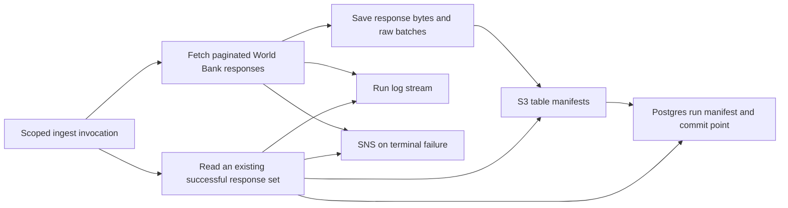
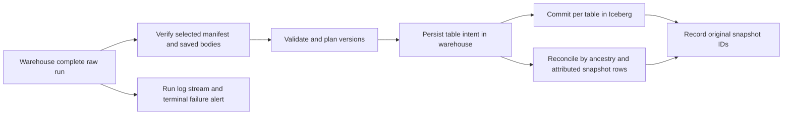
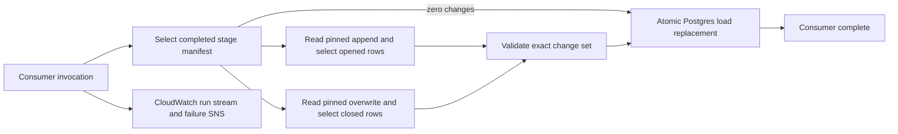
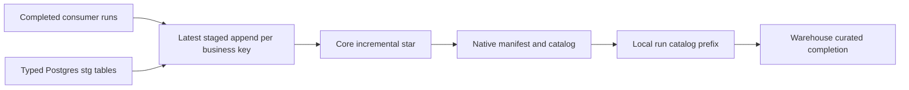
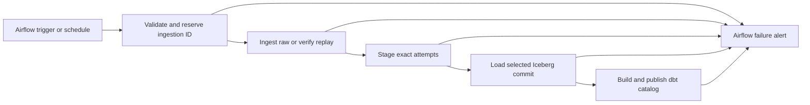
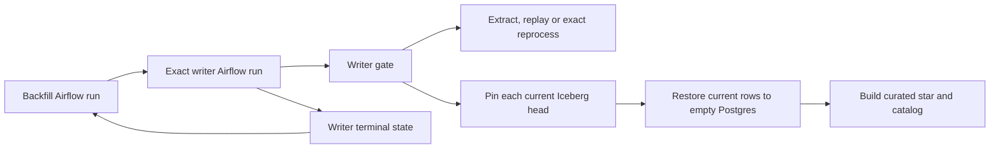

# Implementation contract history

Completed wave specs. The live contract is `IMPLEMENTATION_CONTRACT.md`. The agreed proposal is `ARCHITECTURE.md`. Read that document before using anything below. Where a rule in this archive conflicts with `ARCHITECTURE.md`, the architecture wins. The platform wave did not call the public World Bank API. That closed-wave limit is not a ban on the agreed ingest extract mode. Saved responses are for tests and replay.

## Wave `platform`

Closed. Merged. Archived here when ingest became the next wave. The text below is the spec this wave was built from. It is not the active wave.

Status at archive: the wave had been ready for the machinist, then completed. Wave `platform` is not active.

`make test` prints `test suites are not in this MR` and exits 0. `make test-spike` runs the Iceberg and dbt spikes, including the stale `spike.scd2_probe` repair. The file plan is unchanged. Edit `Makefile` and `README.md` only.

This file is the platform wave only. Later merge requests are boundaries in the next section. They are not files to create in this wave.

## Invariants

- All work stays on this machine. No AWS account, no paid API, no `git push`, no call to `api.worldbank.org`.
- Every AWS API call uses `https://127.0.0.1:9297` and the certificate the AWS Emulator writes for that port. `localhost` is not a substitute. The emulator certificate covers `127.0.0.1` and `localhost` only, and S3 must stay path-style on the IP.
- The apply environment unsets `AWS_ACCESS_KEY_ID`, `AWS_SECRET_ACCESS_KEY`, `AWS_SESSION_TOKEN`, and `AWS_PROFILE`, then points at `~/.aws/emulator/9297/emulator_credentials`, `config`, and `ca.pem`. It also sets `AWS_ENDPOINT_URL`, `AWS_CA_BUNDLE`, `AWS_EC2_METADATA_DISABLED=true`, `AWS_DISABLE_HOST_PREFIX_INJECTION=true`, and `AWS_REGION=us-east-1`.
- Terraform state, plans, `*.tfvars`, and `secrets/email.key` are gitignored. `secrets/alert_email.enc` may be committed. qa and prd tfvars are not created.
- No email address is invented. The alert recipient exists only after the user supplies ciphertext. The local Airflow web login is the fixture user `airflow` / `airflow` with email field `airflow@localhost`. That fixture is not the alert recipient and is not a person.
- Plaintext email, the key, and emulator credentials are never written into Terraform variables, the plan, the repo, or logs.
- dbt and the Iceberg spike run in Linux containers. dbt does not run on the Mac host. DuckDB is not installed on the Mac host.
- If the dbt 2.0.12 spike fails, stop. Do not switch the image to dbt Core 1.x inside this wave. That pin is a contract change.

## Wave plan

| Wave | Type | Status | What it does |
|---|---|---|---|
| `platform` | feature | closed | Local emulator, Postgres, Iceberg REST, Airflow with no DAGs, dev Terraform, `dbt-postgres` image, two spikes, `make platform`, `make test`, `make test-spike`, `make down` |

Later merge requests are not waves in this file and have no file plans. Their order is ingest, stage, consumer, curated star, `world_bank_pipeline`, `world_bank_backfill`, analytic outputs, data quality, production note. Each waits until the user reviews the previous one. The production-note MR is the one that documents `make demo` as the clean-checkout command.

## Boundaries later MRs must keep

Raw layout. HTTP bodies under `responses/` and batches of at most 100 records under `records/`, with attempt prefixes. `API_PAGE_SIZE` is 50. `RAW_BATCH_SIZE` is 100. These provenance columns travel through stage, `stg`, and the fact: `raw_response_key`, `raw_record_index`, `response_sha256`, `raw_object_key`, `source_url`, `api_page`, `raw_ingested_at`, `ingestion_id`.

Stage. DuckDB 2.0 Iceberg SCD2 on `s3://lakehouse-stage/world-bank/{table}`, hidden-partitioned by `day(stage_ingested_at)`. `record_hash` is canonical API fields only. Merge-on-read close plus insert run in one SQL transaction. DuckDB 2.0.1 commits that pair as two snapshots, an overwrite and then an append. The pair is not one snapshot. Absent keys keep the current version. The platform spike uses namespace `spike` and must not create `world-bank` tables.

Writer. One DAG, `world_bank_pipeline`, `max_active_runs=1`. `world_bank_backfill` only triggers it. Modes later: `extract`, `replay`, `reprocess_commit`, `rebuild`. No `meta.pipeline_lock`. No `meta.observation_coverage`.

Manifest. `meta.pipeline_run` is the manifest. XCom carries `ingestion_id` only. Recovery stores both snapshot ids from each SCD2 close and insert: the overwrite snapshot and the following append snapshot. Request scope is country, indicator, and year.

Data quality. `meta.dq_result` stores `ingestion_id`, `check_name`, `severity`, `business_key`, `message`, `detected_at`. Missing-view reasons are `NEVER_RETURNED`, `SOURCE_NULL`, and `MISSING_FROM_LATEST_EXTRACT`. The third keeps the fact value. The check is scoped to the country, indicator, and year the run requested. A key omitted from a later in-scope extract stays on the fact. The warning is a row in `meta.dq_result`.

Curated. Fact surrogate keys are stable hashes. Income level is an outrigger. dbt lineage requires a static-analysis compile, then `dbt docs generate`.

Logs. Later images write to the groups created here. The stream name is `ingestion_id`. Reserved image names, not built in this wave: `lakehouse-ingest-world-bank`, `lakehouse-stage-world-bank`, `lakehouse-consumer-postgres`.

Images Airflow will start later with `DockerOperator`, removing them on exit. That wiring is not this wave. This wave does not build ingest, stage, consumer, curated models, DAGs, views, `meta.pipeline_run`, `meta.dq_result`, or the production note.

## Wave `platform`

Feature wave. Depends on nothing in the repo. The repo today is a README and the lead planning docs.

### Working-deliverable obligations

| ID | Outcome |
|---|---|
| P1 | `make platform` starts the infra compose, builds `dbt-postgres`, and applies dev Terraform to the emulator. With no ciphertext and no key it exits 0. |
| P2 | After that run the three buckets exist, SNS topic `world-bank-alerts` exists, a publish returns a message id, secret `world-bank/alert-email` exists with no secret value, and the topic has no email subscription. |
| P3 | `make test` prints `test suites are not in this MR` and exits 0. It does not call the emulator, dbt, or DuckDB. `make test-spike` runs the Iceberg spike and the dbt spike. `make down` stops the stack. |
| P4 | `make demo` and `make run` exit non-zero and print `pipeline DAG is not in this MR`. They do not start the pipeline or call the World Bank API. |
| P5 | The email step follows the four-row table and the AES-256-CBC commands below. Plaintext never enters Terraform. |
| P6 | An apply whose provider endpoints are not all `https://127.0.0.1:9297` is a failed wave. Real credentials must be unset before Terraform and the AWS CLI run. |

P1–P6 are the working-deliverable obligations for this wave.

### Infra compose

`compose.infra.yaml` is always on. Project name `world-bank`. Publish ports only on `127.0.0.1`.

`aws-emulator`. Build `infra/aws-emulator/Dockerfile` from the AWS Emulator Docker guide: `public.ecr.aws/amazonlinux/amazonlinux:2023-minimal`, install the LTS RPM, `aarch64` when `TARGETARCH` is `arm64` and `x86_64` otherwise. `USER 1000`, `ENV HOME` and `EMULATOR_BIND_ADDRESS=0.0.0.0`, entrypoint `aws-emulator`. Compose sets `HOME` to the host home, mounts `~/.aws/emulator` at the same path, limits memory to 2g, and runs `aws-emulator -p 9297`. Publish `127.0.0.1:9297:9297` and `127.0.0.1:8181:8181`. Healthcheck is HTTPS `GET /__admin/health` with the emulator CA, expecting `ok`.

`postgres`. Image `postgres:16`. Local superuser `postgres` / `postgres`. Init SQL creates databases `airflow`, `warehouse`, and `iceberg_catalog`. Healthcheck `pg_isready`.

`iceberg-rest`. Build `infra/iceberg-rest/Dockerfile` from `apache/iceberg-rest-fixture` at a pinned 1.x tag, not `latest`, minimum 1.8.1, recorded in the Dockerfile. Add the PostgreSQL JDBC driver `42.7.5` on the fixture classpath. `network_mode: service:aws-emulator` so S3 is `https://127.0.0.1:9297` and the certificate hostname matches. Start only after the emulator is healthy and Postgres is healthy. Catalog impl `org.apache.iceberg.jdbc.JdbcCatalog`, URI `jdbc:postgresql://postgres:5432/iceberg_catalog`, warehouse `s3://lakehouse-stage/catalog`, IO impl `org.apache.iceberg.aws.s3.S3FileIO`, path-style access on. The entrypoint reads the emulator credentials file, imports `ca.pem` into a private truststore, and does not disable TLS. REST listens on port 8181.

`airflow-webserver` and `airflow-scheduler`. Image `apache/airflow:2.10.5`, LocalExecutor, examples off, metadata DB `airflow` on the Postgres service. Mount `dags/` which contains no DAG files. `_AIRFLOW_DB_MIGRATE=true` and the fixture web user above. Publish `127.0.0.1:8080:8080` for the webserver. A fixed local Fernet key may live in the compose file. It is a local fixture, not a reused secret.

`compose.jobs.yaml` builds `dbt-postgres` and does not leave it running. It does not define the three reserved image names.

### Terraform

Dev apply only. Values live in committed `.tf` locals. No `dev.tfvars`, `qa.tfvars`, or `prd.tfvars`. Backend is local. State stays under `infra/terraform/` and is gitignored. Commit `.terraform.lock.hcl`.

Provider `hashicorp/aws` 5.x, pinned. Region `us-east-1`. Do not set `access_key` or `secret_key` in the provider. Signing uses the emulator credentials file from the make environment. Set `s3_use_path_style`, `skip_credentials_validation`, `skip_metadata_api_check`, and `skip_requesting_account_id`. The `endpoints` block sets `s3`, `sns`, `secretsmanager`, `logs`, `sts`, and `iam` to `https://127.0.0.1:9297`. `make platform` exports `AWS_CA_BUNDLE` before apply.

Resources:

- S3 buckets `lakehouse-raw`, `lakehouse-stage`, `lakehouse-curated`, `force_destroy = true`
- SNS topic `world-bank-alerts`
- Secrets Manager secret `world-bank/alert-email` with no `aws_secretsmanager_secret_version`
- Log groups `/world-bank/airflow`, `/world-bank/lakehouse-ingest-world-bank`, `/world-bank/lakehouse-stage-world-bank`, `/world-bank/lakehouse-consumer-postgres`, `/world-bank/dbt-postgres`, with no retention that the emulator must honor

Outputs: topic ARN, secret name, bucket names, log group names. After apply, `scripts/prove-topic.sh` publishes one message with no email address and requires a message id. It also checks the secret exists, `get-secret-value` has no value, and the topic has no subscription when the ciphertext is absent.

### Email step

`scripts/email-subscribe.sh` runs after a successful apply, inside `make platform`. Decrypt, when it happens, is this shell step. The plaintext is not a Terraform variable and is not written to disk.

| Ciphertext `secrets/alert_email.enc` | Key `secrets/email.key` | Result |
|---|---|---|
| Absent | Absent | Skip the subscription. `make platform` still exits 0. |
| Present | Absent | Skip the subscription, print that the key is not on this machine, exit 0. |
| Present | Present | Decrypt, `put-secret-value`, subscribe that address to `world-bank-alerts`. |
| Present | Invalid | The subscription step fails with an explicit decrypt error. `make platform` exits non-zero. Buckets already applied stay applied. |

Cipher is AES-256-CBC with PBKDF2, via `openssl enc` on this machine's LibreSSL 3.3.6. AES-GCM is not the command. Decrypt stdout is the plaintext. The script may pass it to `put-secret-value` and `sns subscribe`. It must not write it to a file, the plan, or the log.

Decrypt when both files are present:

```bash
openssl enc -aes-256-cbc -d -salt -pbkdf2 -pass file:secrets/email.key -in secrets/alert_email.enc
```

A bad key or a bad ciphertext file is the invalid row. `openssl` failing is the explicit decrypt error. Do not treat a usage error as a skip.

Encrypt, for the lead to give the user later. Do not run it in this wave, and do not commit ciphertext:

```bash
printf '%s' 'the-address' | openssl enc -aes-256-cbc -salt -pbkdf2 -pass file:secrets/email.key -out secrets/alert_email.enc
```

`the-address` is the user's address, not a fixture. The probed round trip of this command pair exited 0 and returned the original text.

The machinist proves the present/present and invalid rows with a temporary key and ciphertext outside the committed tree. The plaintext is `spike-local@example.com`. It is a syntactically valid address on the reserved `example.com` domain, not a real mailbox. `spike-local` is not a valid subscribe endpoint. After that proof, remove the temporary files, delete the secret value, and delete the subscription, so a later `make platform` with neither file still satisfies P2. Do not print the address.

### Spikes

`make test-spike` does not apply Terraform and does not call the World Bank API. If the emulator health URL or the warehouse is down, it exits non-zero and tells the user to run `make platform`. `make test` does not have that precondition and does not start the stack.

Iceberg spike. Image built from `spikes/iceberg/Dockerfile` with DuckDB 2.0.1, recorded in the Dockerfile, not installed on the host. Two separate `docker compose run` containers, both on the emulator network namespace, both mounting the emulator CA and credentials. DuckDB attaches the REST catalog at `http://127.0.0.1:8181` with authorization none, and uses path-style HTTPS S3 at `127.0.0.1:9297` with `ca.pem`. The DuckDB file is discarded with the container. The table is `spike.scd2_probe` in the REST catalog.

`make down` keeps the Postgres volume. Emulator objects live only until that container stops. Before any statement that loads `spike.scd2_probe`, `spikes/iceberg/run.sh` checks the `iceberg_tables` row for namespace `spike` and table `scd2_probe`. If that row exists and loading the table fails because the metadata object is gone (`NoSuchKeyException` on the REST load), the script deletes that row and only that row, then continues. `DROP TABLE IF EXISTS` must not be the first load of a stale row. Do not delete the volume, other namespaces, or other tables. Do not add a file.

Assertions, all required:

- In one SQL transaction, close the current SCD2 row and insert the new version. DuckDB 2.0.1 commits that pair as two snapshots: operation `overwrite`, then operation `append`. The spike requires that pair and records both snapshot ids. It must not require or report one snapshot for the close and the insert. A setup insert before the transaction is not part of the pair.
- A forced statement failure inside a transaction rolls back. No overwrite/append pair is added, and the current row is unchanged.
- An unchanged rerun adds no snapshot.
- A second container reads the committed current row.

dbt spike. `images/dbt-postgres/Dockerfile` installs the official dbt `2.0.12` Linux binary for the image architecture and sets `DBT_ALLOW_EXPERIMENTAL_ADAPTERS=1`. The project has one model, one data test, and a Postgres profile aimed at host `postgres`, database `warehouse`. `spikes/dbt/run.sh` runs, in the container: `dbt run`, `dbt test`, `dbt compile --static-analysis baseline`, `dbt docs generate`. Do not pass `--static-analysis off`. The run exits 0 only if all four succeed and `target/manifest.json` and `target/index.html` exist. A failure stops the wave. The machinist does not retarget dbt Core 1.x.

### Make targets

| Target | Behavior |
|---|---|
| `platform` | Up infra, wait until healthy, build `dbt-postgres`, apply, prove the topic, run the email step |
| `test` | Print `test suites are not in this MR` and exit 0. Do not call the emulator, dbt, or DuckDB. Do not add a test suite. |
| `test-spike` | Iceberg spike, including the stale `spike.scd2_probe` repair, then the dbt spike |
| `down` | `docker compose -f compose.infra.yaml down` without deleting volumes. A later `make test-spike` must still pass against that volume and a new emulator. |
| `demo`, `run` | Print `pipeline DAG is not in this MR` to stderr and exit 1 |

### Logging

This matches the approved design.

- `make`, Terraform, and the email script write plain text to the terminal. Info: healthy, apply finished, subscription skipped, publish message id. Warn: ciphertext present and key absent, with the key-not-on-this-machine sentence and no file contents. Error: health, apply, or decrypt failure, with no plaintext, key, or address.
- Spikes write assertion name and pass or fail. They do not print row values that could be an email address.
- This wave creates the log groups and does not call `PutLogEvents`. `FilterLogEvents` is the later read path. Events live until the emulator process stops. The same group names are the production mapping.
- Later images, not this wave: one stream per `ingestion_id`, JSON lines with `level`, `event`, and `ingestion_id`. No secrets, email addresses, or AWS keys.

### File-level execution plan

Create:

- `Makefile`
- `compose.infra.yaml`
- `compose.jobs.yaml`
- `.gitignore`
- `dags/.gitkeep`
- `secrets/.gitkeep`
- `infra/aws-emulator/Dockerfile`
- `infra/postgres/init.sql`
- `infra/iceberg-rest/Dockerfile`
- `infra/iceberg-rest/entrypoint.sh`
- `infra/terraform/versions.tf`
- `infra/terraform/providers.tf`
- `infra/terraform/buckets.tf`
- `infra/terraform/topic.tf`
- `infra/terraform/secret.tf`
- `infra/terraform/logs.tf`
- `infra/terraform/outputs.tf`
- `infra/terraform/.terraform.lock.hcl`
- `scripts/emulator-env.sh`
- `scripts/prove-topic.sh`
- `scripts/email-subscribe.sh`
- `images/dbt-postgres/Dockerfile`
- `images/dbt-postgres/dbt_project.yml`
- `images/dbt-postgres/profiles.yml`
- `images/dbt-postgres/models/spike_model.sql`
- `images/dbt-postgres/models/schema.yml`
- `spikes/iceberg/Dockerfile`
- `spikes/iceberg/scd2.sql`
- `spikes/iceberg/run.sh`
- `spikes/dbt/run.sh`

Modify:

- `README.md` — local `make platform`, `make test`, `make test-spike`, and `make down`. `make test` prints that the test suites are not in this MR. State that `make demo` is not the clean-checkout command in this MR.

Delete: none.

Do not create ingest, stage, consumer, DAG, view, `meta` SQL, qa/prd tfvars, or the three reserved Dockerfiles. A file outside this list is drift.

### Validation

Local commands:

- `make platform` with neither ciphertext nor key exits 0 and satisfies P2.
- `make test` prints `test suites are not in this MR` and exits 0 with the stack stopped. It does not call the emulator, dbt, or DuckDB.
- `make test-spike` satisfies the four Iceberg assertions and the four dbt commands.
- `make down` stops the containers.
- `make demo` and `make run` exit non-zero with the required sentence.
- Ciphertext present and key absent: skip, print the key sentence, exit 0.
- Ciphertext present and key invalid: explicit decrypt error, non-zero exit.
- A temporary AES-256-CBC round trip with plaintext `spike-local@example.com` decrypts to that address, then `put-secret-value` and `sns subscribe` succeed. A bad key and a bad ciphertext file each fail the subscription step with a decrypt error. The temporary files, secret value, and subscription are removed afterward.
- After the catalog repair, `make test-spike` passes when `iceberg_tables` still has `spike` / `scd2_probe` and the emulator metadata object for that row is gone. The Postgres volume stays.

Runtime owned by Docker, the emulator, Postgres, and the Iceberg catalog is proven by those commands, not by a fake. There is no separate post-merge AWS account gate.

### Finding disposition

| Finding | Class | Fields | Attempt | Action |
|---|---|---|---|---|
| `openssl enc -aes-256-gcm` exits 1 with `bad decrypt` on LibreSSL 3.3.6 | unsupported capability, resolved | The subscription step could not decrypt. The user replaced the algorithm with AES-256-CBC and PBKDF2. The probed command pair exited 0 and returned the original text. | 0 | Closed. P5 now names those commands. No machinist correction. |
| Iceberg close and insert produced two snapshots | contract defect, closed | The spike required one snapshot. DuckDB 2.0.1 committed overwrite `4670047895643442367` then append `3795146508833802852`. Correction attempt 1 passed `close-and-insert`, `unchanged-rerun`, `rollback`, and `read-current`. | 1 | Closed. |
| `sns subscribe` rejected `spike-local` | contract defect, closed | `spike-local` was not a valid endpoint. Correction attempt 1 subscribed `spike-local@example.com`, confirmed the secret matched, then removed the subscription, the secret value, and the temporary files. A later `make platform` with neither file exited 0. | 1 | Closed. |
| Stale `spike.scd2_probe` after a new emulator | contract gap | The Iceberg spike is the product surface. With the Postgres volume kept, REST `GET /v1/namespaces/spike/tables/scd2_probe` returned HTTP 500 and `NoSuchKeyException` because `DROP TABLE IF EXISTS` loaded the catalog row. The spike exited 2. A manual `DELETE` of that one row let the next spike pass. The passing run did not exercise a recreated emulator. | 0 | The repair stays in `spikes/iceberg/run.sh`. The proof command is `make test-spike`. This target rename does not edit that script. |

### Contract readiness

Historical gate record for this closed wave. It does not authorize new work.

The wave was ready for the machinist. Gate outcome: **accepted**. This change edits `Makefile` and `README.md` only. The file-level plan is unchanged. No test suite is added.

`make test` with the stack stopped prints `test suites are not in this MR` and exits 0. `make test-spike` is the spike command. Credit the earlier spike pass, the subscribe proof, `make platform` with neither file, the key-absent skip, `make down`, `make demo`, and `make run`. Do not rerun those. Reason: the target rename does not change their behavior.

The stale-catalog proof, if not already recorded, is `make test-spike` after the emulator is recreated and the Postgres volume still has the `spike.scd2_probe` row. Logging is the Logging section and is part of the approved design.

## Wave `ingest` — Standalone World Bank raw ingestion

Merged to `main` at `af1b325`. The archived wave is closed.


**Scope.** One one-shot image and one ingest command. It accepts an extract or selection of saved responses for replay, and exposes the raw inputs to downstream consumers only after successful publication. There is no DAG, stage processing, backfill DAG, export, new AWS resource, or change to the platform spikes in this wave.

### Working-deliverable obligations

Five blocking obligations are bounded by the image invocation and the artifacts it commits. There are no prior ingest implementation or review attempts.

| ID | Behavior and consequence | Implementation and evidence |
|---|---|---|
| ING-1 | Extract the configured or narrowed scope from a paginated source with bounded retries and preserve absence and nulls. A bad page fails the invocation. | `config/pipeline.yml`, source adapter, unit and CLI fixture tests. |
| ING-2 | Store whole bodies and batches of at most 100 records with resolvable provenance. Stage and a reviewer can trace each record to the stored body. | Raw writer, independent body/lineage checks against saved HTTP bytes and real emulator objects. |
| ING-3 | Keep attempts immutable, commit only a complete selection, and allow same-ID retry or saved-response replay. Stage can distinguish published from incomplete data. | Postgres manifest, S3 manifests, unit failure injection and CLI fixture fail/retry/replay. |
| ING-4 | Report a failed accepted invocation with a nonzero status, CloudWatch error, and SNS publish when those services are reachable. An operator can retrieve the event by run ID. | CLI and local AWS adapter, real `FilterLogEvents` and a returned SNS message ID. |
| ING-5 | Run the packaged entry point and test it on the emulator without using a real AWS endpoint. | Docker/Compose, Makefile and README. Unit safety checks plus end-to-end fixture. |

Credit existing platform evidence for ING-4 and ING-5: `infra/terraform/{buckets,logs,topic,providers,outputs}.tf` provisions and pins the named resources, `scripts/prove-topic.sh` establishes the publish ID and log group, `compose.jobs.yaml` already shares the emulator namespace for a one-shot job, and `compose.infra.yaml` and `infra/postgres/init.sql` establish the reachable warehouse. These platform files, apart from adding the job service, are evidence only. Prior platform Compose and spike results remain credited. `make test` has no existing ingest coverage.

### Entry point and scope

- Compose service and image `lakehouse-ingest-world-bank`, with `python -m world_bank_ingest` as its entry point. Require `--ingestion-id` (1–128 ASCII letters, digits, underscores, or hyphens, starting with an alphanumeric). Default `--mode extract`. Accept optional comma-separated `--countries`, `--indicators`, and inclusive integer `--start-year` and `--end-year` for extract. Trim and reject empty, duplicate, out-of-config or inverted selections; normalize to config order so a retry with the same selections in a different order is the same scope.
- `config/pipeline.yml` is the shared config. Top-level `countries` is a nonempty list of unique ISO3 strings, `indicators` a nonempty list of unique World Bank code strings, and `start_year` and `end_year` are integer defaults. Populate them from the architecture (9 countries, 4 indicators, 2018–2024). The extract permits a year range that is a subset of those defaults. The repository image includes that file. Invalid input exits 2 before storage mutations.
- `--mode replay --source-ingestion-id <id>` selects one completed extract with a different ID, inherits its scope, and rejects scope overrides. Replays retrieve and verify the source attempt's actual response bodies without contacting the public API or copying data under a new S3 namespace. The replay's own Postgres row stores mode, source ID, source scope, source `raw_date`, `raw_ingested_at`, and `successful_attempt`; stage resolves the S3 prefix with the source ID and applies its own rules later. `reprocess_commit` and `rebuild` belong to later entry points.
- The job uses the warehouse service (`postgres:5432/warehouse`, existing local dev identity). It shares the emulator network namespace. It takes the alert topic ARN from `WORLD_BANK_ALERT_TOPIC_ARN`, supplied by the dev Terraform `topic_arn` output. Resolve all boto3 clients explicitly to `https://127.0.0.1:9297` with the mounted emulator CA/credentials, `us-east-1`, S3 path-style addressing, and no proxy, host-prefix injection, credential fallback, or metadata lookup. Never read host AWS profiles or forward host environment AWS credentials. Missing emulator credentials/CA fail closed.



### HTTP requests, pagination, and record artifacts

- Request source 2 observations from `https://api.worldbank.org/v2/country/{semicolon-separated ISO3}/indicator/{code}`, one request per selected indicator with `date={start}:{end}`. Fetch selected country metadata with `/country/{codes}`, selected indicator metadata with `/indicator/{code}?source=2`, and the income-level catalogue with `/incomelevel`. Use `format=json`, `per_page=50` and numeric `page` for every request. Observation requests also carry `source=2`. Assign request ordinals per table in deterministic config order, starting at 1.
- Start at page 1, check returned `page` equals the requested page and `pages` stays constant for that request, then request each page through the reported last page independently of short pages. Accept JSON integer or digit-string fields. The body is a pair of an object with page metadata and a list of record objects. The zero-page empty sentinel may use an empty list or null only with `page=1,pages=0,total=0`. Invalid JSON, invalid records or pagination, an HTTP terminal error, or exhausted retries fail the attempt. An observation value is a finite JSON number or JSON null. Unknown API fields survive in record JSON, and absent observations generate no rows.
- Use explicit 5-second connect and 20-second read timeouts. At most four attempts per page. Retry connection/timeouts, HTTP 429, and HTTP 500/502/503/504. Wait uniform jitter in `[0, min(4, 0.5 * 2^retry_index)]` seconds before the next attempt, with zero-based retry index. Failure exhausts only this page request; a rerun with the same ID creates a new raw attempt. Use normal verified HTTPS for the World Bank and separate its session from AWS transport.
- For each validated page, write the original body bytes, with whitespace untouched, as `responses/request_{ordinal:03d}_page_{page:03d}.json`. For records, flatten the unchanged source object with eight reserved provenance keys. Reject a source object that already carries a reserved provenance key. Buffer across short pages and across requests in a table. Flush at 100 records, split oversized pages across batches, and flush the final nonempty remainder. Output files are arrays of 1–100 objects named `records/{batch:05d}.json`, numbered per table from 1. A zero-record table has no batches.
- Reserved fields are `raw_response_key` and `raw_object_key` (full S3 keys without bucket), `raw_record_index` (zero-based position in that page's API list), `response_sha256` (lowercase SHA-256 hex for the saved body), `source_url` (actual URL including query), `api_page` (positive integer), `raw_ingested_at` (UTC timestamp of the page write in RFC 3339) and `ingestion_id` (string). Numeric fields retain JSON numeric precision without serializing decimals as strings. Preserve nulls.
- Example source fixture bytes (UTF-8, exact in the fixture, including any whitespace it supplies): `[{"page":1,"pages":1,"total":1},[{"countryiso3code":"BRA","indicator":{"id":"SP.POP.TOTL"},"date":"2020","value":null}]]`. With a page of this shape, the first raw record has `value:null`, `raw_record_index:0`, and keys linking to the original body and to `records/00001.json`.

### Run and publication state

- On both new and existing Postgres volumes the CLI idempotently applies the packaged `pipeline_run.sql` to warehouse before use. Use the architecture columns with `ingestion_id text PRIMARY KEY`, `mode text` constrained to the four declared modes, optional `source_ingestion_id text`, `request_countries text[]`, `request_indicators text[]`, `start_year/end_year integer`, timestamps as `timestamptz`, statuses as checked text defaulting to `pending`, `successful_attempt integer`, `stage_snapshot_ids jsonb`, and `stage_changed_count bigint`. The non-raw payload fields are nullable until their owning jobs fill them. Add `raw_date date` for locating S3 objects and `raw_attempt_count integer NOT NULL DEFAULT 0` for monotonic reservation. This wave writes only the request identity and raw columns. Apply concurrent first-time DDL under a Postgres transaction lock.
- Take a Postgres session advisory lock keyed by ingestion ID for the duration. A concurrent same-ID call fails without modifying the active run. New extract IDs fix the UTC `raw_date` before any fetch. The existing mode, source ID and normalized scope are immutable. Before any attempt writes, atomically persist the incremented attempt number and `raw_status=pending`, then commit that state. A failed/killed attempt cannot reuse its prefix, including across UTC midnight.
- Prefix is `world-bank/{table}/date={raw_date}/ingestion_id={id}/attempt={N}/` in `lakehouse-raw`. All four tables share one attempt number. Once every response and record file has been written, write the four table manifests at `world-bank/{table}/date={raw_date}/ingestion_id={id}/manifest.json`. Then atomically set SQL `raw_status=complete`, `successful_attempt=N`, and `raw_ingested_at` to the latest persisted page timestamp. SQL is the commit point. Downstream selects only a SQL-complete row and checks every table manifest has the selected ID, date, table, and successful attempt. A partial set of S3 manifests is unusable, even if individual files already name an attempt whose data was fully written. Do not delete or overwrite attempt objects.
- After a precommit failure, best-effort set the accepted run's `raw_status=failed` without recording a successful attempt. Keep the counter, raw date, and partial artifacts. If the process dies or the database cannot record the failure, the durable pending reservation has the same exclusion and retry behavior. A failed replay attempt has no new raw artifacts. Report uncertain SQL commits as nonzero without demoting a row that committed complete. Preserve a complete row on conflicts and observability failures; the next matching invocation reads it.
- A same-scope invocation of a complete extract verifies its four manifests and that all listed response and record keys still exist, then returns 0 without fetching, allocating an attempt, or writing S3. Missing or inconsistent artifacts fail visibly and preserve the committed row. After an emulator reset operators must extract under a new ID to recreate lost raw data. Replay verifies matching manifests, existence of record keys, and response-body hashes against actual GETs. Complete same-source replays use the same verification and remain read-only in S3.

### S3 manifest and observability

- The stable per-table manifest is UTF-8 JSON. `format_version` is integer 1. `table` is one of `observation`, `country`, `indicator`, `income_level`. `ingestion_id` and `raw_date` are strings (the latter is ISO YYYY-MM-DD). `successful_attempt` is a positive integer. `responses` is the ordered list of objects with `key` (full response S3 key), `sha256` (lowercase hex), `source_url` (complete request URL), `api_page` (positive integer), and `raw_ingested_at` (UTC RFC 3339 string). `record_keys` is the ordered list of complete nonempty batch S3 keys. Reject a replay manifest whose object keys escape its selected attempt prefix or whose listing is malformed.
- Complete example for one observation page with no records, using the exact ASCII body `[{"page":1,"pages":1},[]]` and its body hash below:

```json
{
  "format_version": 1,
  "table": "observation",
  "ingestion_id": "sample",
  "raw_date": "2026-11-24",
  "successful_attempt": 2,
  "responses": [
    {
      "key": "world-bank/observation/date=2026-11-24/ingestion_id=sample/attempt=2/responses/request_001_page_001.json",
      "sha256": "b207cc227eb07597bde71d11e575280b1483492b8f62fd04df6e54a0a30eeacb",
      "source_url": "https://api.worldbank.org/v2/country/BRA/indicator/SP.POP.TOTL?date=2020%3A2020&source=2&format=json&per_page=50&page=1",
      "api_page": 1,
      "raw_ingested_at": "2026-11-24T17:00:00Z"
    }
  ],
  "record_keys": []
}
```

- Use the confirmed architecture's log group `/world-bank/lakehouse-ingest-world-bank` and stream named for the invocation's `ingestion_id`. Emit JSON with `level`, `event`, `ingestion_id` and relevant safe metadata. Include INFO `ingest_started`, INFO `raw_artifacts_ready` before the database commit, INFO `ingest_completed` or `ingest_already_complete` on success, WARN `request_retry` with page and reason when retrying, and ERROR `ingest_failed` on terminal failure. Use `create_log_stream` idempotently and `put_log_events`; honor a reachable service that requires sequence tokens. No credentials, email, response bodies or full exception dumps in operational logs.
- Success exits 0 and writes a structured terminal event to stdout. An accepted invocation failure exits 1 and writes structured failure to stderr and CloudWatch. Independently attempt SNS publish to `world-bank-alerts` with JSON `ingestion_id`, `task_name` equal to `lakehouse-ingest-world-bank`, and a safe `error`. A successful publish records `alert_published` with its returned `message_id`. An unavailable failure reporter cannot hide the original nonzero status. Losing terminal logs after a successful SQL commit does not unwind it. Integration tests require the CloudWatch events and SNS acknowledgement when the services are available. Future DAG wiring must ensure only one alert publisher owns this task failure.

### File-level execution plan

| Action | Path | Responsibility |
|---|---|---|
| Create | `config/pipeline.yml` | Default request scope. |
| Create | `images/ingest-world-bank/Dockerfile`, `images/ingest-world-bank/requirements.txt` | Python 3.12 slim image with pinned boto3, requests, PyYAML, simplejson, psycopg (binary) and coverage. Use the repo root as build context and selective COPY. |
| Create | `images/ingest-world-bank/world_bank_ingest/__init__.py`, `images/ingest-world-bank/world_bank_ingest/__main__.py` | Package and command parsing, composition, orchestration, failure exit, safe logging at the process boundary. |
| Create | `images/ingest-world-bank/world_bank_ingest/source.py` | Scope and World Bank request construction, pagination, validation and retry. |
| Create | `images/ingest-world-bank/world_bank_ingest/raw.py` | Immutable body and record writes, table buffer, manifests and pinned response verification. |
| Create | `images/ingest-world-bank/world_bank_ingest/services.py`, `images/ingest-world-bank/world_bank_ingest/pipeline_run.sql` | Warehouse locking and state transitions, pinned AWS clients and reporting. |
| Create | `images/ingest-world-bank/tests/test_unit.py`, `images/ingest-world-bank/tests/test_integration.py`, `images/ingest-world-bank/tests/fixtures/observation_page_001.json`, `images/ingest-world-bank/tests/fixtures/observation_page_002.json` | Unit checks and the real CLI against saved HTTP bodies and emulator/warehouse. |
| Modify | `.dockerignore` (create if absent), `compose.jobs.yaml`, `Makefile`, `README.md` | Keep root Docker context free of secrets/local state, add one-shot image, scope tests to ingest, and give working operator examples. |

Exclude `.git`, `secrets`, handoffs, Terraform state/init files, virtual environments and coverage artifacts from Docker context. No changes to platform init/terraform, active DAGs, existing spike files, or Lead-owned documents. No deletes.

### Executable validation and review boundary

- Use `unittest` in the image and application coverage from the offline unit command. Unit checks supply an in-memory transport/store, an injected clock and sleeper, and deterministic jitter. Check default 252 requested slots and scope narrowing; a 37/128/5-record page sequence yields 100/70 batches, byte-for-byte response lineage and correctly reset per-page indexes; preserve a fractional number and a null. Also check malformed shape, 429 and transient 5xx retries, retry ceiling and nontransient failures, page-number and page-count failures, invalid arguments, fixed raw date across retry, a precommit failure, and fail-closed AWS transport configuration. Coverage is report-only.
- `test_integration.py` runs inside the one-shot job's network namespace. Start one test HTTP server on literal `127.0.0.1` and an OS-assigned port. The CLI uses an explicit fixture-only `WORLD_BANK_TEST_API_URL` pointing to that base URL; reject non-loopback test URLs and redirects. Validate real request path/query (narrow to BRA, SP.POP.TOTL, 2020–2021, per_page=50, source=2). The two committed observation files contain UTF-8 World Bank JSON pairs reporting 2 pages, one row each, with the API fields in the example above. Page 1 has page=1, date "2020", and value null. Page 2 has page=2, date "2021", and value 42. Serve the files without reserialization. Emit one valid single-page response for each dimension using its expected ID and fields. A complete country fixture, for example, is `[{"page":1,"pages":1},[{"id":"BRA","iso2Code":"BR","name":"Brazil","incomeLevel":{"id":"UMC","value":"Upper middle income"}}]]`.
- Run the actual CLI as a subprocess against that server and real S3, Postgres and CloudWatch. Use a UUID-backed test ID. First serve page 1 and make page 2 return a terminal error (e.g. HTTP 400). Expect exit 1, `ingest_failed` on stderr, no successful terminal stdout event, a persisted first body, no ready S3 table manifests, and failed SQL with no successful attempt. Query `FilterLogEvents` for the error and `alert_published` with nonempty message ID. Next serve page 2 normally with the same ID. Expect exit 0, terminal JSON on stdout, no failure on stderr, SQL complete for attempt 2, all matching manifests, original first-attempt data unchanged, and the second-attempt exact bodies, hashes, record provenance and original null verified by reading real S3. A repeat exits 0 with no new fixture requests or attempt. Then replay under a different UUID-backed ID, with the fixture server stopped or all requests rejected. Expect exit 0, matching source selection in Postgres, and no replay-owned S3 artifacts. Confirm each run's terminal log with `FilterLogEvents`; poll within a bounded deadline if needed. Shut down the server and clean up only the test-owned rows, S3 keys and streams where supported. SNS acknowledgement and data outside the test namespace remain untouched. No live World Bank call in tests.
- Standalone operation after platform resources are healthy and applied:
  ```sh
  docker compose -f compose.infra.yaml -f compose.jobs.yaml build lakehouse-ingest-world-bank
  export WORLD_BANK_ALERT_TOPIC_ARN="$(./scripts/emulator-env.sh terraform -chdir=infra/terraform output -raw topic_arn)"
  docker compose -f compose.infra.yaml -f compose.jobs.yaml run --rm lakehouse-ingest-world-bank --ingestion-id local-extract --countries BRA --indicators SP.POP.TOTL --start-year 2020 --end-year 2021
  ```
  The shipped README documents setup, an equivalent replay invocation, failure status/retry and the log lookup. Automated validation uses only the fixture URL.
- Focused integration prerequisites from a cold checkout, without email subscription: `docker compose -f compose.infra.yaml up -d --wait aws-emulator postgres`, `./scripts/emulator-env.sh terraform -chdir=infra/terraform init -input=false`, and `./scripts/emulator-env.sh terraform -chdir=infra/terraform apply -input=false -auto-approve`. Use the dev platform defaults and only the local emulator.
- **Mechanical acceptance:** `docker compose -f compose.infra.yaml -f compose.jobs.yaml config --quiet` exits 0. `make test-unit` builds the image, runs the unit suite in a standalone container with `--network none`, and prints a diagnostic coverage report. `make test` runs that target and the Compose fixture integration with the Terraform topic ARN, exits 0 only if both suites pass, and visibly reports both. Use `make -n test-spike` and `git diff --check` to check that the pre-existing spike command remains intact and changes are whitespace-clean. Local runtime validation needs a functioning Docker daemon and healthy provisioned emulator/warehouse; record actual runtime verification separately from dry-runs.
- **Auditor scope:** one job entry point and its externally observed raw publish/replay behavior (ING-1 through ING-5). Verify manifest activation and retained attempt artifacts, scope and saved-body provenance, failure status, actual logs and local-only clients. This is the complete wave boundary. No stage, real AWS, live API validation or additional proof layers are required.

### Contract readiness

This is one bounded standalone image entry point with one tightly coupled commit and replay protocol. Stable scope, fixture outputs and commands are specified above. Existing platform evidence is credited, and runtime acceptance covers the image, warehouse and all three local AWS service interfaces used by the entry point. The contract is mechanically ready for implementation under the Architect gate.

## Wave `stage` — Standalone Iceberg SCD2 and snapshot recovery

Merged to `main` at `e921316`. The archived wave is closed.


The stage image consumes one completed raw run by ID, validates its published input, commits changed versions to local Iceberg, and publishes the exact original snapshots in warehouse. The scope excludes DAG wiring, consumer, backfill orchestration, and curated output.

| ID | Working-deliverable blocking behavior | Implementation and direct evidence |
|---|---|---|
| STG-1 | Consume only the selected completed attempt and validate body-to-record lineage and supported values before writes. Corrupt input cannot modify Iceberg. | Raw reader and fixture rejection; ingest manifest and S3 tests credit the producer seam. |
| STG-2 | Compare canonical per-key state and preserve newer source confirmations, missing keys and nulls. Older replay or resume cannot regress current values. | Input normalization and SCD2 planner, unit and real fixture transitions. |
| STG-3 | Atomically close/insert per Iceberg table. Persist the exact snapshots, or no IDs for no change. Data and after-images remain readable by historical snapshot and use the agreed hidden partition and location. | Existing single-table spike credits runtime and operation types. Real integration asserts stage schema, location, snapshots and rows. |
| STG-4 | Reserve a stable run timestamp and table intent. After uncertain commit or interruption, recover that table's original snapshot IDs without adding a duplicate or attributing another run's commit. | Warehouse coordination and Iceberg ancestry/time-travel checks; exact after-commit interruption tests. |
| STG-5 | Package the one-shot job, keep cloud calls on the local emulator, and report failure with nonzero exit, run logs and the existing SNS topic. | Compose and existing pinned transports credit endpoint patterns. Unit safety checks and real job CloudWatch/SNS fixture. |

Scope sizing is five coupled behaviors with one stage entry point. Evidence-only platform files are `infra/terraform/{buckets,logs,topic,providers}.tf`, `infra/iceberg-rest/`, `compose.infra.yaml`, and the existing ingest source/tests. `spikes/iceberg/` proves the version, attach, SCD2 transaction, two REST-visible operations and rollback on the spike table. Separate capability discovery below establishes the new table and historical-read seam.



### Entry point, inputs, and freshness

- Add one-shot service/image `lakehouse-stage-world-bank` and `python -m world_bank_stage --ingestion-id <id>`. Use the existing ingest run-ID format. The job takes no public source URL and makes no World Bank requests. A missing/unready source, unsupported run mode, or corrupt storage fails visibly. Validate a replay against its completed extract row and require the source ID, raw destination coordinates and scope to agree. Already-complete stage invocations are idempotent. Confirm recorded snapshot IDs remain present in the catalog and fail visibly on missing committed artifacts.
- Validate all inputs for a pending write before changing any Iceberg data. Fetch version 1 manifests, ordered response and batch objects only by their validated keys. Validate manifest identity, fields, unique attempt-relative paths, contiguous listed pages per request against page metadata, actual SHA-256 for each saved body, 1–100 records per batch, and numeric/null observation values. Parse JSON preserving decimals. Require every listed record to match the source payload at its zero-based response index after removing exactly the eight reserved fields. Check all eight provenance values against the manifest, object key, source ID and response index. Every response record appears exactly once across batches. For replay the records still come from the saved body; the batch supplies their verified provenance.
- Build the business key from observation `countryiso3code`, `indicator.id`, and integer `date` (year), country `id`, indicator `id`, and income level `id`. Check observation, country and indicator keys against the run scope. Income levels are an unfiltered catalogue. Table-specific keys must be present and nonempty. Reject conflicting hashes for a key before any Iceberg write. For multiple identical canonical payloads of one key, choose the record with the greatest source ordering tuple.
- The source ordering tuple is parsed UTC `raw_ingested_at`, source `ingestion_id`, `raw_response_key`, `raw_record_index`. Compare per candidate key to the latest present record from successful extract rows (including raw-complete extracts that produced no stage version). Never consider a replay row distinct source data. A relevant source run can be skipped when its raw run timestamp is strictly earlier than the earliest candidate record timestamp, or its requested scope cannot contain any candidate key for that table. A more recent extract that omits the key is no confirmation, and a relevant unreadable selected source fails closed rather than authorizing a stale change. This bounded local proof scans published inputs in warehouse, with no separate coverage or lock table.
- Filter candidates whose source tuple is older than the latest successful raw record for the same key. Also skip a current row whose `valid_from` is greater than or equal to this run's reserved stage time, guarding a resumed older stage intent when a later run already committed that key. After those checks, open unseen keys at version 1, retain identical hashes unchanged, and close/reopen different hashes. Omitted keys never close. Compare stage current rows and reject multiple current versions for an affected key before writing.

### Iceberg storage and transaction

- In production attach DuckDB 2.0.1 as `ice` at `http://127.0.0.1:8181`, namespace `world_bank`. Create each missing Iceberg format-v2 table by the REST catalog at `s3://lakehouse-stage/world-bank/{table}`, with a hidden `day(stage_ingested_at)` partition on the timestamp column. Use the REST configuration's returned prefix if supplied. Validate existing table location, schema and default partition before writes. Create a table lazily for its first real append; unchanged existing tables get no data or metadata write. In test mode (`WORLD_BANK_STAGE_TEST_NAMESPACE`), the isolated Postgres database uses the same name as the test namespace. The test namespace is strictly constrained to `stage_test_<32 lowercase hex chars>` and its locations are `s3://lakehouse-stage/stage-tests/{namespace}/{table}`; it never writes production locations.
- Build immutable schema with stable Iceberg column IDs. Canonical `api_payload STRING` keeps all provider fields. `record_hash STRING` is SHA-256 over its UTF-8 bytes. Canonicalize recursively using sorted object keys, compact JSON, list order, null as JSON null, decimal form without exponent or trailing fractional zeros and normalized numeric zero. Use exact decimal parsing, never binary float. Canonicalize parseable ISO timestamps with explicit offsets to UTC, preserving date-only strings. Hash only original API fields, with no derived fields, timestamps added by ingest/stage, lineage or SCD2 metadata.
- Business columns: `observation(country_iso3 STRING, indicator_code STRING, year INT, value DECIMAL(38,18) nullable)`; `country(country_iso3 STRING, country_name STRING nullable, income_level_id STRING nullable)`; `indicator(indicator_code STRING, indicator_name STRING nullable)`; `income_level(income_level_id STRING, income_level_name STRING nullable)`. Names are the raw `name`, except income-level name is raw `value`. Country classification is raw `incomeLevel.id`. Require numeric values to be exactly representable in the pinned observation decimal type; reject rather than round out-of-range scale or precision.
- Common columns on all four tables after business columns: `api_payload STRING`, `record_hash STRING`, `raw_response_key STRING`, `raw_record_index INT`, `response_sha256 STRING`, `raw_object_key STRING`, `source_url STRING`, `api_page INT`, `raw_ingested_at TIMESTAMPTZ`, `ingestion_id STRING`, `stage_run_id STRING`, `stage_ingested_at TIMESTAMPTZ`, `version INT`, `valid_from TIMESTAMPTZ`, `valid_to TIMESTAMPTZ nullable`, `is_current BOOLEAN`. Key and common values are always populated except `valid_to` on current rows. Use the run's reserved time for the inserted row's `valid_from` and `stage_ingested_at`. Close rows only by setting `valid_to` to that time and `is_current=false`. Keep their historic lineage, stage time and version unchanged.
- Write only actual new/changed keys. In one DuckDB connection and transaction per table, update planned current rows by exact key and prior version, then insert every new version. Skip the UPDATE SQL for pure first inserts and skip all writing for an empty plan. One append snapshot is expected for pure insert. A correction has two snapshots: overwrite then append. Both snapshots are reachable in the live metadata chain, and the overwrite contains the closed after-images. Use DuckDB CLI with `-bail`, safe bound or escaped data, and no secret or query dumps on failure.
- Runtime capability discovery succeeded on pinned v2.0.1. The isolated REST format-v2 probe verified explicit location and hidden day partition on a timestamptz field; performed an exact decimal write, an update+insert correction and a later append; then read the original baseline, overwrite, and append via `iceberg_scan(metadata_location, snapshot_from_id = <id>)`. It observed the expected value, close, and null respectively and correct overwrite/append ancestry. The probe exited 0 and purged its test table. Use REST GET for metadata location and exact signed 64-bit snapshot/parent IDs; do not use SQL `FOR VERSION AS OF` with this pinned CLI.

### Warehouse publication and recovery

- Serialize standalone stage writers through a warehouse session advisory lock in a separate lock key space from ingest. Hold it from the first stage-state read to the last SQL update. A conflicting invocation exits nonzero without modifying the active run. Use transactions for individual manifest updates; there is no stage-specific Postgres table. Set `stage_status=pending` and reserve one UTC `stage_ingested_at` before any Iceberg mutation. For a new reservation use at least one microsecond after the greatest previous reservation under that lock. Retain the reserved timestamp on all retries. Populate a pending line for all four tables at reservation time. No changes to raw or later-layer fields.
- The `stage_snapshot_ids` JSON object maps the four table names to their durable state. Pending entry is `{"state":"pending","plan":null}` before preparation, or a plan object naming `parent` (decimal snapshot ID string or null), `closes` (list of original `{"key":[...],"version":int}`), and `appends` (list of `{"key":[...],"version":int,"hash":"sha256-lowercase-hex"}`). A key is the business-key tuple above as JSON primitives in that order (e.g. `["BRA","SP.POP.TOTL",2020]`). IDs are strings in JSON so consumers never round 64-bit Iceberg IDs. Example prepared entry:
  ```json
  {"state":"pending","plan":{"parent":"8161548230596231425","closes":[{"key":["BRA","SP.POP.TOTL",2020],"version":1}],"appends":[{"key":["BRA","SP.POP.TOTL",2020],"version":2,"hash":"74234e98afe7498fb5daf1f36ac2d78acc339464f950703b8c019892f982b90b"}]}}
  ```
- Process tables in the durable raw interface order above. For each affected table, persist its actual current head and exact change list in the prepared entry before any transaction writes application data. Recover all prior pending plans before replanning remaining work. A successful invocation and retry use the same verification to publish table IDs. Read authoritative live REST metadata and follow parent IDs from current head back to the recorded parent. A missing nonnull parent, an unexplained lineage conflict, or unavailable snapshots must fail closed. For the recorded plan, a pure insertion is the immediate append child. For a close+insert, require its immediate overwrite child and the overwrite's immediate append child. Later commits on the same branch are allowed; do not substitute their head.
- Positively attribute an append to this intent using its historical snapshot: the exact set of inserted rows tagged with the run's `stage_run_id` and reserved timestamp must match all planned keys, hashes and versions, and each must be current at that snapshot. For each planned close, verify the overwrite after-image of the exact key/version is marked closed with `valid_to` equal to this run's reservation. A partial attributable close, conflicting marker, or other ambiguous result fails closed without retrying mutations. If no attributable change happened and there is no conflicting marker, revalidate/recompute the remaining work against its new current head and latest raw inputs, then replace that table's plan before any writes. A completed table is never rerun or replaced.
- A complete table entry is `{"state":"complete","overwrite":<id string or null>,"append":<id string or null>,"changed_count":<nonnegative int>}`. For append-only, overwrite is null. For unchanged both are null and count is zero. Example corrected entry `{"state":"complete","overwrite":"4859385892680518385","append":"7652143244230041123","changed_count":1}`. Changed count is only appended new versions. After all four entries complete, atomically publish `stage_status=complete` and the sum as `stage_changed_count`. A later consumer reads only complete rows and these IDs. The original run's overwrite after-images remain pinned even when their stage day is earlier than the new append's partition.
- On failure persist `stage_status=failed` if the accepted run is still uncompleted and retain all prepared/completed table entries. On crash the pending lines suffice. Do not roll back an already committed Iceberg table, delete files or compensate with a new version. A repeated completed invocation verifies its committed IDs, performs no Iceberg mutation, and exits 0. The emulator's ephemeral object store can make past IDs unavailable after a reset. Fail visibly and do not reset persistent stage locations or Postgres metadata automatically.

### Runtime, observability, and file plan

- Reuse the platform's local endpoints and namespace sharing. Warehouse is `postgres:5432/warehouse`; REST is `http://127.0.0.1:8181`; all AWS S3/Logs/SNS calls use `https://127.0.0.1:9297`, the mounted emulator credential/CA, region `us-east-1`, TLS verification and path-style S3. No ambient AWS credentials, proxies, AWS fallback endpoints, or unsafe REST redirects. The tested DuckDB secret and attach settings are in `spikes/iceberg/scd2.sql`. Use the dev Terraform `WORLD_BANK_ALERT_TOPIC_ARN` input as in ingest. Keep reusable raw schema constants and the previously validated boto3 client constructor from the ingest package where feasible without changing ingest behavior.
- Log structured JSON in group `/world-bank/lakehouse-stage-world-bank`, stream = ingestion ID. All messages have `level`, `event`, and `ingestion_id`. Emit `stage_started`, `stage_table_committed`, `stage_table_recovered` or `stage_table_unchanged`, then `stage_completed` or `stage_already_complete` for success. Table messages carry table name and changed count, and IDs where available. Failures emit `stage_failed` at ERROR and publish safe JSON `ingestion_id`, `task_name=lakehouse-stage-world-bank`, and `error` to SNS; log `alert_published` with message ID on acknowledgement. Preserve original failure and nonzero status if reporting fails. No credential, row payload or email logging. Later DAG wiring owns prevention of duplicate notifications.
- CLI exits 2 for usage errors, 1 for accepted processing failures with safe JSON on stderr, and 0 for successful completion with terminal JSON on stdout. Fault injection is test-only and is permitted only with an isolated test namespace matching the contract. When `WORLD_BANK_STAGE_TEST_EXIT_AFTER_COMMIT` names a stage table, terminate with exit 75 immediately after that real Iceberg commit and before Postgres finalizes that table; this simulates an abruptly killed process without graceful failure reporting.

| Action | Path | Responsibility |
|---|---|---|
| Create | `images/stage-world-bank/Dockerfile` | Package Python runtime, merged ingest dependencies and the v2.0.1 CLI with preinstalled iceberg/httpfs. Use the same pinned CLI/extension build pattern as the spike. |
| Create | `images/stage-world-bank/world_bank_stage/__init__.py`, `images/stage-world-bank/world_bank_stage/__main__.py` | Command orchestration and safe terminal behavior. |
| Create | `images/stage-world-bank/world_bank_stage/input.py` | Raw artifact validation, source records, canonical payloads, keys and freshness. |
| Create | `images/stage-world-bank/world_bank_stage/scd2.py` | Pure per-key change planning and version/validity policy. |
| Create | `images/stage-world-bank/world_bank_stage/iceberg.py` | Schemas, catalog, DuckDB execution, snapshots and recovery attribution. |
| Create | `images/stage-world-bank/world_bank_stage/services.py` | Stage Postgres state and local reporting adapters; reuse ingest code where it exposes a neutral seam. |
| Create | `images/stage-world-bank/tests/test_unit.py`, `images/stage-world-bank/tests/test_integration.py` | Focused planning and CLI fixture tests. |
| Modify | `compose.jobs.yaml`, `Makefile`, `README.md` | Add one-shot stage job, aggregate suites, and document stage invocation/retry/log lookup. |

No deletes. Existing ingest package, spikes, Terraform, architecture, warehouse schema DDL, and DAG files stay evidence-only.

### Executable validation and review boundary

- Stage unit suite runs without a network. Check canonical equality across numeric formats and key ordering, exact decimal extremes and nulls, all four downstream keys, invalid batch/provenance/hash and duplicate-key conflicts, omit-vs-null-vs-update planning, older source confirmation, and later current version precedence. Give fake API transport no external URLs. Existing ingest tests continue to validate the raw publisher and emulator clients. Diagnostic stage coverage prints source gaps without a percentage threshold.
- Real integration runs the packaged CLI under Compose using the actual emulator, Iceberg REST, Postgres and DuckDB. Generate a UUID-based isolated namespace and a same-name test database on the local Postgres instance. Apply the unchanged ingest manifest DDL to that database. Only the guarded test mode can use this DB, its isolated Iceberg namespace/path, and the postcommit exit injection. Produce raw fixtures under unique extract IDs using the merged writer and complete SQL rows. The fixture runner publishes inputs in source-time order, except that deliberately delayed older stage executions are invoked later. Build each successful fixture from four API pairs with integer page metadata and exact JSON body bytes. Example observation body: `[{"page":1,"pages":1},[{"countryiso3code":"BRA","indicator":{"id":"SP.POP.TOTL"},"date":"2020","value":10},{"countryiso3code":"BRA","indicator":{"id":"SP.POP.TOTL"},"date":"2021","value":20}]]`. Companion fixture records are country `{"id":"BRA","name":"Brazil","incomeLevel":{"id":"UMC"}}`, indicator `{"id":"SP.POP.TOTL","name":"Population, total"}` and income level `{"id":"UMC","value":"Upper middle income"}`. Scope is BRA, that indicator and 2020–2021. Use real lineages, and construct replay SQL rows with their original extract coordinates.
- Exercise this order in the real fixture. Verify stage operation IDs and data independently through REST and historical DuckDB reads.
  1. Initial fixture above stages four append-only table entries, five changed versions, expected partition/location, original provenance, and current version 1 with open validity. A newly ingested identical confirmation makes no REST snapshot or S3 table object changes and records a completed count of zero. A same-ID stage repeat exits 0 with the previously recorded IDs and no new writes.
  2. Between initial load and its newer unchanged confirmation, publish an older raw extract containing 11 for 2020. Replay that older extract after the confirmation. Expect no version or snapshot, even though the current row's own lineage predates the older extract. The 2020 value stays 10.
  3. A fresh extract gives 2020 a JSON null and omits 2021. The 2020 pair is an overwrite plus append, closed version 1 and current version 2 with numeric-to-null transition. The omitted 2021 version remains open at 20. Verify close and open share the intended timestamp and have their correct historical lineages.
  4. After that transition, publish a source with 2020 value 25 and a different country name. Exit 75 at observation commit and read the observation pair from REST while SQL still holds its pending plan. Publish and stage a later source with 2020 value 30 and a newer country name. Resume the interrupted run. It must disclose the original pair by ID, add no observation snapshots, and keep the later 30 and later country name current. The original append snapshot reads version 3 at 25 (null-to-number), and the later current is version 4 at 30. Retrying again is a no-op.
  5. Publish a final selected extract whose raw record body or provenance is modified after publication. The CLI fails before Iceberg writes, with exit 1 and `stage_failed` on stderr. Verify SQL failure, unchanged Iceberg state, run failure in CloudWatch `FilterLogEvents`, and the logged SNS acknowledgement with nonempty message ID. Other real successes exit 0 with terminal stdout JSON and no failure event on stderr.
- Test teardown purges only the UUID-isolated Iceberg tables and namespace, test-owned raw objects, test database, and test log streams when supported. Do not alter service state or production tables/prefixes. An uncaught runtime or assertion error returns nonzero; no skipped live test is a passing full suite. The deliberately abrupt exit has no graceful failure event requirement.
- Exact prerequisites: `docker compose -f compose.infra.yaml up -d --wait aws-emulator postgres iceberg-rest`; `./scripts/emulator-env.sh terraform -chdir=infra/terraform init -input=false`; `./scripts/emulator-env.sh terraform -chdir=infra/terraform apply -input=false -auto-approve`. No email subscription is needed. Runtime validation then uses these commands:
  ```sh
  docker compose -f compose.infra.yaml -f compose.jobs.yaml config --quiet
  make test-unit
  make test
  make -n test-spike
  git diff --check
  ```
  Compose configuration and job build must succeed; `make test-unit` builds/runs both isolated unit suites and prints stage diagnostic coverage; `make test` includes both real fixture integrations; the spike dry-run confirms the existing target remains intact. The core focused invocation after build is `WORLD_BANK_ALERT_TOPIC_ARN="$(./scripts/emulator-env.sh terraform -chdir=infra/terraform output -raw topic_arn)" docker compose -f compose.infra.yaml -f compose.jobs.yaml run --rm --no-deps lakehouse-stage-world-bank --ingestion-id <completed-id>`. Document the analogous `aws logs filter-log-events` command via `scripts/emulator-env.sh`.
- Auditor scope is the single stage entry point and its tightly coupled validation, write and recovery contract (STG-1 to STG-5). Check independent fixture outcomes, exact historical IDs, isolated test cleanup, and AWS endpoint safety. No consumer, DAG, live World Bank call, real AWS call, runtime version substitution or additional proof layer is required.

### Contract readiness

The stage file plan and executable cases cover one standalone entry point. Existing ingest and platform checks receive partial credit, and the local capability probe resolves partition, location, decimal, correction ancestry and historical-read assumptions. The stage wave passes the Architect gate and is mechanically ready for implementation.

## Wave `consumer` — Exact Iceberg commit load into Postgres

Merged to `main` at `705efe0`, including the completed same-ID retry fix. The archived wave is closed.


The `lakehouse-consumer-postgres` one-shot command loads the changed rows for a completed stage commit into Postgres `stg`. It preserves both sides of a correction and makes warehouse replacement atomic. This wave excludes dbt, curated output, DAG wiring and the separate current-state rebuild path.

| ID | Working-deliverable blocking behavior | Implementation and direct evidence |
|---|---|---|
| CON-1 | Read only a stage-complete commit's exact snapshot IDs, and no snapshots for zero changes. A switched table head, malformed manifest or absent snapshot cannot substitute different data. | Manifest validation and historical reader; fixed-ID Iceberg fixture with later commits. |
| CON-2 | Load only the selected append rows and matching closed after-images with their original raw lineage, exact numeric/null values and stage timestamps. | Reader projection and typed Postgres schema; real data assertions for both operation sides and historical partitions. |
| CON-3 | Publish an unfinished invocation's rows and `consumer_status` atomically, and skip a same-ID retry after completion. | Warehouse adapter; real PostgreSQL insert failure and completed no-op. |
| CON-4 | Run the packaged local-only job, record terminal failures, and expose logs and SNS acknowledgement when services are reachable. | Compose, pinned adapters and runtime fixture status/log checks. |

Four coupled obligations share one command and one bounded review. Credit the merged stage integration for real correction ancestry, original historical reads after a later head, stage crash/recovery and isolation. Credit ingest/stage integration for local endpoints, log groups, SNS topic and acknowledgements. Credit existing Compose and offline test targets. They do not establish Postgres consumer effects or decimal transport. Existing producer packages and tests, spike, Terraform and infra Compose are evidence-only. No prior consumer review attempts.



### Entry point and exact snapshot read

- Add one-shot Compose service/image `lakehouse-consumer-postgres`, entry point `python -m world_bank_consumer --ingestion-id <id>`. Use the existing ingest/stage run-ID syntax. Under the consumer writer lock, query the invocation from `meta.pipeline_run` and return successfully right away if `consumer_status=complete`. For an unfinished `extract` or `replay`, select that row's own stage commit. For a pre-existing `reprocess_commit` invocation row, select the distinct `source_ingestion_id` row if it is a stage-complete extract or replay. The reprocess row's stage fields are irrelevant and unmodified; the same exact snapshot load is written under the reprocess invocation ID. Reject missing, malformed, pending or failed source commits, and reject `rebuild` in this command. Creation of reprocess/rebuild runs and execution of the current-state rebuild are separate orchestration work.
- Validate the source's complete stage manifest against the durable schema before opening a snapshot, including its UTC timestamp, four table entries, exact sum and count/ID consistency. Snapshot IDs accept canonical positive integer strings in the signed 64-bit range, bound as exact integers without float conversion. Nonzero count requires append; zero requires both IDs null. Validate that both saved IDs exist in REST metadata with the declared operation and that an append following a correction has the saved overwrite as its immediate parent. A metadata location must be under the selected stage table's fixed S3 metadata prefix. Never read current Iceberg head as a fallback. With total zero, skip all catalog and S3 calls.
- For a positive entry, query only its saved append via the proven `iceberg_scan` seam, selecting `stage_run_id = selected stage ingestion_id`, `stage_ingested_at = selected stage time`, `valid_from = selected stage time`, and current rows with no `valid_to`. Expect exactly the entry's `changed_count` unique business keys. Use the separate saved overwrite only when present, selecting closed rows with `valid_to = selected stage time`. Do not filter closes by source stage run ID or its new day partition; the close retains the old version's metadata. For each append of version 2 or above require exactly one same-key close of version minus one, with older `valid_from`. Version 1 expects no close. Fail on unexpected or duplicate rows, unmatched pairs/roles, missing provenance, or unexpected null in required fields before any warehouse replacement.
- Reuse stage's catalog checks, REST client, SQL literal handling and DuckDB runtime setup. Use a consumer projection that returns observation `value` as decimal text, then bind a Python `Decimal` or SQL null to Postgres. Do not use the producer's default JSON float decoder for the decimal. Use typed UTC timestamps and preserve the original raw, stage and validity times. The output contains only the selected changes, not full snapshot contents.

### Postgres staging and retry

- Consumer owns idempotent initialization of `stg.{observation,country,indicator,income_level}` on both fresh and existing warehouse volumes. Use existing `meta.pipeline_run` created by ingest. DDL mirrors the stage business and common columns with Postgres `text`, `integer`, `numeric(38,18)`, `timestamptz`, and `boolean`; preserve `api_payload` as canonical text. Observation `value`, optional names/country income level, and `valid_to` are nullable as in stage. All keys and provenance are required. Keep numeric null as SQL null.
- Add `consumer_run_id text NOT NULL` (invocation ID), `change_kind text NOT NULL` (one of `close` and `append`) and `snapshot_id bigint NOT NULL` (exact operation ID). The primary key is `(consumer_run_id, change_kind, <the stage business key>)`. A close preserves its original `ingestion_id`, `stage_run_id`, `stage_ingested_at`, and version. Do not use either upstream ID to replace a load. The role discriminator lets the next curated phase choose append rows without treating historical closures as current changes.
- Example corrected observation rows for consumer invocation `load-replay` selecting stage commit `run-replay`: the `close` for `(BRA,SP.POP.TOTL,2020)` has `snapshot_id=4859385892680518385`, `ingestion_id=raw-seed`, `stage_run_id=run-seed`, `version=1`, `is_current=false`, and `valid_to` equal to `run-replay`'s stage time. The `append` has `snapshot_id=7652143244230041123`, `ingestion_id=raw-correction`, `stage_run_id=run-replay`, `version=2`, `is_current=true` and null `valid_to`. Both rows carry `consumer_run_id=load-replay` while their original raw keys and timestamps stay with their own payloads.
- Hold a warehouse consumer session advisory lock, distinct from ingest and stage locks, around the invocation. A concurrent local consumer exits nonzero without altering the active load. For each unfinished invocation, gather and validate all change rows before warehouse replacement. Use one Postgres transaction to initialize DDL, delete only that `consumer_run_id` from all four tables, insert validated rows with bound parameters, and set the invocation's `consumer_status='complete'`. Zero changes perform the same completion with no inserts. Do not modify raw, stage, curated, or export state. A completed same-ID repeat returns before source selection, Iceberg reads or staging writes. Use a distinct `reprocess_commit` invocation to load the pinned commit again. A failure during replacement rolls back every delete and insert and the complete marker together. When PostgreSQL is reachable and the consumer holds the lock, record a processing failure separately on an existing target whose consumer status is not already complete, preserving earlier complete data and status. An uncertain or abrupt commit can be retried with the same ID.
- Emit structured CloudWatch JSON to `/world-bank/lakehouse-consumer-postgres` using the invocation ID stream. Events include `consumer_started`, `consumer_completed` with selected stage ID, counts for closed and appended rows, `consumer_already_complete` for a completed retry, and `consumer_failed`; the initial load success event is emitted after the Postgres commit. A failure publishes safe JSON with `ingestion_id`, `task_name=lakehouse-consumer-postgres`, and `error` to the existing SNS topic, with `alert_published` and returned message ID in the log. No credentials, raw payloads or email. Exit 2 for usage errors, 1 with structured stderr on processing failure, and 0 with structured terminal stdout on success. Failure of reporting cannot conceal an original processing failure or undo a committed load.

### File-level execution plan

| Action | Path | Responsibility |
|---|---|---|
| Create | `images/consumer-postgres/Dockerfile` | Package Python, merged ingest/stage dependencies and pinned v2.0.1 DuckDB CLI with iceberg/httpfs using the proved platform/stage pattern. |
| Create | `images/consumer-postgres/world_bank_consumer/__init__.py`, `images/consumer-postgres/world_bank_consumer/__main__.py` | Command parsing, run selection, orchestration and terminal reporting. |
| Create | `images/consumer-postgres/world_bank_consumer/snapshots.py` | Validate manifest and snapshot roles, query exact historical changes and verify paired row sets/types. |
| Create | `images/consumer-postgres/world_bank_consumer/services.py`, `images/consumer-postgres/world_bank_consumer/staging.sql` | Run/status coordination, atomic replacements, idempotent staging schema, and local reporting. |
| Create | `images/consumer-postgres/tests/test_unit.py`, `images/consumer-postgres/tests/test_integration.py` | Focused selection/validation and real historical load fixtures. |
| Modify | `compose.jobs.yaml`, `Makefile`, `README.md` | Add one-shot service, suite commands, and operator instructions. |

No deletes. Consumer reuses the existing session/network pattern: warehouse `postgres:5432/warehouse`, local REST `http://127.0.0.1:8181`, emulator `https://127.0.0.1:9297`, explicit mounted local CA and credentials, path-style S3, no ambient AWS discovery, proxies, insecure TLS or alternate endpoints. Pass the local Terraform topic ARN. Stage and ingest packages remain unchanged.

### Executable fixture and acceptance

- Offline unit suite covers selected source versus consumer ID, all manifest shapes (zero, append-only, correction), integer bounds, unavailable/wrong-role/wrong-parent IDs, close/append attribution and pairing, missing provenance, and exact numeric/null transport. Any in-memory catalog fixture only returns an explicitly requested snapshot. Assert zero changes never opens a catalog. Report coverage without a percentage requirement.
- Real suite runs the packaged consumer and stage commands from the new image in the existing local Compose stack. Use a fresh `stage_test_<32 lowercase hex>` namespace/database, inherited stage test S3 prefix, and unique run IDs. The consumer uses `WORLD_BANK_CONSUMER_TEST_NAMESPACE` only for that exact pattern, mapping to the same isolated Postgres database and Iceberg location. Production always uses `warehouse` and `world_bank`. Apply the merged warehouse manifest DDL in the fixture database and publish exact saved raw pairs using the merged ingest writer. Use real stage orchestration and the existing test-only fault after a commit. No public source calls.
- Source scope is BRA, indicator `SP.POP.TOTL`, 2020–2021. A seed observation body is `[{"page":1,"pages":1},[{"countryiso3code":"BRA","indicator":{"id":"SP.POP.TOTL"},"date":"2020","value":10},{"countryiso3code":"BRA","indicator":{"id":"SP.POP.TOTL"},"date":"2021","value":null}]]` encoded as UTF-8. Companion single-page records are `{"id":"BRA","name":"Brazil","incomeLevel":{"id":"UMC"}}`, `{"id":"SP.POP.TOTL","name":"Population, total"}` and `{"id":"UMC","value":"Upper middle income"}`. Variants change only the named business records.
- Fixture sequence and observable results:
  1. Stage and consume the seed. Place the seed's reserved stage timestamp on an earlier UTC day using a legitimate pending reservation fixture. Expect five append rows, exact raw provenance, 2021 SQL null, no close rows, and committed consumer status. Use fixture-controlled raw timestamps in increasing order.
  2. Publish a newer extract with 2020 value `12345678901234567890.123456789012345678`, no 2021 record, and a changed country name. Start a distinct replay row selecting it and run actual stage, injecting process exit 75 after the country Iceberg correction and before warehouse records its completion. Consumer for the replay must fail on its pending stage state and insert nothing. Stage a subsequent newer extract with a distinguishable value (e.g. 30) and country name, then resume the replay stage. Verify its original two saved snapshot pairs survived. Consume the replay and assert the older value and country data from those pairs, one close plus one append for each changed table, no 2021 or untouched dimensions, and no copying of later head data. Assert exact decimal, raw and stage identities, original and new partition days, version and validity, exact operation IDs, and `consumer_run_id` equal to the replay invocation. Consume the newer extract separately and verify its distinct rows.
  3. Consume the replay again using the completed no-op case in the task below. Assert no staging mutation and that seed and newer loads stay unchanged. Create a `reprocess_commit` row referencing the replay. Its consumer load repeats original stage operations under the new invocation ID without changing stage fields or removing another load. Stage a newer identical confirmation and consume it, checking complete status and no rows.
  4. Before the first attempt of an unfinished nonzero `reprocess_commit` invocation, install a PostgreSQL fixture trigger rejecting a country insert for that ID. Run the CLI, expecting code 1 after the replacement transaction was entered, no partial rows and consumer status `failed`. Check other completed loads are unchanged. Disable the trigger and retry the unfinished ID, expecting exact source rows and success. In a separate case tamper with an isolated stage manifest to point to a missing, syntactically valid snapshot ID. Expect code 1 and no partial replacement or head fallback. Restore the fixture manifest after the check. Assert the real consumer CloudWatch `consumer_failed` and nonempty SNS acknowledgement for an ordinary failure.
- A successful CLI returns 0 with terminal `consumer_completed` or `consumer_already_complete` JSON on stdout and no failure event. A processing failure returns 1 with safe `consumer_failed` JSON on stderr and never prints successful terminal output. The existing stage fault uses its established 75 status. Uncaught runtime or assertion errors fail the test; skipped integration is not a full pass. Cleanup removes only fixture database, Iceberg namespace/tables, fixture raw objects and log streams where supported, leaving live pipeline data and service state untouched.
- Setup uses `docker compose -f compose.infra.yaml up -d --wait aws-emulator postgres iceberg-rest` then `./scripts/emulator-env.sh terraform -chdir=infra/terraform init -input=false` and `./scripts/emulator-env.sh terraform -chdir=infra/terraform apply -input=false -auto-approve`. Exact acceptance:
  ```sh
  docker compose -f compose.infra.yaml -f compose.jobs.yaml config --quiet
  make test-unit
  make test
  make -n test-spike
  git diff --check
  ```
  `make test-unit` builds/runs the three offline suites and prints coverage diagnostics. `make test` also runs all three real fixture suites. Document `WORLD_BANK_ALERT_TOPIC_ARN="$(./scripts/emulator-env.sh terraform -chdir=infra/terraform output -raw topic_arn)" docker compose -f compose.infra.yaml -f compose.jobs.yaml run --rm --no-deps lakehouse-consumer-postgres --ingestion-id <completed-id>`, same-ID retry, and the corresponding local `aws logs filter-log-events` lookup.
- Auditor scope is the one-shot exact-commit load (CON-1 through CON-4). The direct witnesses are unchanged Iceberg history, actual Postgres data/status and atomic rollback, and local logs/acknowledgements. DAG, curated, rebuild, live World Bank calls and real AWS are outside this wave.

### Contract readiness

The consumer wave passes the Architect gate and is mechanically ready for implementation. The merged stage and platform runtime evidence establish local reads of pinned snapshots, after-images and recovery after later heads. The packaged consumer fixture exercises the remaining warehouse, numeric and retry obligations at their runtime boundary.

### Task `consumer-completed-retry` — Return immediately for a completed load

- **Scope.** The accepted consumer wave at `a469e9e` projects and replaces rows even when the locked invocation is already complete. A missing historical snapshot then makes retry report failure even though the warehouse load was committed. Explicit user approval reopens only that same-ID entry-point branch. Existing exact-snapshot selection, validated DML and distinct-ID reprocess semantics receive full credit and remain the same for unfinished rows.
- **Blocking behavior.** After acquiring the existing consumer writer lock and finding the target row, observe `consumer_status='complete'` as authoritative for same-ID retry. Return 0 with terminal `consumer_already_complete` JSON and the existing run-stream logging. The branch occurs before selecting or validating a source commit, building a catalog or querying Iceberg, calling staging replacement or its DDL, or writing any run status. Release the existing lock through the normal close path. Pending and failed invocations still load or replace atomically. A distinct `reprocess_commit` ID still performs its own historical load.
- **File plan.** Modify only `images/consumer-postgres/world_bank_consumer/__main__.py`, the existing `images/consumer-postgres/tests/test_integration.py`, optionally the existing `images/consumer-postgres/tests/test_unit.py` for the direct branch assertion, and `README.md` for operator behavior. No schema, dependency, Compose or prior implementation changes.
- **Executable case.** Extend the existing isolated packaged-CLI fixture. For an already complete nonzero load, temporarily replace its saved source append ID with the syntactically valid absent ID `9223372036854775807` and install a fixture-only staging write guard that raises if replacement DML runs (a statement trigger catches deletes even on an empty table). Invoke the same ID, assert exit 0 and `consumer_already_complete` with no failure event, and verify the load/status and other loads are unchanged. Restore the source manifest and remove the guard. A focused offline branch test can also assert that the locked invocation's `get` is the sole lookup and that neither source selection, historical reading nor replacement is dispatched. The real snapshot-missing rejection stays on a separate unfinished ID. The real insert rollback case now uses a distinct unfinished reprocess ID, with exit 1, no partial rows, then exact success after trigger removal.
- **Acceptance.** Run `make test` from the normal provisioned local stack and `git diff --check`. The fixture must execute the completed fast path with unavailable source and guarded staging, unfinished rollback/retry, and distinct-ID reprocess. The existing launch, status, naming and network evidence is reused; only this narrow runtime behavior receives fresh review. This task passes Architect readiness and is mechanically ready for implementation.

Both the test selector and curated scopes below closed at merge `54e3542`.

## Task `test-suite-selection` — Select one test suite or run all

- **Scope.** User requested the existing `make test` aggregate and explicit `make test ingestion`, `make test stage`, `make test consumer`, and `make test curated` commands. This task owns command routing for the current suites and the curated selector seam. The curated suite itself is a separate task. Use the existing unit and real integration recipes unchanged in substance.
- **Behavior.** Partition recipes into suite dependencies. A selector runs its suite's image build, offline unit tests, and real fixture tests once. `make test` without a selector runs all installed suites. Multiple named selectors run their selected suites once. `make test-unit` runs all installed unit suites; `make test-spike` stays independent. Use the explicit goals in `MAKECMDGOALS` and phony aliases so `make test stage` does not implicitly run the full aggregate before its selector. Propagate a suite failure as a nonzero Make exit status. Until the separate curated suite lands, the curated selector exits nonzero with a clear unavailable message and runs none of the other suites. At curated delivery, wire its real unit and integration commands into its selector and both aggregates so it can pass only by running that suite.
- **File plan.** Modify `Makefile` and the test commands paragraph in `README.md`. No application files, test wrappers, changes to service credentials, or duplicate fixture suites. The curated task may later replace the temporary unavailable recipe and update the test commands paragraph when it supplies real tests.
- **Validation.** Run `make -n test`, `make -n test ingestion`, `make -n test stage`, `make -n test consumer`, `make -n test curated` and `make -n test-spike`. Dry-runs show the selected build, offline unit, and integration commands exactly once, or the explicit curated error before the curated suite exists. With the local stack and dev Terraform healthy, run `make test ingestion`, `make test stage`, `make test consumer`, and `make test`. Each installed selector and aggregate exit 0 only if their actual suites pass. Run `make test curated` for the expected independent nonzero status until it has real tests. Also check `git diff --check`. The merged Make recipes and runtime fixture suites supply the validation mechanism. The selector task passes Architect readiness and is mechanically ready.

## Wave `curated` — Core Postgres star and native dbt catalog

The `dbt-postgres` job merges current staged versions into a Postgres star, persists relation and column descriptions and publishes the native dbt manifest and catalog. The approved runtime is dbt Core 1.12.7 with dbt-postgres 1.11.0. Native manifest dependencies provide model-level lineage. Analytics views, reports/exports, DAG wiring, rebuild, and the later data-quality checks are outside this wave. The user chose Core with its native outputs and took column-level lineage out of scope.

| ID | Working-deliverable blocking behavior | Implementation and evidence |
|---|---|---|
| CUR-1 | Project a reproducible current star from completed consumer loads with stable surrogate keys, exact numeric/null values, and original raw provenance. Older retries and omissions cannot regress a retained fact. | Five dbt models, staged append selection, and real warehouse assertions. |
| CUR-2 | Build, test, persist descriptions, and validate populated native catalog and manifest with model-level dependencies. Incomplete metadata cannot be published as success. | Core project/config, verified catalog probe, and real artifact assertions. |
| CUR-3 | Publish both artifacts to the local run prefix and only then complete curated state. A failed build or upload can be retried without another consumer load. | One-shot runner, SDK and Postgres, real build failure/retry and artifact checks. |
| CUR-4 | Keep the installed test selectors, aggregate and platform spikes executable with the approved runtime. | Audited selector routing, Core-compatible spike, and explicit commands below. |

The four obligations share one runnable curated job and its normal test targets. Credit the merged consumer suite for complete typed staging loads and immutable provenance. The isolated Core 1.12.7/Postgres 1.11.0 two-model probe passed build/tests and produced a catalog containing both models without errors, crediting native Core/Postgres execution and artifact generation. Prior runtime checks proved emulator-only boto3 clients, local S3 interactions, run logs and SNS acknowledgement. The separate selector task already passed review. Those checks do not witness the star's current-state semantics, real comments, exact catalog publication, or retry around a failed build.

### Source selection and star schema

- Acquire the curated and consumer writer advisory locks for this local warehouse session before dbt reads. Stage never writes `stg`. Consumers use the existing `world_bank_consumer_writer` advisory key. Acquire locks in a fixed order and fail without altering an active run if either is busy. This holds a stable completed-load input set across dbt model statements. Use the same mechanism in the isolated fixture database. No lock table.
- Read each `stg` table through declared dbt sources and join `meta.pipeline_run.ingestion_id = stg.consumer_run_id` for `consumer_status='complete'`. Only `append` rows with `is_current=true` enter the current candidate set. Rank each table by its natural key, descending `version`, `stage_ingested_at`, `stage_run_id`, then `consumer_run_id` for duplicate reprocess copies. Use rank 1. Never transfer a historical close into the star. Reading all accepted changes keeps omitted keys and ensures that retrying an older run cannot regress a value. Reprocess load identity is never projected as raw provenance.
- Write five `curated` tables with Core incremental `merge` and fixed keys. For dimensions use their single surrogate key and for the fact use the three-surrogate tuple, with uniqueness and not-null/relationship dbt tests. The merge source contains one current row per key and does not delete omitted keys. For a business-key input, the stable surrogate is the signed big-endian 64-bit value formed by the first eight bytes of MD5 over the UTF-8 text key (base-10 text for year), equivalent to Postgres `('x' || substr(md5(cast(key as text)), 1, 16))::bit(64)::bigint`. Use a shared macro, propagate null for a null income level, and test that each dimension's natural and surrogate keys are unique.
- Public schemas:
  - `dim_income_level(income_level_sk bigint, income_level_id text, income_level_name text)`.
  - `dim_country(country_sk bigint, country_iso3 text, country_name text, income_level_sk bigint nullable)`. Classification is the latest accepted country classification. The model description states it is not a historical classification as of 2018. Test the nonnull outrigger keys against `dim_income_level`.
  - `dim_indicator(indicator_sk bigint, indicator_code text, indicator_name text)`.
  - `dim_year(year_sk bigint, year integer)`. Include observed years and every year of a completed extract/replay's requested scope, so a fully missing year in that scope can still be represented. Observed years cover a reprocess load whose source was never consumed separately.
  - `fact_indicator_year(country_sk bigint, indicator_sk bigint, year_sk bigint, value numeric(38,18) nullable, raw_response_key text, raw_record_index integer, response_sha256 text, raw_object_key text, source_url text, api_page integer, raw_ingested_at timestamptz, ingestion_id text)`. Preserve all eight provenance columns verbatim. Names and optional display fields retain provider nulls. Test fact grain, each dimension relationship, and provenance presence. Derive every accepted fact key from the staged natural keys and use actual `ref` dependencies on the dimensions. Missing dimension matches must produce a failing relationship or an equivalent explicit test, never silently remove facts through an inner join. Do not convert null measurements to zero.
- Use project `world_bank_curated` in a separate copy under `/usr/app/curated`, with declared `stg` and `meta` sources. Give every public column a `schema.yml` description and enable `persist_docs` for relation and columns. The native manifest must include model/source dependencies, e.g. `model.world_bank_curated.fact_indicator_year` reaches `source.world_bank_curated.stg.observation` and the dimension models. The published catalog must report real Postgres columns, types and comments for all five public relations without warehouse introspection errors.



### Job, catalog, and failure boundaries

- Use one-shot Compose service/image `dbt-postgres` with `python -m world_bank_curated --ingestion-id <id>`, existing ingest ID syntax, warehouse `postgres:5432/warehouse`, and target schema `curated`. Use the existing service namespace-sharing pattern, mounted emulator CA/credentials and path-style TLS AWS at `https://127.0.0.1:9297`. Reuse the tested local-only boto3 client construction and the Terraform `WORLD_BANK_ALERT_TOPIC_ARN`. No cloud credential fallback, proxies, remote adapter, or telemetry. Use an explicit CLI profile/project dir. Keep historical spike project files at `/usr/app`; the curated project is separate.
- Query the target's manifest under the locks. An extract/replay invocation requires a complete consumer and stage row. A distinct `reprocess_commit` invocation requires its own complete consumer row and a valid stage-complete extract/replay source for the catalog date. Validate stage timestamp, mode, and IDs. An unfinished target enters `curated_status='pending'` before a build. When already complete return successfully without another build. A new reprocess ID still executes independently.
- In a fresh temporary target directory execute `dbt build --project-dir /usr/app/curated --profiles-dir /usr/app/curated --target-path <temp>`, then `dbt docs generate` with the same directories. Require zero exits. Check the actual Core `manifest.json` and `catalog.json`: valid JSON, all five named public nodes, real model-level dependencies, nonempty declared column maps, and no catalog errors. An empty or invalid file is material failure. Publish the two unmodified native JSON files with `application/json` to `s3://lakehouse-curated/world-bank/dbt_catalog/date={day}/ingestion_id={id}/`; `day` is the UTC day of the selected completed stage commit, stable across midnight retries. A reprocess publishes under its new run ID using the source stage day. Ignore HTML, transient targets, and other dbt artifacts.
- Update only `curated_status='complete'` after both successful puts. On caught failure, leave already completed state intact, otherwise record `failed` when warehouse is reachable and the invocation owns both locks. Individual dbt model commits and an uploaded first artifact may survive a failure. The complete flag is the published success boundary. Retry a failed or interrupted curated ID from already completed `stg`, remerging current keys and replacing partial docs at the same prefix. Do not clear or demote any consumer status, repeat the consumer, or touch `export_status`.
- Per-run CloudWatch group `/world-bank/dbt-postgres` and stream = ingestion ID. Log structured `level`, `event`, `ingestion_id`, and safe metadata for `curated_started`, `curated_completed` or `curated_already_complete`, and terminal `curated_failed`. On accepted processing failure emit a safe error to stderr and attempt existing SNS topic publish with `ingestion_id`, `task_name=dbt-postgres`, and `error`; log `alert_published` with the acknowledgement ID. Keep credentials and provider values out of operational errors. Exit 2 on usage errors, 1 on failed accepted work, and 0 with terminal structured stdout on success.

### File-level execution plan

| Action | Path | Responsibility |
|---|---|---|
| Modify | `images/dbt-postgres/Dockerfile`, `compose.jobs.yaml` | Approved Linux Core pins, runnable entry point, emulator networking and read-only mounts. Preserve spike project layout and dbt service name. |
| Create | `images/dbt-postgres/curated/dbt_project.yml`, `images/dbt-postgres/curated/profiles.yml` | Separate project with local profiles and documented model materializations. |
| Create | `images/dbt-postgres/curated/macros/staging.sql`, `images/dbt-postgres/curated/models/sources.yml`, `images/dbt-postgres/curated/models/schema.yml` | Stable hashes, shared ranking, declared sources, relationship and uniqueness tests, and all column descriptions. |
| Create | `images/dbt-postgres/curated/models/{dim_income_level,dim_country,dim_indicator,dim_year,fact_indicator_year}.sql`, `images/dbt-postgres/curated/tests/fact_grain.sql` | Five current-only star models and composite fact grain check. |
| Create | `images/dbt-postgres/world_bank_curated/__init__.py`, `images/dbt-postgres/world_bank_curated/__main__.py`, `images/dbt-postgres/world_bank_curated/services.py` | Job arguments, state, dbt subprocess, artifact verification/publishing and local reporting. |
| Create | `images/dbt-postgres/tests/test_unit.py`, `images/dbt-postgres/tests/test_integration.py` | Offline runner checks and real warehouse/artifact integration. |
| Modify | `Makefile`, `spikes/dbt/run.sh`, `README.md` | Install the curated suite selector/aggregate, preserve independent spike checks with plain Core compile, document operator commands. |
| Create | `docs/dbt-runtime.md` | Record Fusion v2.0.12 PostgreSQL strict-lineage panic and failed catalog introspection near `None`, successful native Core probe, approved model-lineage scope, and reproducible local command forms. |

No deletes. Existing spike model/config, ingest, stage, consumer, Terraform and DAG code are evidence-only. Change the dbt spike command from the Fusion-only static analysis flag to Core `dbt compile`; require real populated `manifest.json` and `catalog.json` plus the existing run/test/docs checks. Extend the root build context only as needed to copy existing safe SDK dependencies and consumer staging DDL into the fixture image. Use the existing root ignore rules for secrets and local state.

### Executable fixture and acceptance

- Offline suite tests argument and run gating, retry-stable catalog date for distinct reprocess IDs, declared JSON model/dependency/catalog validation, and the failure boundary if the second upload throws. Use local in-memory service doubles. This suite must not reach Postgres, dbt or AWS, and reports coverage without a threshold.
- Real suite runs the packaged CLI using the local Postgres and emulator. Create one disposable Postgres database matching `curated_test_<32 lowercase hex>`, then apply the unchanged merged `meta.pipeline_run` and `stg` DDL there. The runner accepts that exact database pattern only via `WORLD_BANK_CURATED_TEST_DATABASE`. Production remains fixed at `warehouse`. Keep the target schema `curated` in both contexts. Populate staging using the finalized consumer column schema and completed manifest rows, without calling the World Bank API or rewriting Iceberg. Credit the previous real consumer fixture for its handoff into this schema.
- Initial completed extract fixture scope is BRA, `SP.POP.TOTL`, 2019–2021. Stage timestamps are fixed increasing UTC times e.g. `2025-01-01T12:00:00Z` and `2025-01-02T12:00:00Z`; run/atomically published consumer IDs use unique strings. Supply the four dimension/source tables with rows for country `BRA, Brazil, UMC`, indicator `SP.POP.TOTL, Population, total`, and income levels `UMC, Upper middle income`, `HIC, High income`. Stage observation appends are 2019 value 10 and 2020 value SQL null. `consumer_run_id` points to the selected complete ledger row, `snapshot_id` is a positive bigint, `change_kind='append'`, `version=1`, `is_current=true`, `valid_from=stage_ingested_at`, `valid_to=NULL`. Supply all required stage fields and distinct matching raw lineage for each row, for example a response key under the fixture raw observation attempt, index 0, a 64-digit SHA-256, record key under the same attempt, source URL, page 1, a UTC raw timestamp, and the fixture's extract ID. No real raw fetching is necessary for this consumer-facing fixture.
- Run and observe the following sequence:
  1. The seed CLI exits 0, ledger is complete, five curated relations exist, and two fact rows retain 10 and SQL null with all eight original provenance fields. Verify stable key values independently from the documented hash algorithm, dimension relationships, and year 2021 in the dimension even though its fact is absent. Inspect PostgreSQL relation and column comments. Download both artifacts from the exact S3 prefix; require the five model nodes and real columns/comments plus source and dimension dependencies.
  2. Repeat the completed seed ID and assert exit 0 with `curated_already_complete` and unchanged counts. Publish a later completed correction with a close for the 2019 version 1, a 2019 append version 2 with `12345678901234567890.123456789012345678`, and a country append with latest classification HIC. Omit 2020. Run curated. Verify exact decimal and the new row's provenance, preserved 2020 SQL null and lineage, current country classification, stable keys and no duplicates. Add a completed distinct reprocess ID staging copies of the older append rows, run the CLI and prove the newest fact and country still win.
  3. Publish a later completed consumer load changing the 2019 value. Install a fixture-owned Postgres trigger failing a fact update for that new raw ingestion ID. Run curated expecting exit 1, a `curated_failed` JSON on stderr, retained consumer completion, failed curated status and no successful new artifact pair. Check the real CloudWatch stream and SNS acknowledgement. Remove the trigger and rerun the same ID without ingest/stage/consumer commands. Assert exit 0, complete status, the updated exact fact, preserved omitted row and a populated pair at the expected prefix.
- The real harness runs only against local Compose. Always close connections and remove only the test database, catalog objects keyed by test run IDs, and their log streams where supported. No fixture mutations to the production schema. Build failure is a failing full suite, and catalog is asserted from real uploaded content as well as the warehouse. CLI success prints one terminal success JSON without a failure event. Accepted failure exits 1 and prints no success JSON.
- Prepare local services with `docker compose -f compose.infra.yaml up -d --wait aws-emulator postgres iceberg-rest`, then the dev Terraform init/apply commands documented by platform. Execute:
  ```sh
  docker compose -f compose.infra.yaml -f compose.jobs.yaml config --quiet
  make test curated
  make test
  make -n test ingestion
  make -n test stage
  make -n test consumer
  make -n test curated
  make test-spike
  git diff --check
  ```
  The curated selector runs only its real unit and integration suite. The aggregate runs all four installed suites, with `make test-unit` continuing to cover all four offline suites. The three earlier selectors keep their existing recipe separation. Both platform spikes must pass, with dbt reporting Core 1.12.7 and Postgres plugin 1.11.0. Document `WORLD_BANK_ALERT_TOPIC_ARN="$(./scripts/emulator-env.sh terraform -chdir=infra/terraform output -raw topic_arn)" docker compose -f compose.infra.yaml -f compose.jobs.yaml run --rm --no-deps dbt-postgres --ingestion-id <consumed-id>` and the log/artifact location.
- Auditor scope is the one curated command and its required selector/runtime boundary (CUR-1–CUR-4). Model values, catalog content and warehouse status are direct completion evidence.

### Contract readiness

The curated wave passes the Architect gate and is mechanically ready. The approved Core and Postgres versions have been proven together on the native build/docs path, prior local SDK and consumer evidence is credited, and the executable fixture supplies direct star, artifact, and post-consumer failure/retry evidence. The documented Fusion failure and model-lineage scope implement the user's explicit decision.

## Wave `world_bank_pipeline` — Only writer DAG and Airflow run command

Merged to `main` at `c557a2f`. The archived wave is closed.


One scheduled-capable writer DAG runs the existing ingest, stage, consumer and curated jobs using the shared warehouse ledger. This wave includes same-ID resume, explicit abandonment, exact reprocess, Airflow-owned failure alerts, and the real `make run` command. The trigger-only backfill DAG, current-state rebuild, analytics/exports, data quality and clean-checkout `make demo` follow later.

| ID | Working-deliverable blocking behavior | Direct evidence |
|---|---|---|
| PIPE-1 | The sole writer has one active run, selects validated scope, gates new extracts, and resumes the recorded ID and scope. | Offline decision cases and real queued/blocked/abandoned Airflow runs. |
| PIPE-2 | The scheduler invokes the real local images in dependency order and skips only already-complete or mode-excluded work. | Real Docker child probe, producer integration credit, and disposable-stack Airflow fixture. |
| PIPE-3 | A task failure alerts once through the supervised publisher, remains failed in Airflow, and prevents later job execution. | Real saved-page failure, owner check and actual DAG/task state. |
| PIPE-4 | `make run` starts one identifiable Airflow run and returns according to its terminal state. | Real API auth probe and packaged CLI cases against the fixture stack. |
| PIPE-5 | Host and daemon endpoints remain local and the new test selector joins the current aggregate. | Docker capability probes, Airflow suite and existing selector evidence. |

One bounded writer entry point, with five coupled obligations. Credit existing job integrations, local Terraform resources, ledger contracts and Stage resumed commit proof. Airflow 2.10.5 image capability checks found the bundled Docker provider 4.0.0 and Docker SDK 7.1.0, with nonroot socket access through the configured supplemental group. A real DockerOperator child used the emulator namespace, mounted the engine-visible CA read-only, reached Postgres, and was removed with `auto_remove="force"`. The local API probe proved 200 with fixture Basic auth and 401 without when the Basic/session backends are configured. These probes establish interfaces; the full fixture must prove scheduled task execution.



### DAG identity and warehouse gate

- Define `world_bank_pipeline` in Airflow 2.10.5, UTC, `catchup=False`, `max_active_runs=1`, and no automatic task retries. Use `2026-01-01T00:00:00Z` as its fixed start date and read the optional `WORLD_BANK_PIPELINE_SCHEDULE` cron/preset from trusted scheduler configuration. Default to manual operation to keep an unconfigured local platform from calling the public API on startup. The same single-active-run limit applies to schedule and manual triggers. Leave the DAG unpaused on first registration for manual use.
- DAG conf is a JSON object with optional `ingestion_id`, `mode`, `source_ingestion_id`, `countries`, `indicators`, `start_year`, `end_year`, and `abandon_previous`. Reject unknown fields, invalid types, and invalid lengths/values. IDs use existing 1–128 ASCII alphanumeric/underscore/hyphen syntax with initial alphanumeric. Without an ID derive a stable safe value from the Airflow DagRun ID. Extract is the default new mode. Extract scope flags are lists of unique strings drawn from `config/pipeline.yml` and integers forming a subset of the defaults; normalize to config order, matching ingest. Existing resumed scope comes from the ledger, and supplied fields must agree. Replay and reprocess inherit source scope, require a distinct valid source ID, and reject scope overrides. Reject `rebuild` with a clear message until the backfill wave adds its writer path.
- Example new extract: `{"ingestion_id":"local-bra","mode":"extract","countries":["BRA"],"indicators":["SP.POP.TOTL"],"start_year":2020,"end_year":2021}`. Resume it with `{"ingestion_id":"local-bra"}`. Example replay is `{"ingestion_id":"local-replay","mode":"replay","source_ingestion_id":"local-bra"}`; reprocess uses `mode:"reprocess_commit"` and its own new ID.
- Before writes apply the existing ingest `pipeline_run.sql` under its existing DDL advisory lock and idempotently add nullable `abandoned_at timestamptz` and `abandoned_by_ingestion_id text` on that table. In a single transaction under a gate advisory lock, read or reserve the target row and decide abandonment. Use the existing schema and no new lock/coverage table. New extract rows pin current UTC `raw_date` and normalized scope. Replay requires a complete extract source and copies its raw date and scope. Reprocess requires a stage-complete extract or replay, copies source scope and leaves its own raw/stage statuses pending. Source and mode are immutable.
- A new extract is blocked by any other nonabandoned unfinished extract, replay or reprocess row, including standalone rows. For this wave `curated_status='complete'` is the successful boundary; `export_status` remains pending. Gate failures reserve no new row. With explicit `abandon_previous:true` on a new extract, mark all its blockers abandoned with UTC timestamp and the new run ID in the same transaction as insertion. Preserve every upstream status, object, and attempt. Existing active IDs resume when their input matches; reject resuming an abandoned ID. `abandon_previous` is invalid for a resume or another mode. Historical complete raw/commit artifacts remain usable as replay/reprocess sources.
- XCom carries one `return_value`: the gate's string ingestion ID. Read remaining inputs from the warehouse and Airflow context. There are no job output XComs, branch decisions in XCom, file lists or raw payloads.

### Task execution and failure ownership

- The task chain is `gate -> ingest -> stage -> consumer -> curated`, with success dependencies and no all-done leaf. By current ledger status each image task either finishes as an explicit no-work success, or executes its DockerOperator with the validated ID. Do not launch ingest or stage for reprocess. For extract/replay skip a job whose own status is already complete; for eligible unfinished jobs enforce predecessor complete. After a child succeeds, verify the corresponding warehouse completion flag before returning Airflow success. A child failure propagates and blocks later tasks. Core or downstream failures leave earlier completion flags intact.
- Launch only the known local images and list-form entrypoint arguments. Ingest gets ledger mode, extract scope or replay source flags; other images get only `--ingestion-id`. Jobs share `container:<local emulator container>` (default `world-bank-aws-emulator-1`) and mount the engine-visible emulator credential directory, derived from the Compose host `${HOME}/.aws/emulator/9297` or the private fixture override `WORLD_BANK_EMULATOR_HOST_DIR`, read-only at `/opt/emulator`. Use fixed local Docker socket, provider API version `auto`, `mount_tmp_dir=False`, `auto_remove="force"`, `do_xcom_push=False`, and local-image preflight. A missing image fails with a build instruction rather than pulling by application image name. Default nonroot Airflow scheduler gets the Docker supplementary group through `WORLD_BANK_DOCKER_GID` (local Colima default 991; configurable). `WORLD_BANK_DOCKER_SOCKET` defaults to the engine-host `/var/run/docker.sock`. Only the scheduler gets that bind.
- Give the scheduler emulator namespace sharing and a local CA/credentials mount for callbacks, and the existing config and initial SQL through read-only mounts. Airflow webserver retains localhost-only port 8080. Enable the Basic and session API auth backends. Share the Airflow logs volume between scheduler and webserver. Keep Postgres access on the local network. Local image environment carries `WORLD_BANK_ALERT_TOPIC_ARN` resolved from the unique emulator SNS topic named `world-bank-alerts`, and `WORLD_BANK_ALERT_OWNER=airflow`.
- Airflow task failure callback owns SNS when it supervises jobs. The four image reporters retain their own CloudWatch failure event and standalone SNS behavior; when the trusted launcher supplies `WORLD_BANK_ALERT_OWNER=airflow`, they skip SNS. Airflow logs structured `pipeline_task_failed` and successful `alert_published` with its emulator MessageId in `/world-bank/airflow`, stream = ingestion ID. The SNS JSON carries ingestion ID, task name, safe error and Airflow run ID. Gate failures without XCom use a safe supplied ID or the deterministic run ID derivation. Gate rejection, unavailable child image, nonzero child exit and abrupt task failure all follow this same failure callback. Notification failures cannot mark the Airflow task successful.
- Use explicit emulator credentials/CA, no ambient AWS credentials or proxies, and `https://127.0.0.1:9297` for scheduler AWS operations. A private fixture API URL may be supplied from trusted test scheduler configuration only, restricted to HTTP on literal `127.0.0.1` and sent to ingest via its existing loopback fixture env. Trigger conf cannot supply endpoints, Docker images, host mounts or environment keys.

### Operator command and file plan

- `make platform` builds the four writer images under their local application names, in addition to starting the existing infra and applying dev Terraform. Keep existing secrets/topic proof and spike behavior. `make run` invokes a local Python 3 stdlib client. The endpoint is authenticated Airflow REST v1 at literal loopback `http://127.0.0.1:8080`; a trusted environment override may choose a different loopback port for the private fixture. Use the existing local fixture Airflow account, reject alternate hosts, do not follow redirects, and bypass proxies. Read optional trigger JSON from environment `WORLD_BANK_RUN_CONF` without shell interpolation. Example `WORLD_BANK_RUN_CONF='{"ingestion_id":"local-bra"}' make run`.
- POST exactly one DagRun for `world_bank_pipeline` with a distinct valid Airflow `dag_run_id` and selected conf, then bounded-poll that same run ID at `/api/v1/dags/world_bank_pipeline/dagRuns/{dag_run_id}`. Report Airflow run ID and resolved ingestion ID for resume. Exit 0 only for actual `success`, and nonzero for `failed`, validation/HTTP errors, or deadline expiry. Do not resubmit after an ambiguous response or infer success from warehouse state. Timeouts leave the existing Airflow run available for inspection. Keep `make demo` pending until its planned wave.
- Document default manual scheduling, trusted local schedule opt-in, socket/GID override, four modes' current availability, same-ID scope and explicit abandonment, API status, and local CloudWatch log lookup. `make test pipeline` selects only the new offline and integration suites; `make test` and `make test-unit` include them, and existing selectors retain their behavior.

| Action | Path | Responsibility |
|---|---|---|
| Create | `dags/world_bank_pipeline.py` | Airflow DAG, task construction and success dependencies. |
| Create | `dags/world_bank_pipeline_support/{__init__,gate,runtime}.py` | Config/ledger reservation and recovery, DockerOperator/local IAM-free logging and callback. Use the mounted ingest schema. |
| Create | `scripts/run-pipeline.py` | Local authenticated trigger, exact DagRun polling, observable exit codes. |
| Modify | `compose.infra.yaml`, `Makefile`, `README.md` | Local scheduler/socket, builds, REST auth, operator commands and selector. |
| Modify | `images/ingest-world-bank/world_bank_ingest/services.py`, `images/stage-world-bank/world_bank_stage/services.py`, `images/consumer-postgres/world_bank_consumer/services.py`, `images/dbt-postgres/world_bank_curated/services.py` | Suppress image SNS only under trusted Airflow ownership. Preserve standalone reporting and CloudWatch job error. |
| Create | `tests/pipeline/test_unit.py`, `tests/pipeline/test_integration.py`, `tests/pipeline/compose.fixture.yaml`, `tests/pipeline/fixture_services.py` | Offline gates/CLI cases, private scheduler fixture and saved local responses/provisioning. |

No deletes. Existing producers, schema DDL, config and Terraform are evidence-only except the four reporter conditionals. No Docker provider replacement or new Airflow dependency.

### Executable fixture and acceptance

- Offline suite runs in the existing pinned Airflow image with `--network none` and read-only source mounts. Exercise conf shapes, immutable/resumable scope, completion predicates, explicit durable abandonment, strict mode/source dispatch, failure identity fallback and API client success/failure/timeout without a real socket. Coverage percentage is diagnostic only if measured by the existing runtime.
- Real integration uses a unique disposable Compose project, same real Airflow/provider and four locally built job images, and private Postgres, Iceberg REST and AWS emulator services. Use a fixture overlay to clear AWS host-published ports, dynamically publish the Airflow API on a loopback host port, and use a private temporary emulator HOME/credential mount on both emulator and scheduler. Set the emulator sibling name from the fixture project. Provision the three buckets, relevant log groups and local alert topic through the same mounted CA and local endpoint inside that test namespace. The HTTP fixture server shares the private emulator namespace, binds the ingress test seam on loopback, and reads only local fixture controls. Use the existing observation fixtures and source shape. Do not stop, restart, alter, or clean the user's running stack. Cleanup removes only that unique Compose project/volumes and its scratch data.
- Fixture scope is BRA, `SP.POP.TOTL`, 2020–2021, with two saved observation pages (2020 null, 2021 value 42) and one page each for BRA country, named indicator and UMC income level. The good fixture responds with complete pagination and the scope metadata. A bad variant returns HTTP 400 on observation page 2, and a correction variant changes 2021 to 43. A bounded local hold on the first observation request may keep one DagRun visibly active during the queue check.
- Real sequence:
  1. Submit a good run via `make run` against the fixture URL. Expect exit 0, one exact Airflow success state, completed four warehouse flags, curated nullable and numeric values, and both native catalog keys. Verify DAG import, `max_active_runs=1`, and exactly the gate's ingestion-ID output in XCom. Trigger two eligible writer runs while the first is held and verify the second remains queued before its gate, then let both succeed.
  2. Trigger the bad page variant. Expect exit nonzero with that Airflow DagRun failed, ingest failed and later tasks upstream-failed or otherwise unexecuted. No selected raw attempt or completed downstream state. Verify image failure log plus exactly one Airflow `alert_published` with a nonempty SNS ID, and no supervised image publication. Try a different new extract without abandonment, expect gate failure and no new ledger row.
  3. Run a different new extract with `abandon_previous:true`, correction fixture, and a fixture DB trigger that rejects a curated fact update for the new ID. Assert the failed ingestion retains its original evidence and is marked abandoned by the new ID. The new DagRun must fail with complete raw, stage and consumer, and failed curated. Remove the DB trigger and resume by the new ingestion ID with scope omitted. Expect success using the original ledger scope, unchanged raw attempt and stage snapshot IDs, no extra upstream launch or request, and corrected catalog/curated output. Verify the exact successful Airflow DagRun, distinct from its earlier failed attempt.
- Execute `docker compose -f compose.infra.yaml -f compose.jobs.yaml config --quiet`, `make test pipeline`, `make test`, `make -n test ingestion`, `make -n test stage`, `make -n test consumer`, `make -n test curated`, `make -n test-spike`, and `git diff --check`. The real fixture must execute and pass. A skipped scheduler or fake job is not a full pass. Existing image suites remain useful evidence for their standalone alert behavior. Auditor scope is the writer DAG/CLI and its exact runtime boundary, including failure/queue behavior and local-only endpoint transport.

### Contract readiness

The writer pipeline wave passes the Architect gate and is mechanically ready for implementation. Runtime probes show the actual bundled operator can launch a local sibling with the required namespace, mount and cleanup, and the actual Airflow API supports the configured authentication. Existing local job and SDK tests are credited. The full fixture observes the scheduler and job-image boundaries together and checks the exact terminal DAG result, retry and notification behavior.

## Wave `world_bank_backfill` — Trigger-and-wait with full-state rebuild

Merged to `main` at `9999d71`. Both bounded tasks are closed.


This wave makes all four established modes available through a trigger-only backfill DAG. It adds the only missing writer path, current-state rebuild into an empty warehouse. Reporting views, reporting exports, extended DQ and demo are later waves. Two separately gateable task surfaces are direct writer rebuild, followed by the trigger-only parent and routing proof.



### Task `writer-rebuild` — Restore all current Iceberg rows into an empty warehouse

| ID | Working-deliverable blocking behavior | Direct evidence |
|---|---|---|
| RB-1 | Admit rebuild as a writer mode without ingest, stage mutations, or an extract scope override. Refuse populated staging or curated targets without deleting data. | Ledger/offline routing and real populated-target rejection. |
| RB-2 | Publish one rebuild load for all four current tables with fixed snapshot IDs, exact decimals and original lineage. A single historical delta cannot substitute for full state. | The existing pinned historical-scan reader and real multi-commit rebuild from empty target. |
| RB-3 | Build curated from the reconstructed load and retry cleanly after warehouse consumer completion. | Real failure at dbt, same-ID resume and artifact/state assertions. |

Credit existing consumer Iceberg exact scans, typed staging inserts, single-transaction publication, curated Core builds, writer queue and local Docker proofs. Only the current-state row selection and empty-target/pin boundaries are new. Source ownership stays in the same stage catalog and is read-only here. There is no new image or Terraform resource.

- Writer conf example `{"mode":"rebuild","ingestion_id":"warehouse-restore"}`. Reject country/indicator/year or abandonment overrides. An optional distinct `source_ingestion_id` identifies a stage-complete extract/replay as an audit anchor when its ledger is available. It never chooses an Iceberg snapshot or bounds the scan. A rebuild must work with a newly bootstrapped control ledger and no source ID. Store null request scope and retain existing immutable identity validation on resume. Include unfinished nonabandoned rebuilds in new-extract gate blockers. As for reprocess, raw/stage statuses stay pending and those two Docker tasks do not launch.
- The writer gate idempotently adds `rebuild_snapshot_ids jsonb` and `rebuild_pinned_at timestamptz` to `meta.pipeline_run` under its existing DDL lock. They belong to rebuild and remain null for the normal modes. Rebuild consumers may only run with a reserved rebuild row. Under the existing consumer advisory lock, verify all four canonical `stg` tables and five canonical `curated` tables are absent or empty prior to any initial load. Preserve unrelated relations and all control records. Never truncate, drop, or reset existing warehouse data. Guard subsequent unfinished consumer retries the same way; a completed same-ID consumer follows the existing no-op, so a failed dbt phase can resume on its loaded rows.
- For a first unfinished rebuild, acquire the existing stage writer advisory lock while reading the four current catalog heads and persist the agreed selection before staging replacement. Release the stage lock after a durable pin. The pin JSON has exactly four table keys and values positive signed-64-bit decimal ID strings or null. Null is allowed for a genuinely absent lazy-created table or a table with no snapshot. Example `{"observation":"8161548230596231425","country":"7652143244230041123","indicator":"4859385892680518385","income_level":null}`. The UTC pin timestamp and all IDs become immutable for the ingestion ID. Catalog/read errors fail visibly; never reinterpret them as empty. A retry reuses the pin, fails if a selected snapshot is unavailable, and never substitutes a newly advanced Iceberg head.
- Read all rows current at each selected snapshot through the proven fixed-ID DuckDB scan and explicit decimal projection. Validate required stage fields, exact allowed keys, and uniqueness of the current row per business key. A current row must have open validity; historical rows do not enter staging. Use normal `stg` types, original provider/raw/stage identities and timestamps, `change_kind='append'`, the exact selected snapshot ID, and the rebuild's `consumer_run_id`. A reconstructed current version number may be greater than 1 without a matching close because this is the full state. Reuse atomic four-table insertion and `consumer_status='complete'` publication; there is no raw, stage or Iceberg mutation.
- Curated accepts a rebuild invocation only with its consumer complete and valid persisted selection/timestamp. Use the existing star models and idempotent completion path. Use the UTC day of `rebuild_pinned_at` for the standard catalog prefix and the rebuild ingestion ID. Restore all current fact/dimension rows. `dim_year` retains the accepted requested ranges when old ledger rows exist and includes observed years when the ledger was new; expected-key calendar recovery is part of the later reporting scope. Do not invent an extract source from historical provenance.

#### Writer rebuild file and verification plan

| Action | Path | Responsibility |
|---|---|---|
| Modify | `dags/world_bank_pipeline_support/{gate,runtime}.py` | Validate and reserve rebuild, schema migration, dispatch only consumer/curated. |
| Modify | `images/consumer-postgres/world_bank_consumer/{__main__,services,snapshots}.py` | Empty-target guard, persistent pin and exact full-state read using existing staging. |
| Modify | `images/dbt-postgres/world_bank_curated/__main__.py` | Rebuild source/date handling, existing models and artifact publisher. |
| Modify | `images/consumer-postgres/tests/test_unit.py`, `tests/pipeline/test_unit.py`, `tests/pipeline/test_integration.py` | New mode and pin tests; real writer rebuild in the existing disposable fixture. |

Do not change staging DDL, stage writer, native models, or existing artifact format. Existing raw and stage files are read-only evidence.

- Offline tests validate mode overrides and immutable optional anchor, no ingest/stage for rebuild, pin validation/reuse across a changed head, historical rows excluded, duplicate current keys rejected, and a missing pinned snapshot failing closed. Use fake catalog responses equivalent to existing exact snapshot scans. Existing producer/read cases retain credit.
- In the private pipeline fixture, run direct `make run` with the rebuild JSON after at least two staged commits. Use BRA/one indicator with 2020 source null and 2021 corrected from 42 to 43. Before a rebuild, independently snapshot source table IDs and current rows for all four tables using the existing local stage catalog/reader. The test must demonstrate at least one restored current row untouched by the later correction. First assert failure on the populated target with unchanged data. Empty only the fixture's four staging and five curated data tables, leaving its separate stage catalog and upstream artifacts. Retry the same rebuild ID. Simulate a dbt write failure in the fixture using a PostgreSQL BEFORE INSERT trigger on its empty fact table. Assert the rebuild load is consumer-complete, contains full current rows with unchanged value/null, stage keys and provenance for all four tables, and curated is failed. Remove the trigger, resume that ID and assert success, same pin and staging, both native catalog files under the pinned UTC day, all expected curated rows, and unchanged source Iceberg heads.
- Execute `docker compose -f compose.infra.yaml -f compose.jobs.yaml build lakehouse-consumer-postgres dbt-postgres`, `make test consumer`, `make test pipeline`, and `git diff --check`. The selected real fixture must pass; affected image/runtime suites provide normal regression evidence. No additional whole-system stack needed.

### Task `backfill-trigger` — Forward validated scope and wait for the exact writer run

| ID | Working-deliverable blocking behavior | Direct evidence |
|---|---|---|
| BF-1 | Parent writes only Airflow metadata, launches one writer child with unchanged validated inputs, and safely reattaches when retried. | Exact Airflow metadata behavior, offline conflict/idempotence cases and one-child real fixture. |
| BF-2 | Parent respects writer serialization and reflects the exact child's outcome, including failure. | Held writer plus queued child, exact matching states, and ordinary failure propagation. |
| BF-3 | All four modes route through the parent and a narrowed extract does not change out-of-scope data. | Real fixture across extract, replay, exact reprocess and rebuild. |

Depends on `writer-rebuild` for the fourth mode. Credit the merged writer API, queue, local scheduler and real Docker fixtures, plus the confirmed Airflow 2.10.5 `trigger_dag`/`DagRun.find` signatures and `DagRunAlreadyExists` exception. The parent needs no Docker, warehouse, AWS, endpoint or app-image config.

- Define `world_bank_backfill` as an unscheduled manually triggered DAG, UTC, no catchup, `max_active_runs=1`, and one `trigger_and_wait` task without output XCom; Airflow writer gate still pushes only the ingestion ID. Keep writer max-active unchanged. Its reader/waiter uses a LocalExecutor slot, with the existing local executor concurrency leaving writer slots available.
- Accept the writer's conf object and known modes, including all extract narrowing and explicit abandonment fields supported by the gate. Validate basic shape and supplied ID, then let the writer perform durable scope, source and empty-warehouse checks. The same conf fields reach the writer, with an ingestion ID derived by the existing safe fallback from the deterministic child run ID when absent. Example: `{"mode":"extract","ingestion_id":"short-bra","countries":["BRA"],"indicators":["SP.POP.TOTL"],"start_year":2021,"end_year":2021}`. The rebuild, replay and reprocess examples use the exact writer modes and source rules above.
- Build the deterministic child ID as `manual__wbbackfill_` followed by the lowercase SHA-256 hex digest of the parent's UTF-8 Airflow run ID. Airflow 2.10.5 must assign the triggered child `run_type=manual` so its normal scheduler can run it. The reserved `backfill__` prefix classified the real fixture child as a CLI backfill run and left it queued after the active writer completed. Check for that exact writer run. If absent, use Airflow's bundled `airflow.api.common.trigger_dag.trigger_dag(dag_id="world_bank_pipeline", run_id=..., conf=..., replace_microseconds=False)`. A concurrent `DagRunAlreadyExists` may reattach only to the exact child with matching conf. Handle missing, conflicting or invalid runs as failures. A task retry/clear finds the same child without creating another. A distinct retriggered parent with the same explicit ingestion ID can resume a failed warehouse run through a new writer child.
- Poll the exact child with `DagRun.find(dag_id="world_bank_pipeline", run_id=[<child-id>])`, fresh Airflow sessions, bounded sleep and 1,800-second deadline. Check identity whenever accepting a result. Return a successful task only after the child is `success`; child `failed`, ambiguity, invalid config, missing child after trigger or timeout marks the parent task failed. No cancel or reissue on timeout. Log the child Airflow ID and ingestion ID before triggering, and include the exact child result in the local task log. The writer remains sole supervised failure publisher. The parent uses Airflow only and never invokes a warehouse, Docker, S3 or SNS client.
- Document triggering the parent through Airflow's existing UI or local authenticated REST with JSON examples for all four modes, exact child reference in parent task logs, same-ID resume, and the rebuild empty-target precondition. Keep `make run` as the direct writer command. Add `make test backfill`, the new offline target in `make test-unit`, and the combined suite in `make test`; preserve previous independent selectors.

#### Trigger-only file and verification plan

| Action | Path | Responsibility |
|---|---|---|
| Create | `dags/world_bank_backfill.py`, `dags/world_bank_pipeline_support/backfill.py` | Manual parent and Airflow-only trigger/wait. |
| Create | `tests/pipeline/test_backfill_unit.py`, `tests/pipeline/test_backfill_integration.py` | Exact child, queue, scope and four modes on actual scheduler. |
| Create / modify | `tests/pipeline/fixture.py`, `tests/pipeline/test_integration.py`, `tests/pipeline/fixture_services.py` | Reuse the existing disposable fixture setup across writer and parent. Extend fixture HTTP responses to respect requested date range without changing old full-range outcomes. |
| Modify | `Makefile`, `README.md` | Independent backfill testing and user-facing mode examples. |

No second Compose topology, extra Airflow dependency, or new service is needed. Keep the parent task's local execution log separate from child task failure alerting.

- Offline trigger cases exercise exact child query, deterministic same-parent retry and `DagRunAlreadyExists`, valid optional and explicit IDs, different-conf conflict, success/failure, timeout, stable mode forwarding and missing exact child. Use the existing pinned Airflow test image with no network.
- In the reused disposable pipeline fixture, seed both 2020 (SQL null) and 2021 (42). Hold a direct writer scoped to 2020 while triggering a backfill parent scoped to 2021. Observe a writer child with the exact deterministic ID and `run_type=manual` queued while another writer holds the active slot. Verify that the scheduler starts that same child after the active slot is released. Release with the correction response for 2021 value 43. Require exact parent and child success, just one child for the parent, and 2020 value, version and provenance untouched. Serve response page count based on requested years and preserve existing two-page full-scope success/failure cases.
- Trigger parent replay of a saved extract and parent reprocess of a completed stage commit. Verify the writer sees the exact modes/source IDs, replay allocates no new API attempt, reprocess launches no ingest or stage work, and both use distinct load identities without changing unrelated curated facts. Trigger parent rebuild once over the populated fixture, assert exact child failure and parent failure with data preserved, then truncate only fixture-owned data tables and resume the same rebuild ID in a new parent. Verify the new exact child succeeds and the complete current set is restored. The writer rebuild suite remains the detailed value/provenance and post-consumer retry witness.
- Execute `make test backfill`, `make test`, `make -n test pipeline`, `make -n test backfill`, `docker compose -f compose.infra.yaml -f compose.jobs.yaml config --quiet`, and `git diff --check`. The selected integration must exercise real child and parent Airflow states. A skipped fixture cannot satisfy acceptance. Reuse the local provisioned service pattern and clean up only the private project.

### Contract readiness

Both named tasks pass the Architect gate and are mechanically ready for Lead acceptance. Implement and validate `writer-rebuild` first, then `backfill-trigger`. The bounded review scopes are the full-state writer/data-safety path and the Airflow-only parent/exact outcome path.
