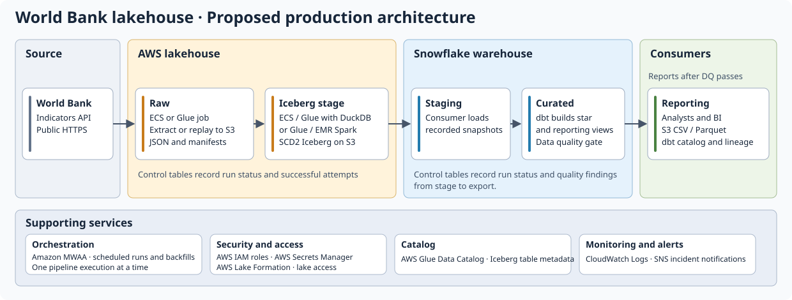
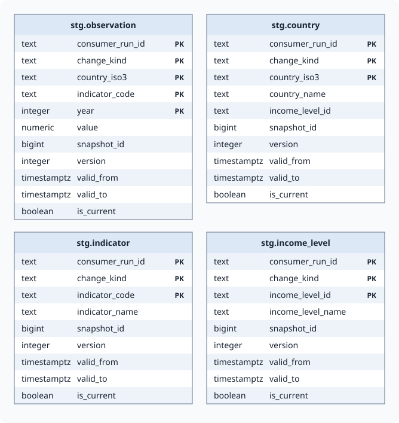
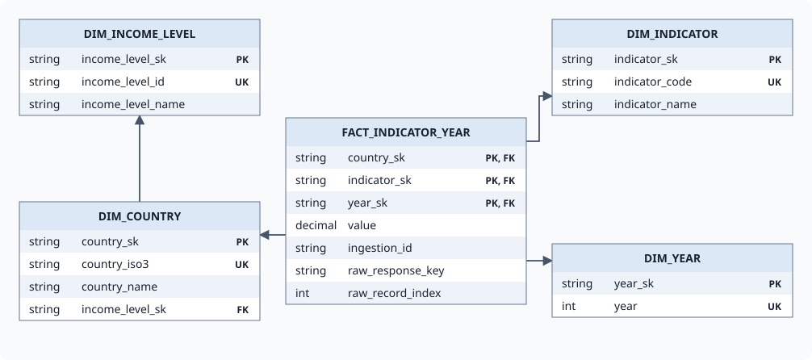

# Production design

This proposal describes how to operate the local demo on AWS and Snowflake. The [README](README.md) covers running it locally.

## Scheduling and incremental refreshes

* Schedule the `world_bank_pipeline` DAG in Amazon MWAA at a cadence agreed with report consumers. Keep one active execution at a time, including backfills. After the initial historical load, each scheduled extract can recheck a configurable window, such as the latest two reporting years. Periodic wider extracts can catch revisions outside that window.
* Stage only new or changed observations in Iceberg and record the committed snapshot IDs in the pipeline run control table. Snowflake consumes changes from those snapshots. A completed consumer load skips repeat reads and writes. Reconcile keys, counts, and values for the selected scope before marking the load complete.

## Handling late, corrected, or changed source data

* When an extract returns a late observation, insert it for its country, indicator, and year. When a previously received value changes, close the prior Iceberg version and add a new one. Snowflake uses `MERGE` to update the current fact for that key. Keep source timestamps and raw-response references so each revision can be traced.
* Preserve explicit source nulls in storage. A presentation view can display missing text fields as “Not available” or expose a separate availability flag. For indicator values, the existing `vw_missing_or_incomplete` view already identifies explicit nulls with `SOURCE_NULL`. If an extract omits a previously received observation within its requested scope, keep the last known fact and record a warning. Use a scoped backfill to recheck older years outside the scheduled window.

## Monitoring, alerting, and data-quality failures

* Track run status, duration, report freshness, input and output counts, and quality findings by ingestion ID. Use CloudWatch for logs and metrics, and SNS for task failures and spikes in omission warnings. Include the ingestion ID and failed task in alerts. Incident handling should tolerate duplicate SNS messages if a retry follows a failure between publishing the alert and saving its status.
* Block publication on hard quality failures and mark publication complete only once all artifacts are available. Publish the reports and dbt artifacts with the run ID and source stage date. Where the SLA permits partial results, agree on row-level thresholds for quarantining failed rows for reprocessing, alerting while valid rows continue, or stopping the run.

## Backfills and replay

* Use the backfill DAG to re-extract a selected set of countries, indicators, and years under a new ingestion ID. For a retry, keep the original ingestion ID and request scope. Record the successful raw attempt, Iceberg snapshot IDs, and task statuses in the control table so the pipeline can resume from its recorded inputs.
* Replay saved response pages from S3 to rerun processing without calling the API. Reprocess recorded snapshots to rerun the warehouse load. Set raw and snapshot retention to cover recovery and backfill needs. Compact Iceberg files based on observed file sizes and query performance. Check control-table references before expiring snapshots or deleting orphan files, and use Iceberg partition evolution when changing the layout.

## Snowflake and AWS service mapping

| Local component | Proposed production component and responsibility |
|---|---|
| Emulator S3 buckets | Amazon S3 for original API responses, Iceberg tables, and published CSV and Parquet files |
| Compose Airflow and DockerOperator | Amazon MWAA for scheduling and backfills. ECS tasks or AWS Glue jobs for raw ingestion |
| DuckDB stage and Iceberg REST catalog | DuckDB on ECS or a compatible Glue job, or Spark on AWS Glue or EMR. Glue Data Catalog registers the Iceberg tables on S3, and Lake Formation governs table access |
| Postgres staging and curated models | Snowflake staging, curated tables, and reporting views built with dbt-snowflake. Durable control and quality tables track run scope, snapshots, statuses, and findings |
| Emulator CloudWatch Logs and SNS | CloudWatch for run logs and metrics. SNS routes alerts to a confirmed incident subscription |
| Emulator Secrets Manager | AWS Secrets Manager for integration and alert secrets |

Apply the principle of least privilege. Give each ECS task or Glue job an IAM role scoped to the resources and operations it needs. Keep secret values out of Terraform state, task arguments, and logs. Start with a small Snowflake warehouse with auto-suspend and size it from measured workloads. Consider Snowflake Streams and Tasks for warehouse-side orchestration, and add clustering when query patterns justify it.

# End-to-end production architecture



<p align="center"><a href="ARCHITECTURE.md">View the local architecture</a></p>

1. **Raw - Capture and retain source data.** An ECS task or Glue job fetches World Bank pages or replays a saved attempt. S3 stores the original JSON responses, record batches with source provenance, and per-table manifests. In the local implementation, `meta.pipeline_run` also tracks raw ingestion, including `raw_status` and `successful_attempt`. The proposed production control table keeps that responsibility from raw ingestion through export.
2. **Stage Lakehouse - Commit Iceberg changes and record the snapshot IDs.** The stage can use DuckDB in ECS or a compatible Glue job, or Spark on Glue or EMR. It commits SCD2 changes to Iceberg tables on S3 and uses Glue Data Catalog for table metadata. The stage job then writes the per-table snapshot IDs to `meta.pipeline_run.stage_snapshot_ids` in Postgres. The proposed Snowflake control table carries the same record.
3. **Stage Snowflake - Load unfinished runs from their recorded snapshots.** The local consumer first checks `consumer_status` for the ingestion ID. If it is `complete`, the consumer exits before reading Iceberg or writing Postgres. An unfinished run reads the recorded snapshots and commits its staging rows and completion status together. A distinct `reprocess_commit` invocation can intentionally load the same snapshots again under a new ingestion ID. The proposed Snowflake consumer follows the same run-level checkpoint.
4. **Curated Snowflake - Curate, check, and publish.** dbt builds the curated star and reporting views. Hard quality failures block CSV and Parquet exports to S3. Scoped omissions keep the last known fact and record a warning. Analysts can query the reporting views, and dbt artifacts provide lineage and catalog metadata.
5. **Airflow - Orchestrate the pipeline.** The `world_bank_pipeline` DAG runs one pipeline execution at a time. It runs ingestion, stage, consumer, dbt, quality checks, and export in order. MWAA can launch it on a schedule. The backfill DAG submits a scoped run of the same pipeline and waits for its outcome. CloudWatch carries run logs, and SNS receives task failures and warning-count jumps.

## Raw API contract example

This illustrative example shows one successful request for Brazil population in 2021. The measurement and dates are sample values. The bucket is `lakehouse-raw`.

```http
GET https://api.worldbank.org/v2/country/BRA/indicator/SP.POP.TOTL?date=2021%3A2021&source=2&format=json&per_page=50&page=1
```

### API response page

The API returns a two-element array containing pagination metadata and the records for that page. Ingestion writes the entire HTTP response body byte for byte under `attempt=1/responses/request_001_page_001.json`.

```json
[
  {
    "page": 1,
    "pages": 1,
    "per_page": 50,
    "total": 1,
    "sourceid": "2",
    "lastupdated": "2026-11-20"
  },
  [
    {
      "indicator": {
        "id": "SP.POP.TOTL",
        "value": "Population, total"
      },
      "country": {
        "id": "BR",
        "value": "Brazil"
      },
      "countryiso3code": "BRA",
      "date": "2021",
      "value": 214000000,
      "unit": "",
      "obs_status": "",
      "decimal": 0
    }
  ]
]
```

### Record batch

The record batch is a JSON array with up to 100 records in the proof of concept. In production, the ingestion job can expose this limit as a batch-size parameter. Its full S3 URI is:

```text
s3://lakehouse-raw/world-bank/observation/date=2026-11-24/ingestion_id=demo-raw-example/attempt=1/records/00001.json
```

The `ingestion_id` identifies one logical run and links its raw objects to the control table that tracks each pipeline run. In this example it is `demo-raw-example`. Retrying unfinished raw ingestion keeps the same ID and writes to the next attempt folder, such as `attempt=2`. A new extract uses a new ingestion ID.

Each record retains the API fields and adds provenance. Here, `raw_record_index: 0` identifies the first record on the stored page. A source `value` may be numeric or `null`. A failed HTTP request fails the attempt.

```json
[
  {
    "indicator": {
      "id": "SP.POP.TOTL",
      "value": "Population, total"
    },
    "country": {
      "id": "BR",
      "value": "Brazil"
    },
    "countryiso3code": "BRA",
    "date": "2021",
    "value": 214000000,
    "unit": "",
    "obs_status": "",
    "decimal": 0,
    "raw_response_key": "world-bank/observation/date=2026-11-24/ingestion_id=demo-raw-example/attempt=1/responses/request_001_page_001.json",
    "raw_record_index": 0,
    "response_sha256": "f3b9ad19865e601852cdb7ef7fb4292f203f4ba0548506ff2fb6a012d4702e97",
    "source_url": "https://api.worldbank.org/v2/country/BRA/indicator/SP.POP.TOTL?date=2021%3A2021&source=2&format=json&per_page=50&page=1",
    "api_page": 1,
    "raw_ingested_at": "2026-11-24T12:00:00Z",
    "ingestion_id": "demo-raw-example",
    "raw_object_key": "world-bank/observation/date=2026-11-24/ingestion_id=demo-raw-example/attempt=1/records/00001.json"
  }
]
```
Country, indicator, and income-level metadata use the same object layout with their own API record fields.

## Staging schema



Each staging table records changes for a consumer run. Its primary key combines the run ID, change kind, and source business key. An `append` row records the version that became current at that commit, with `valid_to` set to `NULL`. A `close` row records when the previous version stopped being current. Rows also retain the source snapshot ID and raw provenance. The tables can receive changes independently, so Postgres defines no foreign keys between them.

## Curated star schema



The fact holds the latest received observation at country, indicator, and calendar-year grain. The three surrogate keys form the logical fact key. The fact retains source nulls and raw provenance. The country dimension links to its current income classification.
